Dette er en selvstændig opgavesamling, ikke en erstatning for formelsamlingen. Find først emne og geometri, slå en gammel opgave op, og følg udledningen.

**Kilder:** 11 eksamenssæt (juni 2021–januar 2026) og det vedhæftede facitark dateret 6. august 2026. [Originale opgaver](kilder/eksamen_alle.pdf) · [Originalt facit](kilder/eksamen_facits.pdf) · [Dækningskontrol og facitafvigelser](00-daekningskontrol.html).

**Notation:** $k_e=(4\pi\varepsilon_0)^{-1}$, $c^{-2}=\mu_0\varepsilon_0$. Cylindrisk radius er normalt $s$, sfærisk radius $r$. Plusomløb følger højrehåndsreglen omkring den valgte normal. Kildernes symboler bevares lokalt; $\rho_e$ bruges til resistivitet, når den ellers kunne forveksles med ladningstæthed. V/m = N/C; T = N/(A·m); Wb = V·s; H = Wb/A.

**Sværhedsgrad:** ★ grundlæggende · ★★ flere trin · ★★★ sammensat. Markeringen er en repetitionshjælp, ikke en officiel bedømmelse.

**Sammenhæng med formelsamlingen:** emnenavne og rækkefølge følger din specifikation. Formelsamlingen selv er ikke vedhæftet; dens præcise metodekoder og notation er derfor ikke verificeret. Der er ikke opfundet DYN-numre. Emner uden en opgave i de leverede sæt markeres eksplicit.

**Dokumenter:** [01-E_V](01-E_V.html) · [02-B_A](02-B_A.html) · [03-DYN](03-DYN.html)

# Indholdsfortegnelse {#indhold}

- [Grundlæggende felt-/potentialeopgaver](#emne-1)
  - [Punktladninger: energi](#type-1-1)
    - [Juni 2021 – 2a: Fire ladninger i tetraeder](#op-2021-06-2)
  - [Kontinuerte ladninger: halvkugleskal](#type-1-2)
    - [November 2021 – 1ab: Potentiale og kraft fra nedre halvkugle](#op-2021-11-1)
  - [Punktladninger: superposition og multipoler](#type-1-3)
    - [Februar 2022 – 1abc: Fire ladninger omkring origo](#op-2022-02-1)
  - [Punktladninger: nulpunkter og arbejde](#type-1-4)
    - [November 2022 – 1abc: Nul potentiale er ikke nul felt](#op-2022-11-1)
  - [Punktladninger: kraft og energi](#type-1-5)
    - [Februar 2023 – 1abc: Tre ladninger i ligesidet trekant](#op-2023-02-1)
  - [Punktladninger: ligevægt og energi](#type-1-6)
    - [November 2023 – 1abc: Tre ladninger og kvadrat med centrumladning](#op-2023-11-1)
  - [Kontinuerte ladninger: halvcirkel og diskret sum](#type-1-7)
    - [Februar 2024 – 1abcd: Én ladning, fem ladninger og ladet halvcirkel](#op-2024-02-1)
  - [Kontinuerte ladninger: skive og plan ring](#type-1-8)
    - [Januar 2025 – 3ab: Potentiale på aksen af en ladet ringflade](#op-2025-01-3)
  - [Øvrige geometrier / dækning](#ovrige-1)
- [Gauss efter geometri](#emne-2)
  - [Cylinder: koaksial leder og dielektrikum](#type-2-1)
    - [Februar 2022 – 2abc: Ladet stang og tynd cylinderskal](#op-2022-02-2)
  - [Kugle: ikke-uniform fri ladning i dielektrikum](#type-2-2)
    - [Februar 2023 – 2abc: Kugle med fri tæthed kr](#op-2023-02-2)
  - [Cylinder: ikke-uniform volumenladning](#type-2-3)
    - [November 2024 – 2ab: Lang cylinder med rho proportional med s²](#op-2024-11-2)
  - [Krydshenvisninger](#kryds-2)
  - [Øvrige geometrier / dækning](#ovrige-2)
- [Felt ↔ potentiale](#emne-3)
  - [E → V og arbejde](#type-3-1)
    - [Februar 2022 – 5ab: Konservativt felt langs cirkelbue](#op-2022-02-5)
  - [E → V: kartesisk felt](#type-3-2)
    - [Januar 2025 – 1ab: Lineært voksende felt i kube](#op-2025-01-1)
  - [V → E → rho: sfærisk logaritme](#type-3-3)
    - [November 2025 – 2abc: Logaritmisk potentiale i kugleområde](#op-2025-11-2)
  - [Krydshenvisninger](#kryds-3)
- [Givet felt → ladning](#emne-4)
  - [Kartesisk divergens og feltkriterier](#type-4-1)
    - [Juni 2021 – 5abc: Statisk polynomielt felt](#op-2021-06-5)
  - [Kuglesymmetrisk divergens](#type-4-2)
    - [November 2022 – 2ab: Ladning fra givet radialfelt](#op-2022-11-2)
  - [Krydshenvisninger](#kryds-4)
- [Region-for-region](#emne-5)
  - [Koncentriske ledere og dielektrikum](#type-5-1)
    - [November 2021 – 2abcd: To tykke kugleskaller](#op-2021-11-2)
  - [Koncentriske ledere: felt og energi](#type-5-2)
    - [Januar 2025 – 2abc: Metalkugle i tyk metalskal](#op-2025-01-2)
  - [Koncentriske ledere: potentialnul og dielektrikum](#type-5-3)
    - [November 2025 – 3ab: Kuglepotentiale nul i ladet skal](#op-2025-11-3)
- [Ledere og hulrum](#emne-6)
  - [Forskudt punktladning i kugleskal](#type-6-1)
    - [Juni 2021 – 1abc: Inducerede overfladeladninger](#op-2021-06-1)
  - [Krydshenvisninger](#kryds-6)
- [Spejlingsmetode](#emne-7)
  - [To vinkelrette jordede planer](#type-7-1)
    - [November 2024 – 1ab: Hjørneladning og tre spejlladninger](#op-2024-11-1)
  - [En ledende plan og to virkelige ladninger](#type-7-2)
    - [November 2025 – 1ab: To ladninger over metalplade](#op-2025-11-1)
- [Laplace / randværdiproblemer](#emne-8)
  - [Muligt elektrostatisk felt i ladningsfrit område](#type-8-1)
    - [November 2021 – 3ab: Curltest og harmonisk potentiale](#op-2021-11-3)
  - [Kugle: Legendre og quadrupolrandværdi](#type-8-2)
    - [Januar 2026 – 5abc: Potentiale på kugleskal med P₂](#op-2026-01-5)
  - [Krydshenvisninger](#kryds-8)
- [Multipoler](#emne-9)
  - [Quadrupol: felt på aksen](#type-9-1)
    - [Februar 2023 – 3a: Lineær quadrupol i fjernfeltet](#op-2023-02-3)
  - [Dipol: to punkter og to ladede kvartbuer](#type-9-2)
    - [Januar 2026 – 1abc: Diskret og kontinuert elektrisk dipol](#op-2026-01-1)
  - [Krydshenvisninger](#kryds-9)
- [Elektriske materialer](#emne-10)
  - [Leder ved grænse mellem to dielektrika](#type-10-1)
    - [November 2023 – 4abc: Halvt nedsænket ledende kugle](#op-2023-11-4)
  - [Polarisation: bundne volumen- og overfladeladninger](#type-10-2)
    - [Februar 2024 – 2ab: Polariseret kube](#op-2024-02-2)
  - [Krydshenvisninger](#kryds-10)
- [Kapacitans og elektrisk energi](#emne-11)
  - [Pladekondensator med dielektrikum](#type-11-1)
    - [Januar 2026 – 2ab: Stor kondensator: areal, spænding og energi](#op-2026-01-2)
  - [Krydshenvisninger](#kryds-11)

# Opgaveindeks {#opgaveindeks}

| Opgave | Opgavetype | Metode | Nøgleord |
|---|---|---|---|
| [Juni 2021 – 2a](#op-2021-06-2) | Punktladninger: energi | Parvis energi | tetraeder, seks par |
| [November 2021 – 1ab](#op-2021-11-1) | Kontinuerte ladninger: halvkugleskal | Coulomb-integration | halvkugle, vektorsum, potentiale |
| [Februar 2022 – 1abc](#op-2022-02-1) | Punktladninger: superposition og multipoler | Parsum; Coulomb; dipoludvikling | monopol, dipol, z-akse |
| [November 2022 – 1abc](#op-2022-11-1) | Punktladninger: nulpunkter og arbejde | Superposition; intervalopdeling | modsatte ladninger, fortegn, arbejde |
| [Februar 2023 – 1abc](#op-2023-02-1) | Punktladninger: kraft og energi | Coulomb; superposition; parenergi | trekant, vektorkraft, numerik |
| [November 2023 – 1abc](#op-2023-11-1) | Punktladninger: ligevægt og energi | Kraftbalance; parenergi | ligevægt, stabilitet, kvadrat |
| [Februar 2024 – 1abcd](#op-2024-02-1) | Kontinuerte ladninger: halvcirkel og diskret sum | Coulomb; symmetri; vinkelintegral | halvcirkel, potentiale i centrum |
| [Januar 2025 – 3ab](#op-2025-01-3) | Kontinuerte ladninger: skive og plan ring | Ringintegration; minus gradient | skive, uendeligt plan, aksialt felt |
| [Februar 2022 – 2abc](#op-2022-02-2) | Cylinder: koaksial leder og dielektrikum | Gauss med E og D; potentialeintegral | cylinder, overfladeladning, logaritme |
| [Februar 2023 – 2abc](#op-2023-02-2) | Kugle: ikke-uniform fri ladning i dielektrikum | Gauss med D; polarisation | ikke-uniform kugle, inside/outside |
| [November 2024 – 2ab](#op-2024-11-2) | Cylinder: ikke-uniform volumenladning | Ladningsintegral; Gauss | massiv cylinder, inside/outside |
| [Februar 2022 – 5ab](#op-2022-02-5) | E → V og arbejde | Curl; potentiale; arbejde | kurveintegral, uafhængig af vej |
| [Januar 2025 – 1ab](#op-2025-01-1) | E → V: kartesisk felt | Potentialeintegral; divergens | spænding, ladningstæthed |
| [November 2025 – 2abc](#op-2025-11-2) | V → E → rho: sfærisk logaritme | Gradient; divergens; ladningsintegral | kugle, singularitet, total ladning |
| [Juni 2021 – 5abc](#op-2021-06-5) | Kartesisk divergens og feltkriterier | Curl; divergens; volumenintegral | Maxwell, muligt felt, total ladning |
| [November 2022 – 2ab](#op-2022-11-2) | Kuglesymmetrisk divergens | Gauss; sfærisk divergens | radialfelt, total ladning |
| [November 2021 – 2abcd](#op-2021-11-2) | Koncentriske ledere og dielektrikum | Gauss med D; kapacitans | fri ladning, bundet ladning, fire flader |
| [Januar 2025 – 2abc](#op-2025-01-2) | Koncentriske ledere: felt og energi | Gauss; lederbetingelser; feltenergi | fire regioner, overfladeladninger, energi |
| [November 2025 – 3ab](#op-2025-11-3) | Koncentriske ledere: potentialnul og dielektrikum | Gauss med D; potentialeintegral | potentialnul, εr, ladningsbalance |
| [Juni 2021 – 1abc](#op-2021-06-1) | Forskudt punktladning i kugleskal | Gauss; lederpotentiale | hulrum, induktion, ækvipotential |
| [November 2024 – 1ab](#op-2024-11-1) | To vinkelrette jordede planer | Coulomb; spejling; entydighed | jordet hjørne, billedladninger |
| [November 2025 – 1ab](#op-2025-11-1) | En ledende plan og to virkelige ladninger | Coulomb; spejlingsmetode | metalplan, to billeder, kraft |
| [November 2021 – 3ab](#op-2021-11-3) | Muligt elektrostatisk felt i ladningsfrit område | Curl; Laplace | ladningsfri, harmonisk, polynomium |
| [Januar 2026 – 5abc](#op-2026-01-5) | Kugle: Legendre og quadrupolrandværdi | Separation; Legendre; gradient | Laplace, l=2, quadrupol |
| [Februar 2023 – 3a](#op-2023-02-3) | Quadrupol: felt på aksen | Coulomb; Taylorudvikling | quadrupol, fjernfelt, z^-4 |
| [Januar 2026 – 1abc](#op-2026-01-1) | Dipol: to punkter og to ladede kvartbuer | Coulomb; bueintegration; dipolmoment | dipol, halvcirkel, felt i centrum |
| [November 2023 – 4abc](#op-2023-11-4) | Leder ved grænse mellem to dielektrika | Randbetingelser; Gauss med D; entydighed | to permittiviteter, fri overfladeladning |
| [Februar 2024 – 2ab](#op-2024-02-2) | Polarisation: bundne volumen- og overfladeladninger | P dot normal; minus divergens | polarisation, normal, nul nettoladning |
| [Januar 2026 – 2ab](#op-2026-01-2) | Pladekondensator med dielektrikum | C=εA/d; Q=CV; energi | kondensator, aluminiumsoxid, mF |

# Grundlæggende felt-/potentialeopgaver {#emne-1}

## Punktladninger: energi {#type-1-1}

### Juni 2021 – Opgave 2a · Fire ladninger i tetraeder {#op-2021-06-2}

★ · **Kilde:** samlet opgave-PDF, side 2; del a.

#### Opgavebeskrivelse

Fire ens ladninger $Q$ sidder i hjørnerne af et regulært tetraeder med kant $a$. Bestem energien.

#### Genkendelse

**Denne type opgave genkendes ved:** Punktladninger og kendte indbyrdes afstande.

**Metodevalg:** Parvis energi.

#### Idé

Tæl hvert ladningspar én gang; selvenergier medregnes ikke.

#### Løsning

**a)** Der er $\binom42=4\cdot3/2=6$ forskellige par. Hvert bidrag er
$$U_{ij}=\frac{1}{4\pi\varepsilon_0}\frac{Q_iQ_j}{r_{ij}}=\frac{Q^2}{4\pi\varepsilon_0a}.$$
Summér derfor
$$U=\sum_{i<j}U_{ij}=6\frac{Q^2}{4\pi\varepsilon_0a}.$$
Alternativt ser hver ladning potentialet $3Q/(4\pi\varepsilon_0a)$ fra de andre; $U=\frac12\sum_iQ_iV_i$ giver samme resultat.

#### Slutresultat

$$
\boxed{U=\frac{6Q^2}{4\pi\varepsilon_0a}}
$$

#### Kontrol

Positiv energi for ens fortegn; $U\to0$ for $a\to\infty$. Enhed J.

**Facitkontrol:** de efterspurgte slutresultater er sammenholdt med det leverede facit; ekstra retninger, mellemregninger og forudsætninger er forklaret ovenfor.

#### Metode at huske

**Punktladninger → alle forskellige par → sum af $k_eq_iq_j/r_{ij}$.**

#### Originalfigur og ordlyd

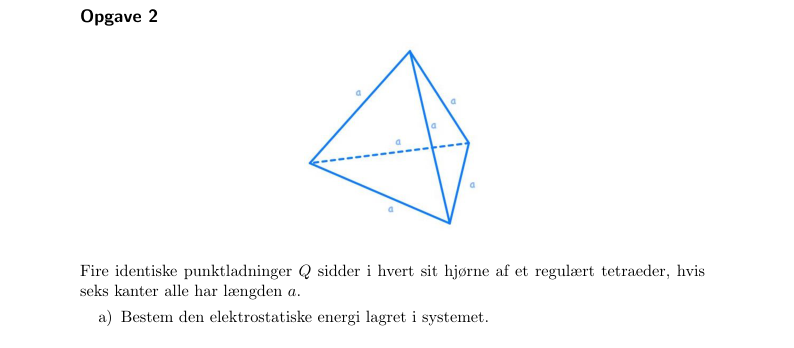{width=90%}

[Til indholdsfortegnelsen](#indhold) · [Til opgaveindeks](#opgaveindeks)

## Kontinuerte ladninger: halvkugleskal {#type-1-2}

### November 2021 – Opgave 1ab · Potentiale og kraft fra nedre halvkugle {#op-2021-11-1}

★★ · **Kilde:** samlet opgave-PDF, side 5; del a, b.

#### Opgavebeskrivelse

En homogen overfladeladning $\sigma=46.0\,\mathrm{nC/cm^2}$ dækker $r=R$, $z<0$. I centrum er $Q=0.75\,\mu\mathrm C$; $R=22.0\,\mathrm{cm}$. Find potentiel energi og kraft.

#### Genkendelse

**Denne type opgave genkendes ved:** Alle ladningselementer ligger lige langt fra centrum, men kun en halvkugle er ladet.

**Metodevalg:** Coulomb-integration.

#### Idé

Potentialer summeres skalarisk; feltets tværkomponenter ophæver hinanden.

#### Løsning

**a)** Sæt $k_e=(4\pi\varepsilon_0)^{-1}$. Afstanden er $R$ for alle $dq$, og arealet er $2\pi R^2$:
$$V(0)=k_e\int\frac{\sigma\,da}{R}=\frac{\sigma R}{2\varepsilon_0},\qquad U=QV(0)=\frac{Q\sigma R}{2\varepsilon_0}.$$
Omregn $\sigma=46.0\cdot10^{-9}/10^{-4}=4.60\cdot10^{-4}\,\mathrm{C/m^2}$; dermed $U=4.29\,\mathrm J$.

**b)** Med sfærisk polvinkel $\theta\in[\pi/2,\pi]$ er $dE_z=-k_e\sigma\cos\theta\sin\theta\,d\theta\,d\phi$. Derfor
$$E_z=-2\pi k_e\sigma\int_{\pi/2}^{\pi}\cos\theta\sin\theta\,d\theta
=\pi k_e\sigma=\frac{\sigma}{4\varepsilon_0}.$$
Så $\mathbf F=Q\sigma/(4\varepsilon_0)\hat z=9.74\hat z\,\mathrm N$.

#### Slutresultat

$$
\boxed{\begin{gathered}U=\frac{Q\sigma R}{2\varepsilon_0}=4.29\,\mathrm J \\ \mathbf F=\frac{Q\sigma}{4\varepsilon_0}\hat z=9.74\,\mathrm N\,\hat z\end{gathered}}
$$

#### Kontrol

Positiv ladning under centrum frastøder opad. For fast $\sigma$ er centrumfeltet uafhængigt af radius, fordi areal og $1/R^2$ ophæver hinanden.

> **OCR-kontrol:** originalen angiver Q=0,75 µC, ikke mC som tekstudtrækket fejlagtigt viste. Den visuelle original og facits 4,3 J / 9,75 N er lagt til grund.

#### Metode at huske

**Kontinuert ladning → $dq$ → skalarpotentiale eller feltprojektion → integral.**

#### Originalfigur og ordlyd

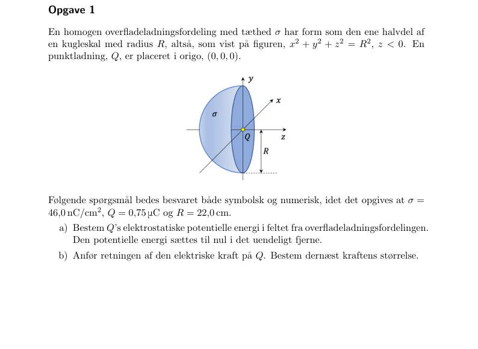{width=90%}

[Til indholdsfortegnelsen](#indhold) · [Til opgaveindeks](#opgaveindeks)

## Punktladninger: superposition og multipoler {#type-1-3}

### Februar 2022 – Opgave 1abc · Fire ladninger omkring origo {#op-2022-02-1}

★★★ · **Kilde:** samlet opgave-PDF, side 9; del a, b, c.

#### Opgavebeskrivelse

$+q$ ved $(-a,0,0),(0,-a,0),(a,0,0)$ og $-q$ ved $(0,a,0)$. Find energi, felt på z-aksen og fjernpotentiale til dipolorden.

#### Genkendelse

**Denne type opgave genkendes ved:** Symmetrisk placerede punktladninger med blandede fortegn.

**Metodevalg:** Parsum; Coulomb; dipoludvikling.

#### Idé

Bevar fortegn i parsummen og udnyt, at alle afstande til z-aksen er ens.

#### Løsning

**a)** De to vandrette $+q$ har bidrag $k_eq^2/(2a)$; det lodrette par giver $-k_eq^2/(2a)$. De fire nabopar med afstand $\sqrt2a$ har to positive og to negative bidrag, som ophæves. Dermed $U=0$.

**b)** For $\mathbf r=(0,0,z)$:
$$\mathbf E=k_e\sum_i\frac{q_i(\mathbf r-\mathbf r_i)}{(a^2+z^2)^{3/2}}.$$
De to x-ladninger bidrager $2qz\hat z$ i tælleren. De to y-ladninger bidrager $2qa\hat y$ (deres z-bidrag ophæves). Så
$$\mathbf E(z)=\frac{2k_eq}{(a^2+z^2)^{3/2}}(a\hat y+z\hat z),\qquad\mathbf E(0)=\frac{2k_eq}{a^2}\hat y.$$
**c)** $Q_{\mathrm{tot}}=2q$ og
$$\mathbf p=\sum_iq_i\mathbf r_i=-2qa\hat y.$$
Da $\hat y\cdot\hat r=\sin\theta\sin\phi$, er
$$V(r,\theta,\phi)\simeq k_e\left[\frac{2q}{r}-\frac{2qa\sin\theta\sin\phi}{r^2}\right],\qquad r\gg a.$$

#### Slutresultat

$$
\boxed{U=0,\quad\mathbf p=-2qa\hat y,\quad\mathbf E(z)=\frac{2k_eq(a\hat y+z\hat z)}{(a^2+z^2)^{3/2}}}
$$

#### Kontrol

Fjernfeltets z-led bliver $2k_eq\hat z/z^2$ for $z\gg a$, svarende til nettoladningen $2q$. Nul energi betyder ikke nul felt.

**Facitkontrol:** de efterspurgte slutresultater er sammenholdt med det leverede facit; ekstra retninger, mellemregninger og forudsætninger er forklaret ovenfor.

#### Metode at huske

**Punktladninger → parsum og vektorsum → total ladning og dipolmoment.**

#### Originalfigur og ordlyd

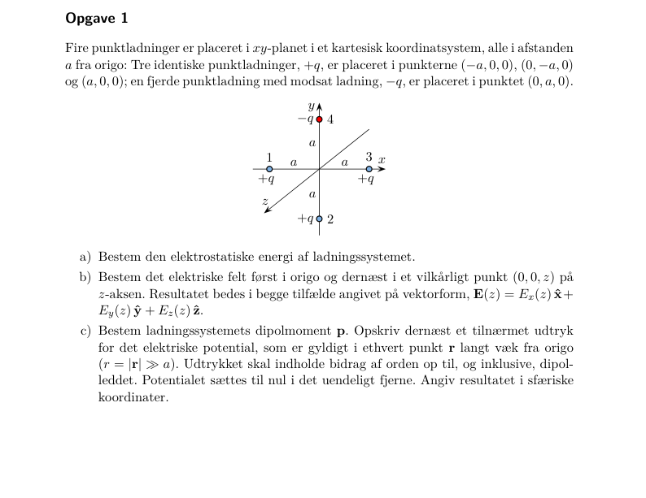{width=90%}

[Til indholdsfortegnelsen](#indhold) · [Til opgaveindeks](#opgaveindeks)

## Punktladninger: nulpunkter og arbejde {#type-1-4}

### November 2022 – Opgave 1abc · Nul potentiale er ikke nul felt {#op-2022-11-1}

★★ · **Kilde:** samlet opgave-PDF, side 13; del a, b, c.

#### Opgavebeskrivelse

$q_1=-6.0\,\mu$C ved $x=0$ og $q_2=3.0\,\mu$C ved $d=0.120$ m. Find endelige nulpunkter for $V,E$ og arbejdet ved at flytte $q_2$ til $2d$.

#### Genkendelse

**Denne type opgave genkendes ved:** Punktladninger med modsatte fortegn og ulige størrelser.

**Metodevalg:** Superposition; intervalopdeling.

#### Idé

Potentialet er en skalar; feltets fortegn skal bestemmes særskilt i hvert interval.

#### Løsning

**a)** $V=k_e[-6\cdot10^{-6}/|x|+3\cdot10^{-6}/|x-d|]=0$ giver $|x|=2|x-d|$. For $0<x<d$: $x=2(d-x)$, så $x=2d/3=0.0800$ m. For $x>d$: $x=2(x-d)$, så $x=2d=0.240$ m. Der er ingen løsning ved $x<0$.

**b)** Mellem ladningerne peger begge felter mod venstre. Udenfor kræves
$$\frac6{x^2}=\frac3{(x-d)^2}\quad\Longrightarrow\quad |x|=\sqrt2|x-d|.$$
Kun løsningen til højre er fysisk: $x=\sqrt2(x-d)$, dvs. $x=(2+\sqrt2)d=0.410$ m. På venstresiden er den største ladning også nærmest, så feltet kan ikke ophæves.

**c)** $U(r)=k_eq_1q_2/r$, derfor
$$W_{\mathrm{ekst}}=k_eq_1q_2\left(\frac1{2d}-\frac1d\right)=+0.674\,\mathrm J.$$

#### Slutresultat

$$
\boxed{V=0:\ x=8.00,24.0\,\mathrm{cm};\quad E=0:\ x=41.0\,\mathrm{cm};\quad W=0.674\,\mathrm J}
$$

#### Kontrol

At skille modsatte ladninger kræver positivt arbejde. Ladningernes egne positioner er singulariteter og kan ikke være nulpunkter.

**Facitkontrol:** de efterspurgte slutresultater er sammenholdt med det leverede facit; ekstra retninger, mellemregninger og forudsætninger er forklaret ovenfor.

#### Metode at huske

**Nulpunkter → opdel aksen → fortegn før algebra → energiforskel.**

#### Originalfigur og ordlyd

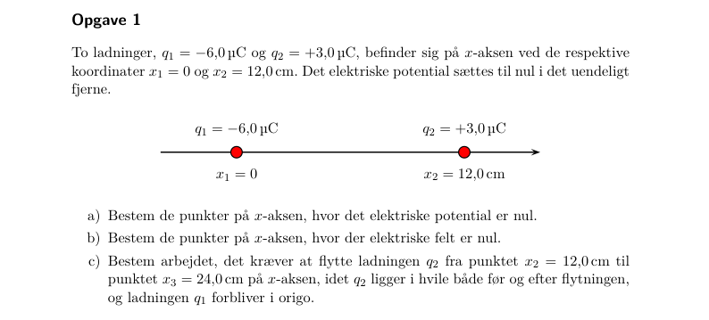{width=90%}

[Til indholdsfortegnelsen](#indhold) · [Til opgaveindeks](#opgaveindeks)

## Punktladninger: kraft og energi {#type-1-5}

### Februar 2023 – Opgave 1abc · Tre ladninger i ligesidet trekant {#op-2023-02-1}

★★ · **Kilde:** samlet opgave-PDF, side 17; del a, b, c.

#### Opgavebeskrivelse

$q_1=-3.00\,\mu$C, $q_2=2.00\,\mu$C og $q_3=4.00\,\mu$C. $q_1,q_2$ ligger vandret med afstand $a=0.200$ m; $q_3$ placeres over midten i en ligesidet trekant. Find kraft på $q_1$ før og efter og samlet energi.

#### Genkendelse

**Denne type opgave genkendes ved:** Flere punktladninger; kræfter skal gives som vektorer.

**Metodevalg:** Coulomb; superposition; parenergi.

#### Idé

Brug tiltrækningens retning og komponenterne $(1/2,\sqrt3/2)$ mod toppen.

#### Løsning

**a)** Med $q_2$ til højre for $q_1$ er
$$\mathbf F_1^{(2)}=-\frac{k_eq_1q_2}{a^2}\hat x=1.35\hat x\,\mathrm N.$$
**b)** Bidraget fra toppen er
$$\mathbf F_1^{(3)}=-\frac{k_eq_1q_3}{a^2}\left(\frac12\hat x+\frac{\sqrt3}2\hat y\right).$$
Summen er derfor
$$\mathbf F_1=-\frac{k_eq_1}{a^2}\left[\left(q_2+\frac{q_3}2\right)\hat x+\frac{\sqrt3q_3}2\hat y\right]
=(2.70\hat x+2.34\hat y)\,\mathrm N.$$
**c)** Alle tre par har afstand $a$:
$$U=\frac{k_e}a(q_1q_2+q_1q_3+q_2q_3)
=\frac{k_e}a(-6-12+8)10^{-12}=-0.449\,\mathrm J.$$

#### Slutresultat

$$
\boxed{\begin{gathered}\mathbf F_{1,a}=1.35\hat x\,\mathrm N \\ \mathbf F_{1,b}=(2.70\hat x+2.34\hat y)\,\mathrm N \\ U=-0.449\,\mathrm J\end{gathered}}
$$

#### Kontrol

Begge positive ladninger tiltrækker $q_1$, så begge komponenter er positive. Energien inkluderer også det frastødende par $q_2q_3$.

**Facitkontrol:** de efterspurgte slutresultater er sammenholdt med det leverede facit; ekstra retninger, mellemregninger og forudsætninger er forklaret ovenfor.

#### Metode at huske

**Coulomb → enhedsvektor mod hver kilde → komponentvis sum → parenergi.**

#### Originalfigur og ordlyd

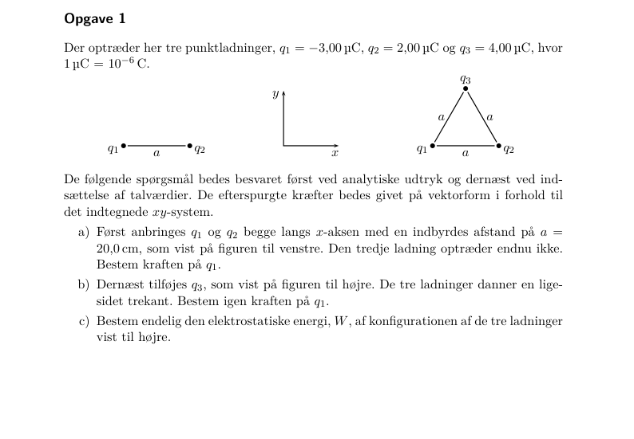{width=90%}

[Til indholdsfortegnelsen](#indhold) · [Til opgaveindeks](#opgaveindeks)

## Punktladninger: ligevægt og energi {#type-1-6}

### November 2023 – Opgave 1abc · Tre ladninger og kvadrat med centrumladning {#op-2023-11-1}

★★★ · **Kilde:** samlet opgave-PDF, side 21; del a, b, c.

#### Opgavebeskrivelse

Først er $Q$ midt mellem to $q$ med afstand $a$. Dernæst ligger fire $q$ i et kvadrat med side $a$ og $Q$ i centrum. Find $Q$ for ligevægt og begge energier.

#### Genkendelse

**Denne type opgave genkendes ved:** Kraften på centrum ophæves af symmetri, men hjørneladningerne kræver en modsat centrumladning.

**Metodevalg:** Kraftbalance; parenergi.

#### Idé

Balancér kraften på én ydre ladning; de øvrige følger af symmetri.

#### Løsning

**a)** En endeladning frastødes af den anden med $k_eq^2/a^2$. Centrum ligger $a/2$ væk, så
$$k_eq^2/a^2+4k_eqQ/a^2=0\quad\Rightarrow\quad Q=-q/4.$$
Ligevægten er ustabil. Flyt eksempelvis den negative centrumladning lidt mod den højre positive ladning: tiltrækningen mod højre vokser, så forskydningen forstærkes.

**b)** På et hjørne giver nabohjørnerne en radial resultant $\sqrt2k_eq^2/a^2$. Det diagonale hjørne giver $k_eq^2/(2a^2)$. Centrumafstanden er $a/\sqrt2$, så
$$\frac{k_eq^2}{a^2}(\sqrt2+1/2)+\frac{2k_eqQ}{a^2}=0,$$
$$Q=-\frac{1+2\sqrt2}{4}q.$$
**c)** For linjen:
$$U_a=\frac{k_e}{a}(q^2+4qQ)\ \Rightarrow\ U_a=0.$$
For kvadratet tælles fire kanter, to diagonaler og fire centrumpar:
$$U_b=\frac{k_e}{a}[(4+\sqrt2)q^2+4\sqrt2qQ]\ \Rightarrow\ U_b=0.$$

#### Slutresultat

$$
\boxed{Q_a=-q/4,\quad Q_b=-\frac{1+2\sqrt2}{4}q,\quad U_a=U_b=0\ \text{ved ligevægt}}
$$

#### Kontrol

Nul energi giver ikke stabilitet. Den elektrostatiske konfiguration har ikke en stabil fri ligevægt; generelle forskydninger må undersøges, ikke kun symmetriske skaleringer.

**Facitkontrol:** de efterspurgte slutresultater er sammenholdt med det leverede facit; ekstra retninger, mellemregninger og forudsætninger er forklaret ovenfor.

#### Metode at huske

**Symmetri → balance på én ladning → tæl par → test en forstyrrende forskydning.**

#### Originalfigur og ordlyd

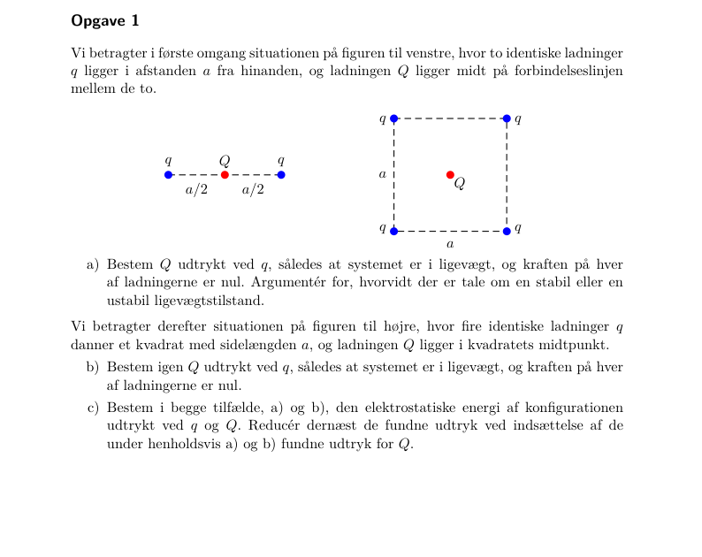{width=90%}

[Til indholdsfortegnelsen](#indhold) · [Til opgaveindeks](#opgaveindeks)

## Kontinuerte ladninger: halvcirkel og diskret sum {#type-1-7}

### Februar 2024 – Opgave 1abcd · Én ladning, fem ladninger og ladet halvcirkel {#op-2024-02-1}

★★ · **Kilde:** samlet opgave-PDF, side 25; del a, b, c, d.

#### Opgavebeskrivelse

Alle ladninger ligger i afstand $a$ fra O: (a) $Q$ på negativ x-akse; (b) fem $Q/5$ ved vinkler $-90,-45,0,45,90$ grader fra negativ x-akse; (c) $Q$ uniformt på venstre halvcirkel. Find felterne og potentialerne i O.

#### Genkendelse

**Denne type opgave genkendes ved:** Afstandene er ens, men feltretningerne er forskellige.

**Metodevalg:** Coulomb; symmetri; vinkelintegral.

#### Idé

Potentialet afhænger kun af total ladning og fælles afstand; feltet kræver projektion.

#### Løsning

**a)** $\mathbf E_a=k_eQ\hat x/a^2$.

**b)** For en ladning i vinkel $\alpha$ fra negativ x er feltets x-komponent $k_e(Q/5)\cos\alpha/a^2$. De modsatrettede y-komponenter ophæves, så
$$\mathbf E_b=\frac{k_eQ}{5a^2}[0+1/\sqrt2+1+1/\sqrt2+0]\hat x
=\frac{k_eQ(1+\sqrt2)}{5a^2}\hat x.$$
**c)** Med $dq=(Q/\pi)d\alpha$, $\alpha\in[-\pi/2,\pi/2]$:
$$E_{c,x}=\frac{k_eQ}{\pi a^2}\int_{-\pi/2}^{\pi/2}\cos\alpha\,d\alpha=\frac{2k_eQ}{\pi a^2},\quad E_{c,y}=0.$$
**d)** I alle tre tilfælde er $V(O)=k_e\int dq/a=k_eQ/a$.

#### Slutresultat

$$
\boxed{\begin{gathered}\mathbf E_a=\frac{k_eQ}{a^2}\hat x \\ \mathbf E_b=\frac{k_eQ(1+\sqrt2)}{5a^2}\hat x \\ \mathbf E_c=\frac{2k_eQ}{\pi a^2}\hat x \\ V=\frac{k_eQ}{a}\end{gathered}}
$$

#### Kontrol

For $Q>0$ peger alle resultanter mod højre. Samme potentiale indebærer ikke samme felt; potentialet er kun sammenlignet i ét punkt.

**Facitkontrol:** de efterspurgte slutresultater er sammenholdt med det leverede facit; ekstra retninger, mellemregninger og forudsætninger er forklaret ovenfor.

#### Metode at huske

**Fælles afstand → potentiale direkte; felt → projektion → sum eller integral.**

#### Originalfigur og ordlyd

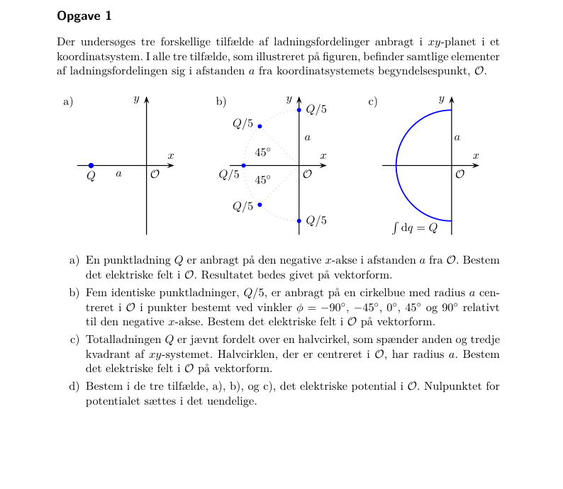{width=90%}

[Til indholdsfortegnelsen](#indhold) · [Til opgaveindeks](#opgaveindeks)

## Kontinuerte ladninger: skive og plan ring {#type-1-8}

### Januar 2025 – Opgave 3ab · Potentiale på aksen af en ladet ringflade {#op-2025-01-3}

★★ · **Kilde:** samlet opgave-PDF, side 34; del a, b.

#### Opgavebeskrivelse

En flad ringflade $a<s<b$ har konstant overfladetæthed $\sigma$. Find $V(z)$ og feltet på symmetriaksen, og undersøg $a=0,b\to\infty$.

#### Genkendelse

**Denne type opgave genkendes ved:** Aksial symmetri, men ingen Gauss-flade med tilstrækkelig symmetri.

**Metodevalg:** Ringintegration; minus gradient.

#### Idé

Del ringfladen i tynde cirkulære ringe og integrér potentialet.

#### Løsning

**a)** En ring med radius $s$ og bredde $ds$ har $dq=2\pi\sigma sds$ og afstand $\sqrt{s^2+z^2}$ til P. Derfor
$$V(z)=\frac{\sigma}{2\varepsilon_0}\int_a^b\frac{sds}{\sqrt{s^2+z^2}}.$$
Sæt $u=s^2+z^2$, $du=2sds$, så integralet er $\sqrt{s^2+z^2}$. Altså
$$V(z)=\frac{\sigma}{2\varepsilon_0}\left(\sqrt{b^2+z^2}-\sqrt{a^2+z^2}\right).$$
**b)** Symmetrien giver kun z-komponent:
$$E_z=-\frac{dV}{dz}=\frac{\sigma z}{2\varepsilon_0}\left(\frac1{\sqrt{a^2+z^2}}-\frac1{\sqrt{b^2+z^2}}\right).$$
For $a=0$, $b\to\infty$ og fast $z\ne0$ fås $E_z=\sigma\,\operatorname{sgn}(z)/(2\varepsilon_0)$, præcis feltet fra et uendeligt ladet plan. Potentialets grænse divergerer; et uendeligt plan kan ikke have $V(\infty)=0$.

#### Slutresultat

$$
\boxed{\mathbf E(z)=\frac{\sigma z}{2\varepsilon_0}\left[\frac1{\sqrt{a^2+z^2}}-\frac1{\sqrt{b^2+z^2}}\right]\hat z}
$$

#### Kontrol

For $a>0$ er $E_z(0)=0$. Langt væk bliver $V\simeq k_e\sigma\pi(b^2-a^2)/|z|$, som for en punktladning med korrekt total ladning.

**Facitkontrol:** de efterspurgte slutresultater er sammenholdt med det leverede facit; ekstra retninger, mellemregninger og forudsætninger er forklaret ovenfor.

#### Metode at huske

**Fladering → $dq=2\pi\sigma sds$ → integrér $V$ → $E_z=-dV/dz$.**

#### Originalfigur og ordlyd

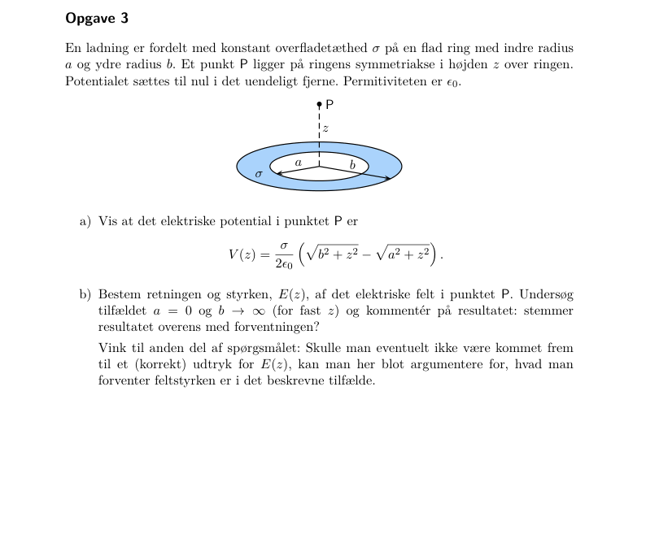{width=90%}

[Til indholdsfortegnelsen](#indhold) · [Til opgaveindeks](#opgaveindeks)

## Øvrige geometrier / dækning {#ovrige-1}

**Linjeladning og hel cirkulær ring.** Ingen selvstændig elektrisk opgave med en uendelig linje eller en hel tynd ring; halvcirkel og ringflade er behandlet.

# Gauss efter geometri {#emne-2}

## Cylinder: koaksial leder og dielektrikum {#type-2-1}

### Februar 2022 – Opgave 2abc · Ladet stang og tynd cylinderskal {#op-2022-02-2}

★★ · **Kilde:** samlet opgave-PDF, side 10; del a, b, c.

#### Opgavebeskrivelse

En lang stang med radius $a$ har uniform ladning $2\lambda$ pr. længde. En tynd metalskal ved $b$ har nettoladning $-\lambda$ pr. længde. Find $E$ mellem dem, skalfladernes ladning og spænding efter indsættelse af $\varepsilon_r$.

#### Genkendelse

**Denne type opgave genkendes ved:** Uendelig længde og cylindrisk symmetri.

**Metodevalg:** Gauss med E og D; potentialeintegral.

#### Idé

En koaksial Gauss-cylinder gør feltintegralet til $E2\pi sL$. I metallet skal nettoindesluttet ladning være nul.

#### Løsning

**a)** For $a<s<b$ er $Q_{\mathrm{enc}}=2\lambda L$, så $E2\pi sL=2\lambda L/\varepsilon_0$ og $\mathbf E=\lambda/(\pi\varepsilon_0s)\hat s$.

**b)** En flade i metallet giver $2\lambda+\lambda_{\mathrm{indre}}=0$. Dermed $\lambda_{\mathrm{indre}}=-2\lambda$ og $\lambda_{\mathrm{ydre}}=-\lambda-(-2\lambda)=+\lambda$. Divider med overfladeareal pr. længde $2\pi b$:
$$\sigma_{\mathrm{indre}}=-\frac{\lambda}{\pi b},\quad\sigma_{\mathrm{ydre}}=\frac{\lambda}{2\pi b}.$$
**c)** Med dielektrikum er $D_s=\lambda/(\pi s)$ og $E_s=D_s/(\varepsilon_0\varepsilon_r)$. Derfor
$$V(a)-V(b)=\int_a^bE_sds=\frac{\lambda}{\pi\varepsilon_0\varepsilon_r}\ln\frac ba.$$
Med $a=1.00\,$mm, $b=4.00\,$mm, $\lambda=90\,$nC/m, $\varepsilon_r=4.2$ fås $1.07\cdot10^3\,$V. Der sættes ikke $V(\infty)=0$ for dette uendelige system.

#### Slutresultat

$$
\boxed{\mathbf E=\frac{\lambda}{\pi\varepsilon_0s}\hat s\ (a<s<b),\qquad V(a)-V(b)=1.07\,\mathrm{kV}}
$$

#### Kontrol

Stangen har højere potentiale ved $\lambda>0$. Indre og ydre skaltæthed giver tilsammen $-\lambda$ pr. længde.

**Facitkontrol:** de efterspurgte slutresultater er sammenholdt med det leverede facit; ekstra retninger, mellemregninger og forudsætninger er forklaret ovenfor.

#### Metode at huske

**Cylinder → Gauss → fri ladning → $D/\varepsilon$ → logaritmisk potentialforskel.**

#### Originalfigur og ordlyd

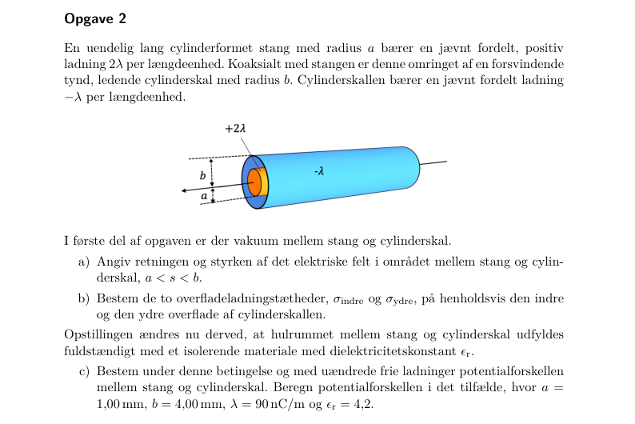{width=90%}

[Til indholdsfortegnelsen](#indhold) · [Til opgaveindeks](#opgaveindeks)

## Kugle: ikke-uniform fri ladning i dielektrikum {#type-2-2}

### Februar 2023 – Opgave 2abc · Kugle med fri tæthed kr {#op-2023-02-2}

★★ · **Kilde:** samlet opgave-PDF, side 18; del a, b, c.

#### Opgavebeskrivelse

En kugle med radius $R$ og relativ permittivitet $\varepsilon_r$ har fri volumenladning $\rho_f(r)=kr$. Udenfor er vakuum. Find $Q_f$, $E$ og $P$.

#### Genkendelse

**Denne type opgave genkendes ved:** Sfærisk symmetri med fri ladning i et lineært dielektrikum.

**Metodevalg:** Gauss med D; polarisation.

#### Idé

Integrér den frie ladning; brug Gauss med $D$ og materialeloven i hver region.

#### Løsning

**a)** Med $d\tau=4\pi r'^2dr'$:
$$Q_f=4\pi k\int_0^Rr'^3dr'=4\pi k[R^4/4]=\pi kR^4.$$
**b)** Indenfor er $Q_f(r)=\pi kr^4$. Gauss giver
$$D_r4\pi r^2=\pi kr^4,\quad D_r=kr^2/4,\quad E_r=\frac{kr^2}{4\varepsilon_0\varepsilon_r}\quad(r<R).$$
Udenfor omsluttes hele $Q_f$:
$$E_r=\frac{Q_f}{4\pi\varepsilon_0r^2}=\frac{kR^4}{4\varepsilon_0r^2}\quad(r>R).$$
Retningen er radial udad ved $k>0$, indad ved $k<0$.

**c)** I kuglen er
$$\mathbf P=\varepsilon_0(\varepsilon_r-1)\mathbf E
=\frac{\varepsilon_r-1}{\varepsilon_r}\frac{kr^2}{4}\hat r.$$
Udenfor er $P=0$.

#### Slutresultat

$$
\boxed{\begin{gathered}Q_f=\pi kR^4 \\ \mathbf E=\begin{cases}\dfrac{kr^2}{4\varepsilon_0\varepsilon_r}\hat r&r<R,\\\dfrac{kR^4}{4\varepsilon_0r^2}\hat r&r>R,\end{cases}\end{gathered}}
$$

#### Kontrol

$D_r$ er kontinuert ved $R$ uden fri overfladeladning; $E_r$ springer med faktor $\varepsilon_r$. $P$ har enhed C/m². Ved $\varepsilon_r=1$ fås vakuum.

**Facitkontrol:** de efterspurgte slutresultater er sammenholdt med det leverede facit; ekstra retninger, mellemregninger og forudsætninger er forklaret ovenfor.

#### Metode at huske

**Ikke-uniform kugle → integrér $Q_f(r)$ → Gauss med $D$ → $E,P$.**

#### Originalfigur og ordlyd

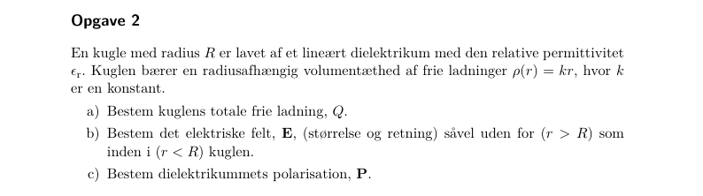{width=90%}

[Til indholdsfortegnelsen](#indhold) · [Til opgaveindeks](#opgaveindeks)

## Cylinder: ikke-uniform volumenladning {#type-2-3}

### November 2024 – Opgave 2ab · Lang cylinder med rho proportional med s² {#op-2024-11-2}

★★ · **Kilde:** samlet opgave-PDF, side 30; del a, b.

#### Opgavebeskrivelse

En uendelig cylinder med radius $a$ har $\rho(s)=\alpha s^2$ indenfor, $\alpha>0$, og vakuum udenfor. Find $Q(s)$ i længden $L$ og feltet i begge regioner.

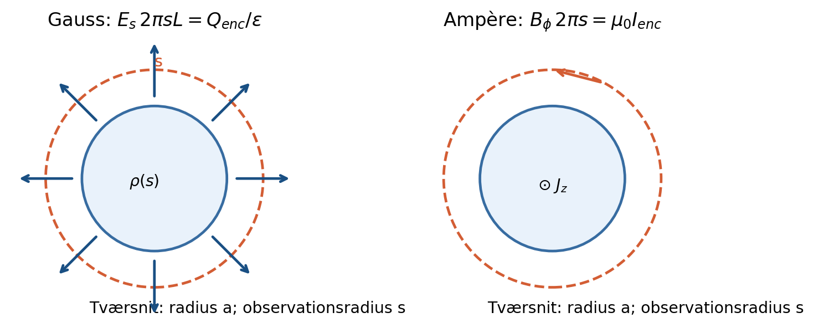{width=85%}

#### Genkendelse

**Denne type opgave genkendes ved:** Cylindersymmetri med ikke-uniform tæthed.

**Metodevalg:** Ladningsintegral; Gauss.

#### Idé

Find først indesluttet ladning med det cylindriske volumenelement $2\pi sLds$.

#### Løsning

**a)** For $s\le a$:
$$Q(s)=\int_0^s\alpha s'^2\,2\pi s'Lds'=2\pi\alpha L\int_0^ss'^3ds'
=\frac{\pi\alpha Ls^4}{2}.$$
**b)** Symmetrien giver $\mathbf E=E_s(s)\hat s$. En koaksial cylinder har ingen flux gennem endefladerne, og derfor
$$E_s2\pi sL=Q_{\mathrm{enc}}/\varepsilon_0.$$
Indenfor indsættes $Q(s)$, så $E_s=\alpha s^3/(4\varepsilon_0)$. Udenfor er $Q_{\mathrm{enc}}=Q(a)$ fast, så $E_s=\alpha a^4/(4\varepsilon_0s)$. Feltet peger udad.

#### Slutresultat

$$
\boxed{\begin{gathered}Q(s)=\frac{\pi\alpha Ls^4}{2} \\ \mathbf E(s)=\begin{cases}\dfrac{\alpha s^3}{4\varepsilon_0}\hat s&s<a,\\\dfrac{\alpha a^4}{4\varepsilon_0s}\hat s&s>a.\end{cases}\end{gathered}}
$$

#### Kontrol

Begge felter er $\alpha a^3/(4\varepsilon_0)$ ved $a$; ingen overfladeladning giver intet spring. Feltet går mod nul på aksen og falder som $1/s$ udenfor.

**Facitkontrol:** de efterspurgte slutresultater er sammenholdt med det leverede facit; ekstra retninger, mellemregninger og forudsætninger er forklaret ovenfor.

#### Metode at huske

**Ikke-uniform cylinder → $Q_{\mathrm{enc}}=\int\rho2\pi sLds$ → Gauss i hver region.**

#### Originalfigur og ordlyd

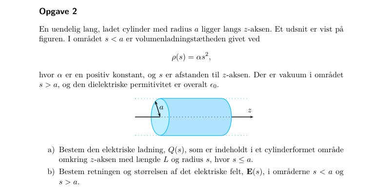{width=90%}

[Til indholdsfortegnelsen](#indhold) · [Til opgaveindeks](#opgaveindeks)

## Krydshenvisninger {#kryds-2}

- [Februar 2023 – 2](01-E_V.html#op-2023-02-2) — Kugle med ikke-uniform fri ladning og dielektrikum.
- [November 2022 – 2](01-E_V.html#op-2022-11-2) — Kugle: givet E → ladning.
- [November 2025 – 2](01-E_V.html#op-2025-11-2) — Kugle: V → E → rho.
- [Januar 2025 – 2](01-E_V.html#op-2025-01-2) — Kugleskaller og flere regioner.

## Øvrige geometrier / dækning {#ovrige-2}

**Kugleskal og massiv uniform kugle.** Ingen særskilt volumengivet opgave med en uniform massiv kugle i disse sæt; se de ikke-uniforme kugler og koncentriske ledere. En ledende kugle er ikke en uniform volumenladning.

**Uniform massiv cylinder og cylinderskal.** Ingen selvstændig uniform-volumencylinderopgave; februar 2022–2 bruger den indesluttede linjeladning udenfor stangen.

**Plan: enkelt og to planer.** Ingen ren Gauss-planopgave. Januar 2025–3 indeholder grænsen til et enkelt uendeligt plan; spejlingsplaner er randværdiproblemer.

# Felt ↔ potentiale {#emne-3}

## E → V og arbejde {#type-3-1}

### Februar 2022 – Opgave 5ab · Konservativt felt langs cirkelbue {#op-2022-02-5}

★★ · **Kilde:** samlet opgave-PDF, side 11; del a, b.

#### Opgavebeskrivelse

$\mathbf E=-V_0(2xy\hat x+x^2\hat y)/R^3$. Ladningen $Q$ flyttes fra $(R,0,0)$ til $(\sqrt3R/2,R/2,0)$ og er i hvile før og efter. Find ladningstætheden og arbejdet mod feltet.

#### Genkendelse

**Denne type opgave genkendes ved:** En krum bane, men feltet ligner en gradient.

**Metodevalg:** Curl; potentiale; arbejde.

#### Idé

Find et potentiale, så arbejdet alene afhænger af endepunkterne.

#### Løsning

**a)** Curlens eneste mulige komponent er
$$\partial_xE_y-\partial_yE_x=-2V_0x/R^3-(-2V_0x/R^3)=0.$$
Feltet er altså elektrostatisk. Divergensen er $\partial_xE_x=-2V_0y/R^3$, så $\rho=-2\varepsilon_0V_0y/R^3$.

**b)** Integrér $\partial_xV=2V_0xy/R^3$:
$$V=V_0x^2y/R^3+f(y,z).$$
Ligningerne $\partial_yV=V_0x^2/R^3$ og $\partial_zV=0$ giver konstant $f$. Startpunktet har $V_A=f$, slutpunktet har
$$V_B-f=\frac{V_0}{R^3}\left(\frac{3R^2}{4}\right)\frac R2=\frac{3V_0}{8}.$$
Da kinetisk energi ikke ændres, er det eksterne arbejde $W_{\mathrm{mod}}=\Delta U=Q(V_B-V_A)=3QV_0/8$.

#### Slutresultat

$$
\boxed{\rho=-\frac{2\varepsilon_0V_0y}{R^3},\qquad W_{\mathrm{mod}}=\frac38QV_0}
$$

#### Kontrol

For $QV_0>0$ kræves positivt arbejde; feltets eget arbejde har modsat fortegn. Ingen antagelse om potentiale ved uendelig er nødvendig.

**Facitkontrol:** de efterspurgte slutresultater er sammenholdt med det leverede facit; ekstra retninger, mellemregninger og forudsætninger er forklaret ovenfor.

#### Metode at huske

**Curl nul → find $V$ → $W_{\mathrm{ekst}}=Q\Delta V$.**

#### Originalfigur og ordlyd

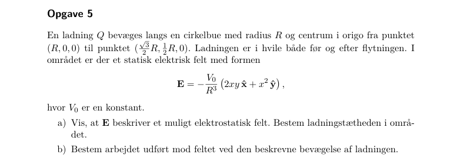{width=90%}

[Til indholdsfortegnelsen](#indhold) · [Til opgaveindeks](#opgaveindeks)

## E → V: kartesisk felt {#type-3-2}

### Januar 2025 – Opgave 1ab · Lineært voksende felt i kube {#op-2025-01-1}

★ · **Kilde:** samlet opgave-PDF, side 33; del a, b.

#### Opgavebeskrivelse

I en kube $0<x,y,z<L$ er $\mathbf E=(a+bx)\hat x$, $L=20.0$ m, $a=500$ V/m og $b=50.0$ V/m². Find potentialforskel og $\rho$.

#### Genkendelse

**Denne type opgave genkendes ved:** Feltet afhænger af én koordinat og peger langs samme akse.

**Metodevalg:** Potentialeintegral; divergens.

#### Idé

Integrér feltet med minusfortegn for potentiale; differentiér for ladningstæthed.

#### Løsning

**a)**
$$V(L)-V(0)=-\int_0^L(a+bx)dx=-[ax+bx^2/2]_0^L=-aL-\frac12bL^2.$$
Indsæt tallene: $-500\cdot20.0-50.0(20.0)^2/2=-2.00\cdot10^4\,$V. Fladen ved $x=0$ har altså højest potentiale.

**b)** $\rho=\varepsilon_0\nabla\cdot\mathbf E=\varepsilon_0\partial_x(a+bx)=\varepsilon_0b$. Numerisk:
$$\rho=8.8541878\cdot10^{-12}\cdot50.0=4.43\cdot10^{-10}\,\mathrm{C/m^3}.$$

#### Slutresultat

$$
\boxed{V(L)-V(0)=-20.0\,\mathrm{kV},\qquad\rho=4.43\cdot10^{-10}\,\mathrm{C/m^3}}
$$

#### Kontrol

Potentialet falder i feltets retning. Konstantleddet $a$ påvirker spændingen, men bidrager ikke til divergensen.

> **Datering:** facit har overskriften »Februar 2025«, men originalen er 31. januar 2025. Samlingen følger originaldatoen.

#### Metode at huske

**Givet $E(x)$ → negativt integral for $\Delta V$ → afledt for $\rho$.**

#### Originalfigur og ordlyd

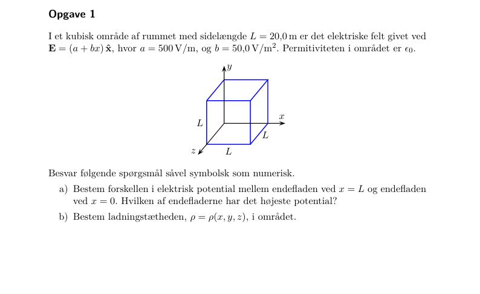{width=90%}

[Til indholdsfortegnelsen](#indhold) · [Til opgaveindeks](#opgaveindeks)

## V → E → rho: sfærisk logaritme {#type-3-3}

### November 2025 – Opgave 2abc · Logaritmisk potentiale i kugleområde {#op-2025-11-2}

★★ · **Kilde:** samlet opgave-PDF, side 38; del a, b, c.

#### Opgavebeskrivelse

For $0<r<R$ er $V(r)=-a\ln(r/R)$, $a=134$ V og $R=5.00$ m. Find felt, tæthed, total ladning og feltstyrke ved $(1.00,1.00,0)$ m.

#### Genkendelse

**Denne type opgave genkendes ved:** Givet sfærisk potentiale; $a$ er en spænding, ikke en længde.

**Metodevalg:** Gradient; divergens; ladningsintegral.

#### Idé

Differentiér radialt og brug sfærisk divergens; undersøg særskilt om centrum skjuler en punktladning.

#### Løsning

**a)** $dV/dr=-a/r$, så $\mathbf E=a\hat r/r$.

**b)**
$$\rho=\frac{\varepsilon_0}{r^2}\frac d{dr}(r^2a/r)=\frac{\varepsilon_0a}{r^2}.$$
**c i)** Den integrable singularitet giver
$$Q=4\pi\int_0^R\frac{\varepsilon_0a}{r^2}r^2dr=4\pi\varepsilon_0aR
=7.45\cdot10^{-8}\,\mathrm C=74.5\,\mathrm{nC}.$$
Der findes ikke en ekstra punktladning ved nul, fordi $\lim_{r\to0}4\pi\varepsilon_0r^2E=4\pi\varepsilon_0ar\to0$.

**c ii)** $r_P=\sqrt{1^2+1^2}=\sqrt2$ m, så $|E(P)|=134/\sqrt2=94.8$ V/m. Retningen er $(\hat x+\hat y)/\sqrt2$, altså $\mathbf E(P)=67.0(\hat x+\hat y)$ V/m.

#### Slutresultat

$$
\boxed{\begin{gathered}\mathbf E=\frac ar\hat r \\ \rho=\frac{\varepsilon_0a}{r^2} \\ Q=74.5\,\mathrm{nC} \\ |E(P)|=94.8\,\mathrm{V/m}\end{gathered}}
$$

#### Kontrol

Gyldighed kun $0<r<R$; opgaven fastlægger ikke et komplet yderfelt eller en overfladeladning ved $R$. Divergerende $V(0)$ indebærer her ikke en punktladning.

**Facitkontrol:** de efterspurgte slutresultater er sammenholdt med det leverede facit; ekstra retninger, mellemregninger og forudsætninger er forklaret ovenfor.

#### Metode at huske

**Givet $V(r)$ → minus afledt → radial divergens → integrér og test centrum.**

#### Originalfigur og ordlyd

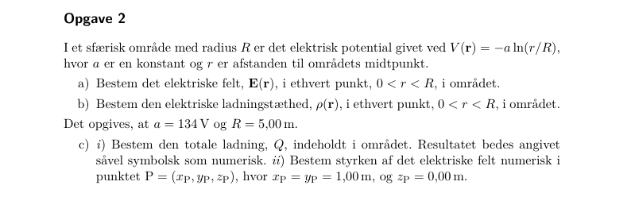{width=90%}

[Til indholdsfortegnelsen](#indhold) · [Til opgaveindeks](#opgaveindeks)

## Krydshenvisninger {#kryds-3}

- [Januar 2025 – 3](01-E_V.html#op-2025-01-3) — Kontinuert ringflade: V → E.
- [Februar 2022 – 2](01-E_V.html#op-2022-02-2) — Cylinder: E → potentialforskel.

# Givet felt → ladning {#emne-4}

## Kartesisk divergens og feltkriterier {#type-4-1}

### Juni 2021 – Opgave 5abc · Statisk polynomielt felt {#op-2021-06-5}

★★ · **Kilde:** samlet opgave-PDF, side 3; del a, b, c.

#### Opgavebeskrivelse

I kuben $0<x,y,z<L$ er $\mathbf f=C[y^2\hat x+(2xy+z^2)\hat y+2yz\hat z]$. Test felttypen, find enheden af $C$, ladningstæthed og total ladning.

#### Genkendelse

**Denne type opgave genkendes ved:** Givet vektorfelt og spørgsmål om mulige kilder.

**Metodevalg:** Curl; divergens; volumenintegral.

#### Idé

Elektrostatik kræver nul curl. Magnetfelter kræver nul divergens. Ladning følger af Gauss på differentialform.

#### Løsning

**a)** Komponentvis:
$$\nabla\times\mathbf f=C[(2z-2z)\hat x+(0-0)\hat y+(2y-2y)\hat z]=0.$$
Men $\nabla\cdot\mathbf f=C[0+2x+2y]=2C(x+y)$, generelt ikke nul. Feltet kan være elektrostatisk; det kan ikke være et magnetfelt for ikke-trivielt $C$. Et potentiale er $V=-C(xy^2+yz^2)+V_{\mathrm{ref}}$.

**b)** $[E]=\mathrm{V/m}$ og parenteserne har enhed $\mathrm{m^2}$, så $[C]=\mathrm{V/m^3}$.

**c)** $\rho=\varepsilon_0\nabla\cdot\mathbf E=2\varepsilon_0C(x+y)$. Integration giver
$$Q=2\varepsilon_0C\int_0^L\int_0^L\int_0^L(x+y)\,dx\,dy\,dz
=2\varepsilon_0C(L^4/2+L^4/2)=2\varepsilon_0CL^4.$$

#### Slutresultat

$$
\boxed{\rho=2\varepsilon_0C(x+y),\qquad Q=2\varepsilon_0CL^4,\qquad [C]=\mathrm{V/m^3}}
$$

#### Kontrol

Differentiation af det angivne potentiale giver alle tre feltkomponenter. $Q$ har enhed C. For $C=0$ er også magnetfeltkriteriet opfyldt.

**Facitkontrol:** de efterspurgte slutresultater er sammenholdt med det leverede facit; ekstra retninger, mellemregninger og forudsætninger er forklaret ovenfor.

#### Metode at huske

**Givet $E$ → curltest → divergens → volumenintegral.**

#### Originalfigur og ordlyd

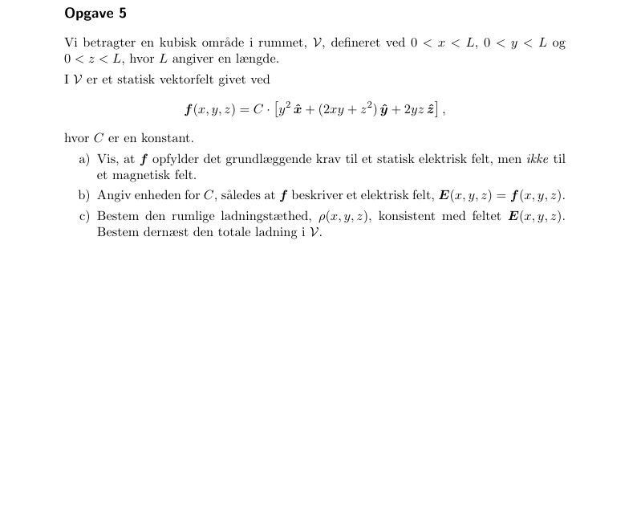{width=90%}

[Til indholdsfortegnelsen](#indhold) · [Til opgaveindeks](#opgaveindeks)

## Kuglesymmetrisk divergens {#type-4-2}

### November 2022 – Opgave 2ab · Ladning fra givet radialfelt {#op-2022-11-2}

★★ · **Kilde:** samlet opgave-PDF, side 13; del a, b.

#### Opgavebeskrivelse

For $r\le R$ er $\mathbf E=E_0[2(r/R)^2-r/R]\hat r$. Find total ladning og volumenladningstæthed.

#### Genkendelse

**Denne type opgave genkendes ved:** Feltet er givet, ikke ladningstætheden.

**Metodevalg:** Gauss; sfærisk divergens.

#### Idé

Brug flux ved $R$ til total ladning og divergens til den lokale tæthed.

#### Løsning

**a)** Ved $r=R$ er $E_r(R)=E_0$. Gauss giver $Q=\varepsilon_04\pi R^2E_0$.

**b)** For radialfelter:
$$\rho(r)=\frac{\varepsilon_0}{r^2}\frac d{dr}(r^2E_r).$$
Her er $r^2E_r=E_0(2r^4/R^2-r^3/R)$, så
$$\rho=\frac{\varepsilon_0E_0}{r^2}(8r^3/R^2-3r^2/R)
=\varepsilon_0E_0\left(\frac{8r}{R^2}-\frac3R\right).$$
Kontrollér ved integration:
$$4\pi\int_0^R\rho r^2dr=4\pi\varepsilon_0E_0[2R^2-R^2]=4\pi\varepsilon_0E_0R^2.$$

#### Slutresultat

$$
\boxed{Q=4\pi\varepsilon_0E_0R^2,\quad\rho(r)=\frac{\varepsilon_0E_0}{R}\left(\frac{8r}R-3\right)}
$$

#### Kontrol

For $E_0>0$ er tætheden negativ nær centrum og positiv yderst; dette er foreneligt med positiv total ladning. Ingen punktladning ved centrum, da $r^2E_r\to0$.

**Facitkontrol:** de efterspurgte slutresultater er sammenholdt med det leverede facit; ekstra retninger, mellemregninger og forudsætninger er forklaret ovenfor.

#### Metode at huske

**Givet radialfelt → flux for $Q$ → radial divergens for $\rho$.**

#### Originalfigur og ordlyd

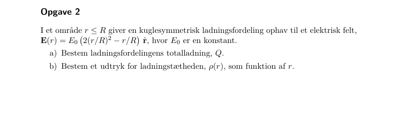{width=90%}

[Til indholdsfortegnelsen](#indhold) · [Til opgaveindeks](#opgaveindeks)

## Krydshenvisninger {#kryds-4}

- [November 2025 – 2](01-E_V.html#op-2025-11-2) — Sfærisk felt fra V.
- [Januar 2025 – 1](01-E_V.html#op-2025-01-1) — Kartesisk lineært felt.
- [November 2023 – 3](03-DYN.html#op-2023-11-3) — Ikke-elektrostatisk E: rho og tidsvarierende B.
- [November 2024 – 4](03-DYN.html#op-2024-11-4) — E(x) i ledende materiale → volumen- og overfladeladning.

# Region-for-region {#emne-5}

## Koncentriske ledere og dielektrikum {#type-5-1}

### November 2021 – Opgave 2abcd · To tykke kugleskaller {#op-2021-11-2}

★★★ · **Kilde:** samlet opgave-PDF, side 6; del a, b, c, d.

#### Opgavebeskrivelse

To metalskaller har radier $a<b<c<d$ og ladninger $Q_1,Q_2$. Mellemrummet $b<r<c$ er først vakuum, så et lineært dielektrikum $\varepsilon_r$. Find overfladetætheder og kapacitans ved $Q_1=-Q_2$.

#### Genkendelse

**Denne type opgave genkendes ved:** Koncentriske metalflader og materialeskift.

**Metodevalg:** Gauss med D; kapacitans.

#### Idé

Indel i metal og hulrum. Den frie ladning bestemmer $D$, og $P=(1-1/\varepsilon_r)D$ bestemmer de bundne ladninger.

#### Løsning

**a)** Ingen ladning findes i centrumhulrummet, så en Gauss-flade i første metal giver $Q_a=0$. Ladningsbevarelse giver $Q_b=Q_1$. I ydre metal kræver nul felt $Q_c=-Q_1$, og derfor $Q_d=Q_1+Q_2$:
$$\sigma_{f,a}=0,\quad\sigma_{f,b}=\frac{Q_1}{4\pi b^2},\quad\sigma_{f,c}=-\frac{Q_1}{4\pi c^2},\quad\sigma_{f,d}=\frac{Q_1+Q_2}{4\pi d^2}.$$
**b)** Ved modsatte ladninger er $E=Q_1/(4\pi\varepsilon_0r^2)$ i mellemrummet, så
$$\Delta V=V_b-V_c=\int_b^cE_rdr=\frac{Q_1}{4\pi\varepsilon_0}\left(\frac1b-\frac1c\right),\quad C=\frac{Q_1}{\Delta V}=4\pi\varepsilon_0\frac{bc}{c-b}.$$
**c)** Frie tætheder er uændrede. I dielektrikummet:
$$\mathbf D=\frac{Q_1}{4\pi r^2}\hat r,\quad\mathbf P=\left(1-\frac1{\varepsilon_r}\right)\frac{Q_1}{4\pi r^2}\hat r.$$
Dets udadnormal er $-\hat r$ ved $b$ og $+\hat r$ ved $c$. Derfor
$$\sigma_{b,b}=-\left(1-\frac1{\varepsilon_r}\right)\frac{Q_1}{4\pi b^2},\quad
\sigma_{b,c}=\left(1-\frac1{\varepsilon_r}\right)\frac{Q_1}{4\pi c^2}.$$
Der er ingen bundne ladninger ved $a,d$ eller i dielektrikummets volumen.

**d)** $E$ og $\Delta V$ reduceres med $\varepsilon_r$, så $C=4\pi\varepsilon_0\varepsilon_rbc/(c-b)$. Med $b=0.100\,$m, $c=0.500\,$m, $\varepsilon_r=3.8$ fås $C=52.9\,$pF.

#### Slutresultat

$$
\boxed{\begin{gathered}C_{\mathrm{vakuum}}=4\pi\varepsilon_0\frac{bc}{c-b} \\ C_{\mathrm{diel}}=\varepsilon_r C_{\mathrm{vakuum}}=52.9\,\mathrm{pF}\end{gathered}}
$$

#### Kontrol

De bundne ladninger summerer til nul. $\varepsilon_r\to1$ giver vakuum; tykkelserne af metallerne påvirker ikke kapacitansen.

> **Facitfortolkning:** i c) angiver facit nettotæthederne fri + bundet ved b og c, dvs. faktoren 1/εr. Her vises fri og bundet tæthed separat som efterspurgt. Facits sidste σb betegner fysisk fladen d.

#### Metode at huske

**Koncentriske ledere → fri ladning via nul felt → $D$ → $E,P$ → potentialforskel → $C$.**

#### Originalfigur og ordlyd

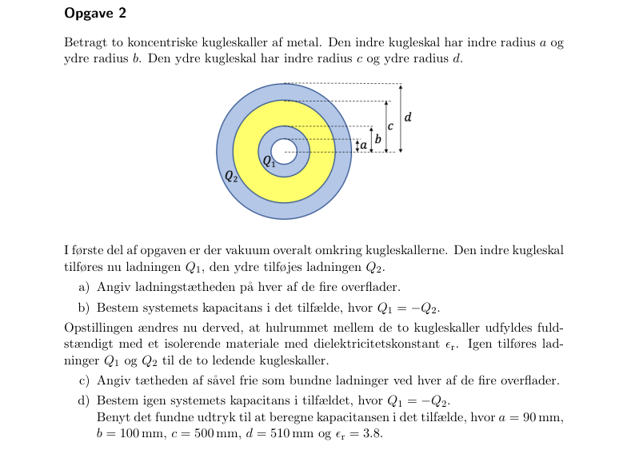{width=90%}

[Til indholdsfortegnelsen](#indhold) · [Til opgaveindeks](#opgaveindeks)

## Koncentriske ledere: felt og energi {#type-5-2}

### Januar 2025 – Opgave 2abc · Metalkugle i tyk metalskal {#op-2025-01-2}

★★★ · **Kilde:** samlet opgave-PDF, side 34; del a, b, c.

#### Opgavebeskrivelse

En metalkugle med radius $a$ og ladning $Q_1$ omgives af en koncentrisk metalskal med radier $b,c$ og ladning $Q_2$. Vakuum i mellemrummet og udenfor. Find felt, ladningsfordeling og energi.

#### Genkendelse

**Denne type opgave genkendes ved:** Flere sfæriske regioner og nul felt i begge metaller.

**Metodevalg:** Gauss; lederbetingelser; feltenergi.

#### Idé

Behandl hvert interval; energien er kun lagret, hvor feltet er forskelligt fra nul.

#### Løsning

**a)** I metallerne $r<a$ og $b<r<c$ er $E=0$. Mellem lederne omsluttes $Q_1$, og udenfor omsluttes $Q_1+Q_2$:
$$\mathbf E=\begin{cases}0&r<a,\\k_eQ_1\hat r/r^2&a<r<b,\\0&b<r<c,\\k_e(Q_1+Q_2)\hat r/r^2&r>c.\end{cases}$$
**b)** Kuglens ladning ligger på $a$. Nul felt i skallen giver $Q_b=-Q_1$, og skallens nettoladning giver $Q_c=Q_1+Q_2$. Derfor
$$\sigma_a=Q_1/(4\pi a^2),\quad\sigma_b=-Q_1/(4\pi b^2),\quad\sigma_c=(Q_1+Q_2)/(4\pi c^2).$$
**c)** Integrér feltenergien:
$$U=\frac{\varepsilon_0}{2}\int E^2d\tau
=\frac{Q_1^2}{8\pi\varepsilon_0}\int_a^b\frac{dr}{r^2}
+\frac{(Q_1+Q_2)^2}{8\pi\varepsilon_0}\int_c^\infty\frac{dr}{r^2}.$$
Da $\int dr/r^2=-1/r$, fås udtrykket i boksen.

#### Slutresultat

$$
\boxed{U=\frac1{8\pi\varepsilon_0}\left[Q_1^2\left(\frac1a-\frac1b\right)+\frac{(Q_1+Q_2)^2}{c}\right]}
$$

#### Kontrol

Energien er ikke-negativ. Ved $Q_2=-Q_1$ forsvinder yderfeltets energi og resultatet bliver kuglekondensatorens $Q_1^2/(2C)$.

**Facitkontrol:** de efterspurgte slutresultater er sammenholdt med det leverede facit; ekstra retninger, mellemregninger og forudsætninger er forklaret ovenfor.

#### Metode at huske

**Regioner → Gauss og metalnul → overfladeladninger → integrér $\varepsilon_0E^2/2$.**

#### Originalfigur og ordlyd

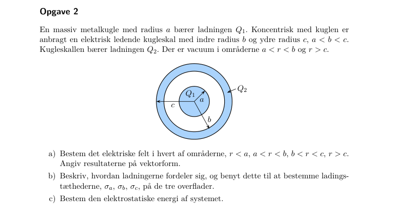{width=90%}

[Til indholdsfortegnelsen](#indhold) · [Til opgaveindeks](#opgaveindeks)

## Koncentriske ledere: potentialnul og dielektrikum {#type-5-3}

### November 2025 – Opgave 3ab · Kuglepotentiale nul i ladet skal {#op-2025-11-3}

★★ · **Kilde:** samlet opgave-PDF, side 38; del a, b.

#### Opgavebeskrivelse

En metalkugle med radius $a$ og ladning $q$ omgives af en tynd metalskal med radius $2a$ og nettoladning $Q$. Find $q$, så kuglens potentiale er nul, først i vakuum og så med $\varepsilon_r$ i mellemrummet. $V(\infty)=0$.

#### Genkendelse

**Denne type opgave genkendes ved:** Potentiale i flere materialeregioner og fri ladning, som skal justeres.

**Metodevalg:** Gauss med D; potentialeintegral.

#### Idé

Integrér fra uendelig til skallen og videre gennem mellemrummet.

#### Løsning

**a)** Udenfor er total ladning $q+Q$, så $V(2a)=k_e(q+Q)/(2a)$. Mellem lederne er $E=k_eq/r^2$, derfor
$$V(a)=V(2a)+\int_a^{2a}\frac{k_eq}{r^2}dr
=\frac{k_e}{2a}(q+Q+q)=\frac{k_e}{2a}(Q+2q).$$
Nul potentiale giver $q=-Q/2$.

**b)** Med dielektrikum ændres kun feltet i mellemrummet til $k_eq/(\varepsilon_rr^2)$. Dermed
$$0=V(a)=\frac{k_e}{2a}\left(Q+q+\frac q{\varepsilon_r}\right).$$
Isolér $q$: $q(1+1/\varepsilon_r)=-Q$, dvs. $q=-\varepsilon_rQ/(\varepsilon_r+1)$.

#### Slutresultat

$$
\boxed{q_{\mathrm{vakuum}}=-Q/2,\qquad q_{\mathrm{diel}}=-\frac{\varepsilon_r}{\varepsilon_r+1}Q}
$$

#### Kontrol

$\varepsilon_r=1$ giver vakuumsvaret. Det ydre vakuumfelt må ikke divideres med $\varepsilon_r$. $V(a)=0$ kræver ikke, at kuglens ladning er nul.

**Facitkontrol:** de efterspurgte slutresultater er sammenholdt med det leverede facit; ekstra retninger, mellemregninger og forudsætninger er forklaret ovenfor.

#### Metode at huske

**Potentialnul → summér potentialfald gennem alle regioner → løs for fri ladning.**

#### Originalfigur og ordlyd

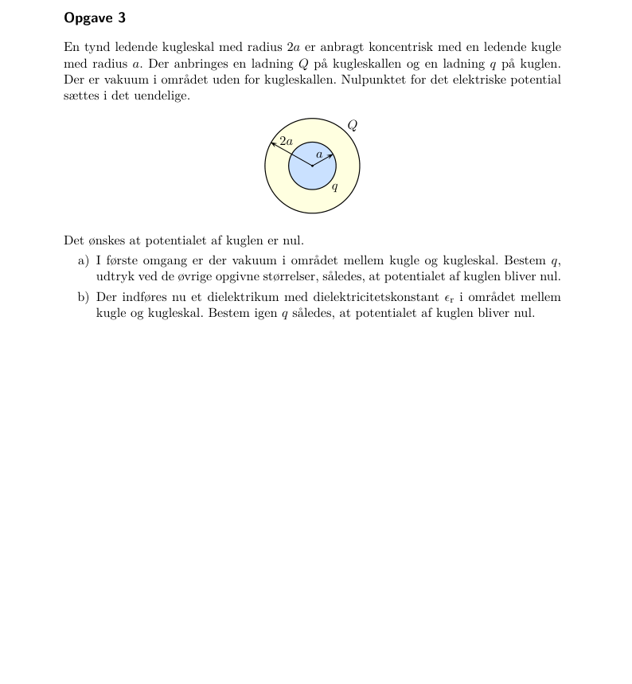{width=90%}

[Til indholdsfortegnelsen](#indhold) · [Til opgaveindeks](#opgaveindeks)

# Ledere og hulrum {#emne-6}

## Forskudt punktladning i kugleskal {#type-6-1}

### Juni 2021 – Opgave 1abc · Inducerede overfladeladninger {#op-2021-06-1}

★★ · **Kilde:** samlet opgave-PDF, side 1; del a, b, c.

#### Opgavebeskrivelse

En punktladning $q>0$ ligger i afstanden $a<b$ fra centrum af en metalkugleskal med radier $b,c$ og nettoladning $3q$. Find overfladeladninger, fordeling og lederpotentiale.

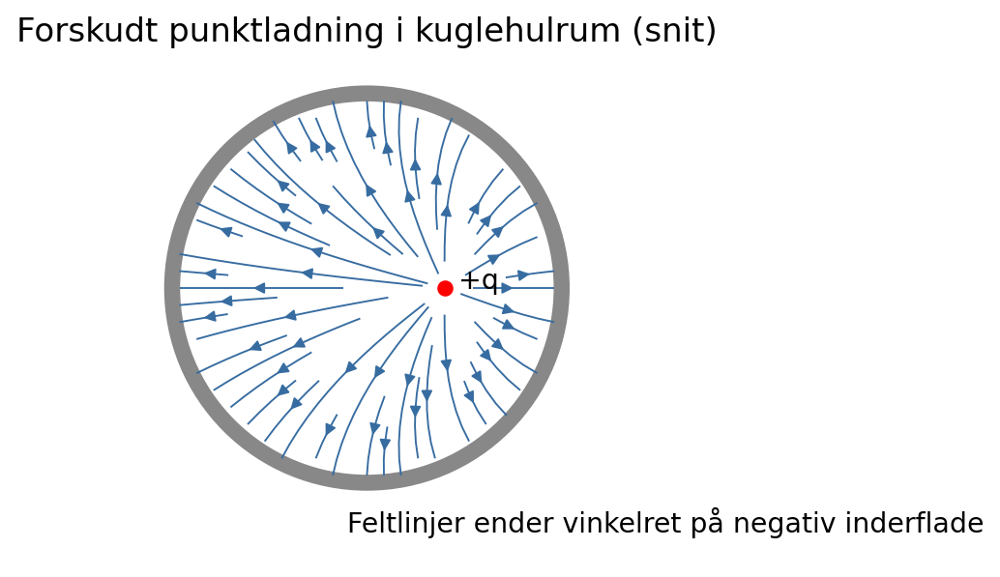{width=85%}

#### Genkendelse

**Denne type opgave genkendes ved:** Forskudt ladning, lukket metalhulrum og $E=0$ i metallet.

**Metodevalg:** Gauss; lederpotentiale.

#### Idé

En Gauss-flade i metallet bestemmer den indre ladning. Ydersiden er sfærisk og ækvipotentiel; uden ydre kilder bliver yderfeltet sfærisk.

#### Løsning

**a)** Vælg en kugleflade helt i metallet. Da $\mathbf E=0$, er
$$0=\oint\mathbf E\cdot d\mathbf a=\frac{q+Q_b}{\varepsilon_0}.$$
Altså $Q_b=-q$. Metalladningen er bevaret: $Q_b+Q_c=3q$, så $Q_c=4q$.

**b)** Den indre tæthed er ikke uniform, når $a\ne0$. Ladningsfeltet er stærkest på den nærmeste væg, hvor $|\sigma_b|$ derfor er størst. Feltlinjer starter på $+q$, slutter på den negative inderflade og rammer metallet vinkelret. Ingen linjer fortsætter gennem metallet. Yderfladen har derimod $\sigma_c=4q/(4\pi c^2)$.

**c)** Udenfor er $E_r=4q/(4\pi\varepsilon_0r^2)$. Derfor
$$V(c)=-\int_\infty^c\frac{4q}{4\pi\varepsilon_0r^2}dr=\frac{4q}{4\pi\varepsilon_0c}.$$
Hele metallet har dette potentiale, fordi $\nabla V=0$ dér.

#### Slutresultat

$$
\boxed{Q_b=-q,\quad Q_c=4q,\quad V_{\mathrm{metal}}=\frac{q}{\pi\varepsilon_0c}}
$$

#### Kontrol

Ladningssummen på metallet er $3q$. Potentialet har enhed V og er uafhængigt af forskydningen $a$.

**Facitkontrol:** de efterspurgte slutresultater er sammenholdt med det leverede facit; ekstra retninger, mellemregninger og forudsætninger er forklaret ovenfor.

#### Metode at huske

**Hulrum → Gauss i metal → indre ladning → ladningsbevarelse → yderpotentiale.**

#### Originalfigur og ordlyd

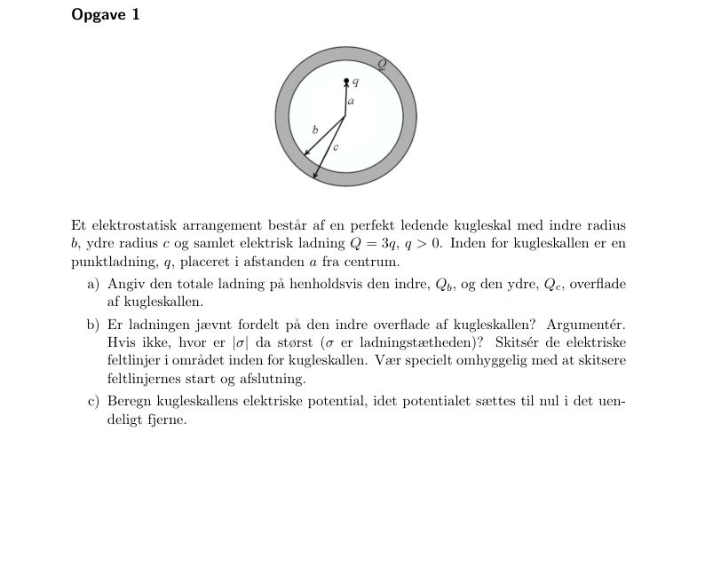{width=90%}

[Til indholdsfortegnelsen](#indhold) · [Til opgaveindeks](#opgaveindeks)

## Krydshenvisninger {#kryds-6}

- [Januar 2025 – 2](01-E_V.html#op-2025-01-2) — Koncentrisk metalkugle og metalskal.
- [November 2021 – 2](01-E_V.html#op-2021-11-2) — Fire ledende overflader.
- [November 2025 – 3](01-E_V.html#op-2025-11-3) — Indstil indre kugles potentiale til nul.

# Spejlingsmetode {#emne-7}

## To vinkelrette jordede planer {#type-7-1}

### November 2024 – Opgave 1ab · Hjørneladning og tre spejlladninger {#op-2024-11-1}

★★ · **Kilde:** samlet opgave-PDF, side 29; del a, b.

#### Opgavebeskrivelse

$+q$ ved $(a,a)$ og $(-a,-a)$, $-q$ ved $(a,-a)$ og $(-a,a)$. Find kraften på $(a,a)$, og brug den for én ladning i hjørnet mellem jordede planer $x=0,y=0$.

#### Genkendelse

**Denne type opgave genkendes ved:** Et jordet retvinklet hjørne kan håndteres med gentagne spejlinger.

**Metodevalg:** Coulomb; spejling; entydighed.

#### Idé

Beregn først den konkrete vektorsum; kontrollér derefter at spejlsystemets potentiale er nul på begge planer.

#### Løsning

**a)** De to negative naboer giver henholdsvis $-k_eq^2\hat x/(4a^2)$ og $-k_eq^2\hat y/(4a^2)$. Den diagonale positive ladning har afstand $2\sqrt2a$, kraftstørrelse $k_eq^2/(8a^2)$ og retning $(\hat x+\hat y)/\sqrt2$. Derfor
$$\mathbf F=\frac{k_eq^2}{a^2}\left(-\frac14+\frac1{8\sqrt2}\right)(\hat x+\hat y).$$
**b)** Spejl $+q$ i hvert plan: $-q$ ved $(-a,a)$ og $(a,-a)$. Dobbelt spejling giver $+q$ ved $(-a,-a)$. På $x=0$ ophæves potentialerne parvis; det samme sker på $y=0$. Potentialet går mod nul ved uendelig. Entydighed sikrer derfor det korrekte felt i første kvadrant. Kun de tre spejlladningers felt bruges i kraften på den virkelige ladning, så resultatet er netop a).

#### Slutresultat

$$
\boxed{\mathbf F=-\frac{k_eq^2}{a^2}\left(\frac14-\frac1{8\sqrt2}\right)(\hat x+\hat y)}
$$

#### Kontrol

Kraften peger ind mod hjørnet. Spejlladningerne er beregningshjælp uden for det fysiske område; deres indbyrdes energi må ikke bruges som fysisk lederenergi.

**Facitkontrol:** de efterspurgte slutresultater er sammenholdt med det leverede facit; ekstra retninger, mellemregninger og forudsætninger er forklaret ovenfor.

#### Metode at huske

**Jordede planer → spejl med fortegn → test alle randflader → kraft fra billeder.**

#### Originalfigur og ordlyd

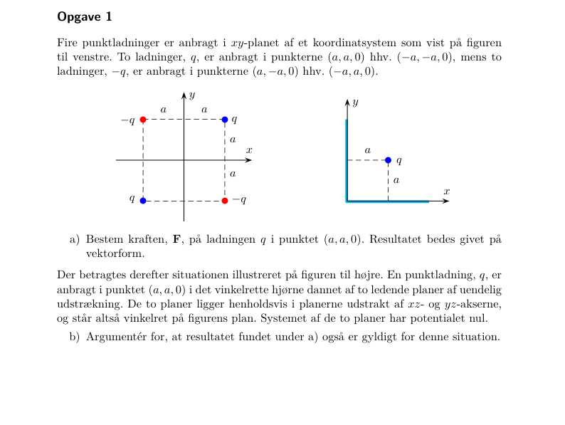{width=90%}

[Til indholdsfortegnelsen](#indhold) · [Til opgaveindeks](#opgaveindeks)

## En ledende plan og to virkelige ladninger {#type-7-2}

### November 2025 – Opgave 1ab · To ladninger over metalplade {#op-2025-11-1}

★★ · **Kilde:** samlet opgave-PDF, side 37; del a, b.

#### Opgavebeskrivelse

To ladninger $q$ ligger ved $(a/2,a/2,0)$ og $(-a/2,a/2,0)$. Find kraft på A og energi uden plan; find derefter kraft på A med uendelig metalplade i $y=0$.

#### Genkendelse

**Denne type opgave genkendes ved:** Et uendeligt ækvipotentialt plan indføres under ladningerne.

**Metodevalg:** Coulomb; spejlingsmetode.

#### Idé

Spejl begge ladninger med modsat fortegn. Det sædvanlige planresultat antager fravær af et ekstra påtrykt homogent felt.

#### Løsning

**a)** Afstanden mellem A og B er $a$, så
$$\mathbf F_A=k_eq^2\hat x/a^2,\qquad U=k_eq^2/a.$$
**b)** Billederne er $-q$ ved $(a/2,-a/2)$ og $(-a/2,-a/2)$. A’s eget billede ligger lodret under A med afstand $a$ og giver $-k_eq^2\hat y/a^2$. billedet af B ligger i afstand $\sqrt2a$ og giver
$$-\frac{k_eq^2}{2\sqrt2a^2}(\hat x+\hat y).$$
Læg de tre bidrag sammen:
$$\mathbf F_A=\frac{k_eq^2}{a^2}\left[\left(1-\frac1{2\sqrt2}\right)\hat x-\left(1+\frac1{2\sqrt2}\right)\hat y\right].$$
Billederne giver konstant potentiale på planen. Opgaven angiver ikke en særskilt ekstra baggrundsbelastning af pladen; hvis et sådant homogent felt var påtrykt, skulle $q\mathbf E_{\mathrm{baggrund}}$ lægges til. Den sædvanlige isolerede uendelige plansituation har samme lokale felt som billedløsningen.

#### Slutresultat

$$
\boxed{\mathbf F_A=\frac{k_eq^2}{a^2}\left[\left(1-\frac1{2\sqrt2}\right)\hat x-\left(1+\frac1{2\sqrt2}\right)\hat y\right]}
$$

#### Kontrol

Kraften har stadig en positiv x-komponent, men planen tiltrækker nedad. Energien i a) gælder før pladen indsættes.

**Facitkontrol:** de efterspurgte slutresultater er sammenholdt med det leverede facit; ekstra retninger, mellemregninger og forudsætninger er forklaret ovenfor.

#### Metode at huske

**Flere ladninger ved plan → spejl alle → udelad eget virkelige felt → vektorsum.**

#### Originalfigur og ordlyd

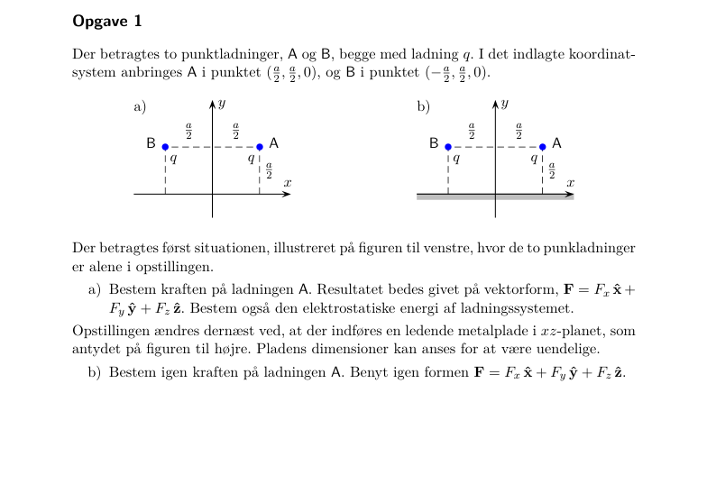{width=90%}

[Til indholdsfortegnelsen](#indhold) · [Til opgaveindeks](#opgaveindeks)

# Laplace / randværdiproblemer {#emne-8}

## Muligt elektrostatisk felt i ladningsfrit område {#type-8-1}

### November 2021 – Opgave 3ab · Curltest og harmonisk potentiale {#op-2021-11-3}

★★ · **Kilde:** samlet opgave-PDF, side 6; del a, b.

#### Opgavebeskrivelse

I et ladningsfrit område undersøges $\mathbf E_1=A_1(y\hat x-x\hat y+d_1\hat z)$ og $V_2=A_2(2\cos^2\theta-\sin^2\theta)r^2$.

#### Genkendelse

**Denne type opgave genkendes ved:** Der spørges, om givne udtryk kan være elektrostatiske i vakuum uden ladning.

**Metodevalg:** Curl; Laplace.

#### Idé

Tjek både det elektrostatiske curlkrav og det ladningsfrie divergenskrav; for potentialer bruges Laplace.

#### Løsning

**a)** $\nabla\cdot\mathbf E_1=0$, men
$$(\nabla\times\mathbf E_1)_z=\partial_x(-A_1x)-\partial_y(A_1y)=-2A_1.$$
Udsagnet er derfor falsk for $A_1\ne0$: feltet er ikke elektrostatisk. Hvis et tidsvarierende magnetfelt tillades, kan det være et elektrisk felt med $\partial_tB_z=2A_1$; det er en anden, dynamisk situation. Det trivielle $A_1=0$ er muligt.

**b)** Brug $r^2\cos^2\theta=z^2$ og $r^2\sin^2\theta=x^2+y^2$:
$$V_2=A_2(2z^2-x^2-y^2),\qquad\nabla^2V_2=A_2(4-2-2)=0.$$
Da $\rho=-\varepsilon_0\nabla^2V_2=0$, er dette et muligt elektrostatisk potentiale i området. Feltet $-\nabla V_2$ har automatisk nul curl.

#### Slutresultat

$$
\boxed{\nabla\times\mathbf E_1=-2A_1\hat z;\qquad\nabla^2V_2=0}
$$

#### Kontrol

Enhederne er $A_1,A_2$: V/m². Et felt kan godt have nul divergens uden at have nul curl. Ordlyden »elektrisk felt« skal skelnes fra »elektrostatisk felt«.

**Facitkontrol:** de efterspurgte slutresultater er sammenholdt med det leverede facit; ekstra retninger, mellemregninger og forudsætninger er forklaret ovenfor.

#### Metode at huske

**Elektrostatik → curl nul; ladningsfri potentiale → Laplace nul.**

#### Originalfigur og ordlyd

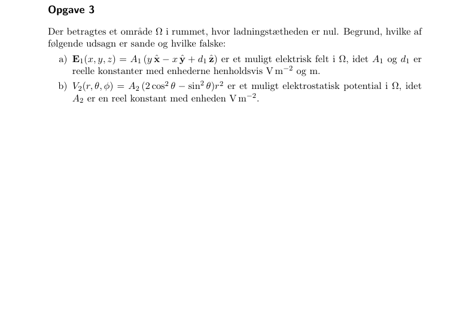{width=90%}

[Til indholdsfortegnelsen](#indhold) · [Til opgaveindeks](#opgaveindeks)

## Kugle: Legendre og quadrupolrandværdi {#type-8-2}

### Januar 2026 – Opgave 5abc · Potentiale på kugleskal med P₂ {#op-2026-01-5}

★★★ · **Kilde:** samlet opgave-PDF, side 43; del a, b, c.

#### Opgavebeskrivelse

På $r=R$ er $V(\theta)=2V_0P_2(\cos\theta)=V_0(3\cos^2\theta-1)$. $V\to0$ ved uendelig. Find potentialer indenfor/udenfor og yderfeltet.

#### Genkendelse

**Denne type opgave genkendes ved:** En kuglerandværdi er allerede skrevet i ét Legendre-led.

**Metodevalg:** Separation; Legendre; gradient.

#### Idé

I kildefrie regioner har det aksesymmetriske l-led formen $(A_lr^l+B_lr^{-l-1})P_l$. Vælg den regulære gren i hver region.

#### Løsning

**a)** For $l=2$ er den ydre løsning $Br^{-3}P_2$. Det voksende $r^2$-led udelades ved uendelig. Randbetingelsen $B/R^3=2V_0$ giver
$$V_{\mathrm{ud}}=2V_0(R/r)^3P_2(\cos\theta)=V_0(3\cos^2\theta-1)(R/r)^3.$$
**b)** Indenfor kræver et regulært potentiale ved centrum, at $r^{-3}$-leddet udelades. Match ved $R$:
$$V_{\mathrm{ind}}=2V_0(r/R)^2P_2(\cos\theta).$$
**c)** I sfæriske koordinater er $\mathbf E=-\partial_rV\hat r-(1/r)\partial_\theta V\hat\theta$ og $E_\phi=0$. Afled:
$$\partial_rV_{\mathrm{ud}}=-3V_0R^3(3\cos^2\theta-1)/r^4,$$
$$\partial_\theta V_{\mathrm{ud}}=-6V_0R^3\sin\theta\cos\theta/r^3.$$
Dermed fås feltet i boksen.

#### Slutresultat

$$
\boxed{\begin{gathered}\mathbf E_{\mathrm{ud}}=\frac{3V_0R^3}{r^4}\left[(3\cos^2\theta-1)\hat r+2\sin\theta\cos\theta\hat\theta\right] \\ r>R\end{gathered}}
$$

#### Kontrol

Potentialet er kontinuert ved $R$, regulært ved nul og aftager som $r^{-3}$ udenfor. Skallen er ikke en enkelt fri metaloverflade i ligevægt: dens foreskrevne potentiale varierer med vinkel. Løsningen forudsætter kildefrie indre og ydre regioner.

**Facitkontrol:** de efterspurgte slutresultater er sammenholdt med det leverede facit; ekstra retninger, mellemregninger og forudsætninger er forklaret ovenfor.

#### Metode at huske

**Legendre-randværdi → vælg regulær radialgren → match → negativ gradient.**

#### Originalfigur og ordlyd

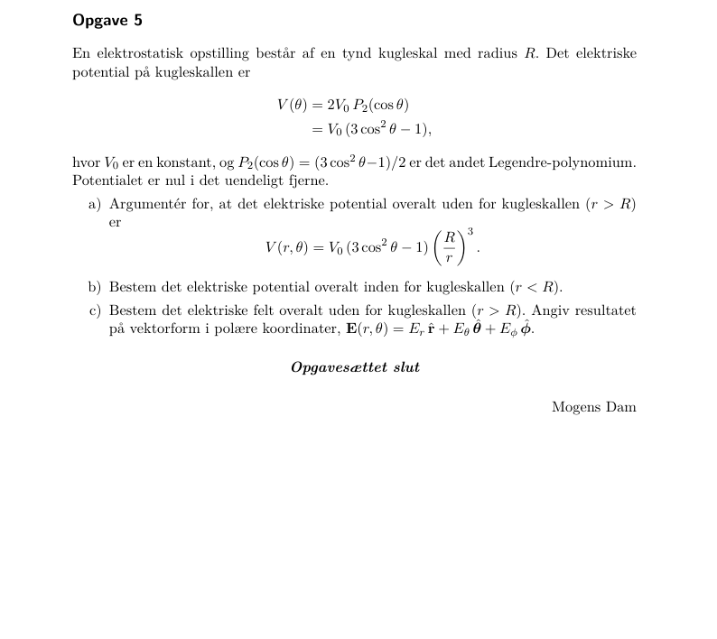{width=90%}

[Til indholdsfortegnelsen](#indhold) · [Til opgaveindeks](#opgaveindeks)

## Krydshenvisninger {#kryds-8}

- [November 2024 – 1](01-E_V.html#op-2024-11-1) — Entydighed ved jordet hjørne.
- [November 2023 – 4](01-E_V.html#op-2023-11-4) — Entydighed ved to dielektrika.

# Multipoler {#emne-9}

## Quadrupol: felt på aksen {#type-9-1}

### Februar 2023 – Opgave 3a · Lineær quadrupol i fjernfeltet {#op-2023-02-3}

★★ · **Kilde:** samlet opgave-PDF, side 18; del a.

#### Opgavebeskrivelse

$+q$ ligger ved $z=\pm d$ og $-2q$ ved $z=0$. Find feltet ved $z\gg d$ i formen $K\Theta/(4\pi\varepsilon_0z^4)$, hvor $\Theta=2qd^2$.

#### Genkendelse

**Denne type opgave genkendes ved:** Nettoladning og dipolmoment er nul.

**Metodevalg:** Coulomb; Taylorudvikling.

#### Idé

Skriv først det eksakte aksiale felt, og udvikl derefter til anden orden i $d/z$.

#### Løsning

**a)** For $z>d$ er
$$E_z=k_eq\left[\frac1{(z-d)^2}+\frac1{(z+d)^2}-\frac2{z^2}\right].$$
Træk $z^{-2}$ udenfor og sæt $u=d/z$:
$$(1-u)^{-2}=1+2u+3u^2+\cdots,\qquad(1+u)^{-2}=1-2u+3u^2+\cdots.$$
Konstanter og lineære led ophæves. Dermed
$$E_z=\frac{k_eq}{z^2}[6u^2+O(u^4)]=\frac{6k_eqd^2}{z^4}+O(d^4/z^6)
=\frac{3\Theta}{4\pi\varepsilon_0z^4}+\cdots.$$
For $q>0$ peger feltet i $+\hat z$ i det efterspurgte punkt på den positive akse.

#### Slutresultat

$$
\boxed{K=3,\qquad\mathbf E\simeq\frac{3\Theta}{4\pi\varepsilon_0z^4}\hat z\quad(z\gg d)}
$$

#### Kontrol

Et quadrupolfelt aftager som $r^{-4}$, hurtigere end dipolfeltets $r^{-3}$. De ulige udviklingsled ophæves ved symmetrien.

**Facitkontrol:** de efterspurgte slutresultater er sammenholdt med det leverede facit; ekstra retninger, mellemregninger og forudsætninger er forklaret ovenfor.

#### Metode at huske

**Nul monopol og dipol → eksakt felt → Taylor til første ikke-nul led.**

#### Originalfigur og ordlyd

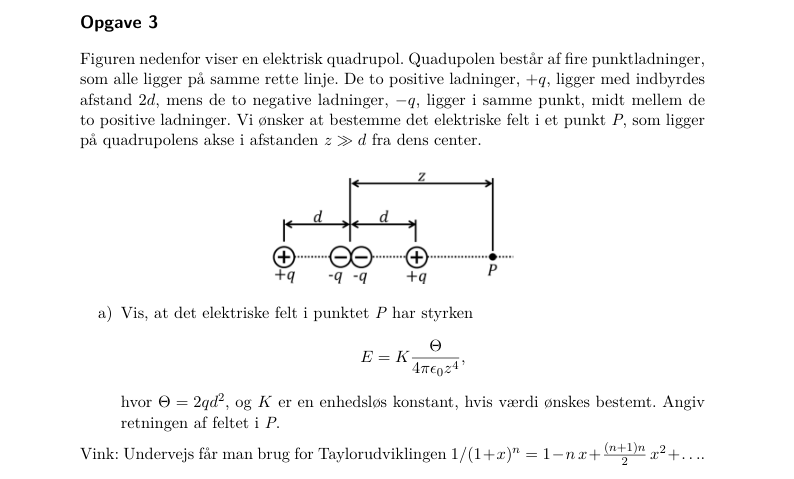{width=90%}

[Til indholdsfortegnelsen](#indhold) · [Til opgaveindeks](#opgaveindeks)

## Dipol: to punkter og to ladede kvartbuer {#type-9-2}

### Januar 2026 – Opgave 1abc · Diskret og kontinuert elektrisk dipol {#op-2026-01-1}

★★★ · **Kilde:** samlet opgave-PDF, side 41; del a, b, c.

#### Opgavebeskrivelse

Tilfælde A: $+q$ ved $(-a/2,\sqrt3a/2)$ og $-q$ ved $(a/2,\sqrt3a/2)$. Tilfælde B: øvre halvcirkel med $-q$ uniformt i første og $+q$ i anden kvadrant. Find centrumfelt, energien af A og begge dipolmomenter.

#### Genkendelse

**Denne type opgave genkendes ved:** Nettoladningen er nul; spejlede fortegn giver felt i x-retningen.

**Metodevalg:** Coulomb; bueintegration; dipolmoment.

#### Idé

Beregn feltet direkte i centrum. Dipoltilnærmelsen gælder kun langt væk og må ikke bruges i O.

#### Løsning

**a)** I A er afstandene til O $a$. De lodrette feltkomponenter ophæves, mens de vandrette hver er $k_eq/(2a^2)$. Derfor $\mathbf E_A=k_eq\hat x/a^2$. Afstanden mellem ladningerne er $a$, så $U_A=-k_eq^2/a$.

**b)** Sæt $\lambda=2q/(\pi a)$. I første kvadrant er $dq=-2q\,d\phi/\pi$, i anden $dq=+2q\,d\phi/\pi$. Et element giver $d\mathbf E=-k_edq(\cos\phi\hat x+\sin\phi\hat y)/a^2$. Da
$$\int_0^{\pi/2}\cos\phi\,d\phi=1,\quad\int_{\pi/2}^{\pi}\cos\phi\,d\phi=-1,$$
fås $E_{B,x}=4k_eq/(\pi a^2)$; y-komponenterne ophæves.

**c)** $\mathbf p_A=q\mathbf r_+-q\mathbf r_-=-qa\hat x$. For buerne:
$$p_{B,x}=\frac{2qa}{\pi}\left[-\int_0^{\pi/2}\cos\phi\,d\phi+\int_{\pi/2}^{\pi}\cos\phi\,d\phi\right]=-\frac{4qa}{\pi},$$
og $p_{B,y}=0$.

#### Slutresultat

$$
\boxed{\begin{gathered}\mathbf E_A=\frac{k_eq}{a^2}\hat x \\ U_A=-\frac{k_eq^2}a \\ \mathbf E_B=\frac{4k_eq}{\pi a^2}\hat x \\ \mathbf p_A=-qa\hat x \\ \mathbf p_B=-\frac{4qa}{\pi}\hat x\end{gathered}}
$$

#### Kontrol

Dipolmomentet peger fra negativ til positiv ladning, her mod venstre. Centrumfeltet peger mod højre; der er ingen modstrid.

> **Datering:** facit har overskriften »Februar 2026«, men originalen er 30. januar 2026. Samlingen følger originaldatoen.

#### Metode at huske

**Diskret eller kontinuert dipol → direkte felt i nærfelt → $p=\int r\,dq$.**

#### Originalfigur og ordlyd

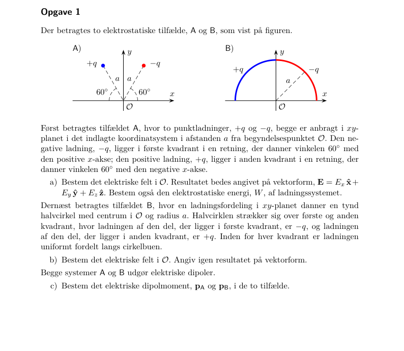{width=90%}

[Til indholdsfortegnelsen](#indhold) · [Til opgaveindeks](#opgaveindeks)

## Krydshenvisninger {#kryds-9}

- [Februar 2022 – 1](01-E_V.html#op-2022-02-1) — Monopol + dipol i fjernpotentiale.
- [Januar 2026 – 5](01-E_V.html#op-2026-01-5) — Ren l=2-kuglerandværdi.

# Elektriske materialer {#emne-10}

## Leder ved grænse mellem to dielektrika {#type-10-1}

### November 2023 – Opgave 4abc · Halvt nedsænket ledende kugle {#op-2023-11-4}

★★★ · **Kilde:** samlet opgave-PDF, side 23; del a, b, c.

#### Opgavebeskrivelse

En ledende kugle med radius $R$ og fri ladning $Q$ har nederste halvkugle i permittivitet $\varepsilon_1$ og øverste i $\varepsilon_2$. Prøv et radialt felt i begge medier.

#### Genkendelse

**Denne type opgave genkendes ved:** En plan materialeflade går gennem kuglens centrum.

**Metodevalg:** Randbetingelser; Gauss med D; entydighed.

#### Idé

Radialfeltet er tangentialt til materialefladen. Kontinuitet af tangentialt $E$ og flux af $D$ bestemmer løsningen.

#### Løsning

**a)** På grænseplanet er $\mathbf E$ tangentialt. Elektrostatik kræver $E_{t,1}=E_{t,2}$, altså $E_1(r)=E_2(r)=E(r)$. Derfor $D_1/D_2=\varepsilon_1/\varepsilon_2$.

**b)** Ved metaloverfladen er $\sigma_{f,i}=D_{n,i}=\varepsilon_iE(R)$, så forholdet er $\sigma_{f,1}/\sigma_{f,2}=\varepsilon_1/\varepsilon_2$. Total ladning giver
$$Q=2\pi R^2(\varepsilon_1+\varepsilon_2)E(R).$$
Derfor
$$\sigma_{f,i}=\frac{\varepsilon_iQ}{2\pi R^2(\varepsilon_1+\varepsilon_2)}.$$
**c)** På en sfærisk Gauss-flade er
$$Q=2\pi r^2(\varepsilon_1+\varepsilon_2)E(r),\quad\mathbf E=\frac{Q}{2\pi(\varepsilon_1+\varepsilon_2)r^2}\hat r.$$
Potentialet $V=Q/[2\pi(\varepsilon_1+\varepsilon_2)r]$ er kontinuert, konstant på metallet, går mod nul ved uendelig og opfylder kilde- og randbetingelserne; $D$ har nul normalkomponent på materialefladen. Entydighedssætningen for positive permittiviteter sikrer, at løsningen er den faktiske, ikke blot en uafprøvet symmetriantagelse.

#### Slutresultat

$$
\boxed{\begin{gathered}\mathbf E=\frac{Q\hat r}{2\pi(\varepsilon_1+\varepsilon_2)r^2} \\ \sigma_{f,i}=\frac{\varepsilon_iQ}{2\pi R^2(\varepsilon_1+\varepsilon_2)}\end{gathered}}
$$

#### Kontrol

For $\varepsilon_1=\varepsilon_2=\varepsilon$ fås det sædvanlige $Q/(4\pi\varepsilon r^2)$. Permittiviteterne her er absolutte, ikke relative.

**Facitkontrol:** de efterspurgte slutresultater er sammenholdt med det leverede facit; ekstra retninger, mellemregninger og forudsætninger er forklaret ovenfor.

#### Metode at huske

**Materialegrænse → tangentialt $E$ → flux af $D$ → randkontrol → entydighed.**

#### Originalfigur og ordlyd

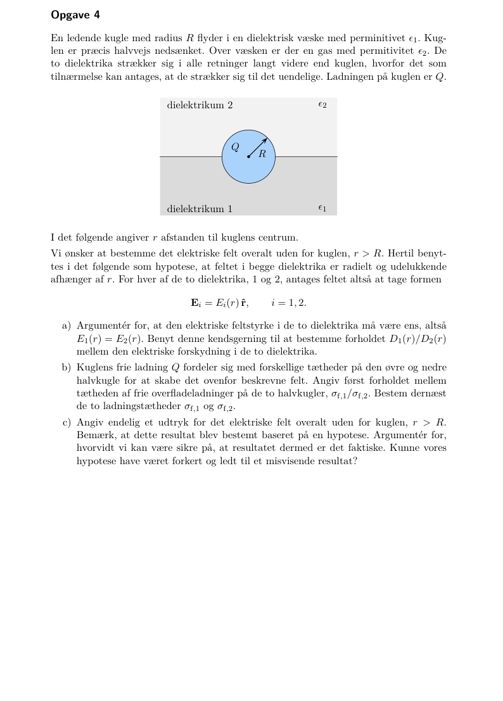{width=90%}

[Til indholdsfortegnelsen](#indhold) · [Til opgaveindeks](#opgaveindeks)

## Polarisation: bundne volumen- og overfladeladninger {#type-10-2}

### Februar 2024 – Opgave 2ab · Polariseret kube {#op-2024-02-2}

★★ · **Kilde:** samlet opgave-PDF, side 26; del a, b.

#### Opgavebeskrivelse

En dielektrisk kube med sidelængde $L$ og centrum i origo har $\mathbf P=A(x\hat x+y\hat y+z\hat z)$, $A>0$. Find bundne ladninger.

#### Genkendelse

**Denne type opgave genkendes ved:** Polarisationen er givet direkte, ikke $E$ eller frie ladninger.

**Metodevalg:** P dot normal; minus divergens.

#### Idé

Brug $\sigma_b=P\cdot\hat n$ på hver side og $\rho_b=-\nabla\cdot P$ i volumen.

#### Løsning

**a)** På siden $x=L/2$ er normalen $+\hat x$ og $\sigma_b=AL/2$. På $x=-L/2$ er både $P_x$ og normalens x-komponent negative, så $\sigma_b=(-AL/2)(-1)=AL/2$. Præcis samme beregning gælder de fire y- og z-flader. Alle seks flader har altså positiv tæthed $AL/2$.

**b)** $\nabla\cdot\mathbf P=A+A+A=3A$, så $\rho_b=-3A$. Dermed
$$Q_{b,\mathrm{vol}}=-3AL^3,\qquad Q_{b,\mathrm{overflade}}=6L^2(AL/2)=3AL^3,$$
$$Q_{b,\mathrm{total}}=0.$$
Der tilføjes ingen særskilte linjeladninger ved kanterne i denne idealiserede stykvist glatte model.

#### Slutresultat

$$
\boxed{\sigma_b=AL/2\ \text{på alle seks flader},\quad\rho_b=-3A,\quad Q_{b,\mathrm{total}}=0}
$$

#### Kontrol

$[P]=$ C/m², så $[A]=$ C/m³. Volumen- og overfladebidrag ophæves, som de skal for polarisation af et isoleret endeligt legeme.

**Facitkontrol:** de efterspurgte slutresultater er sammenholdt med det leverede facit; ekstra retninger, mellemregninger og forudsætninger er forklaret ovenfor.

#### Metode at huske

**Givet $P$ → normalprodukt på alle sider → minus divergens → nettoladningskontrol.**

#### Originalfigur og ordlyd

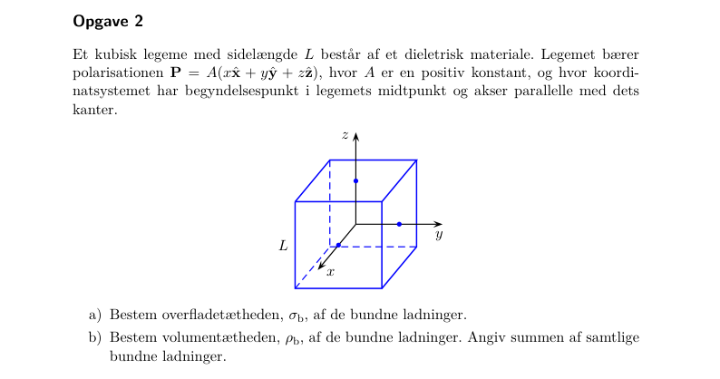{width=90%}

[Til indholdsfortegnelsen](#indhold) · [Til opgaveindeks](#opgaveindeks)

## Krydshenvisninger {#kryds-10}

- [November 2021 – 2](01-E_V.html#op-2021-11-2) — Bundne ladninger mellem metalskaller.
- [Februar 2022 – 2](01-E_V.html#op-2022-02-2) — D og E i koaksialt dielektrikum.
- [Februar 2023 – 2](01-E_V.html#op-2023-02-2) — Kugle: D → E → P.
- [November 2025 – 3](01-E_V.html#op-2025-11-3) — Dielektrikum og potentialnul.

# Kapacitans og elektrisk energi {#emne-11}

## Pladekondensator med dielektrikum {#type-11-1}

### Januar 2026 – Opgave 2ab · Stor kondensator: areal, spænding og energi {#op-2026-01-2}

★ · **Kilde:** samlet opgave-PDF, side 42; del a, b.

#### Opgavebeskrivelse

Kun del a–b: $C=91$ mF, isolatortykkelse $\delta=0.100\,\mu$m og $\varepsilon_r=9.6$. Efter opladning er $Q_0=5.7$ C. Find areal, spænding og energi. Afladning og kraft i c–d findes i DYN.

#### Genkendelse

**Denne type opgave genkendes ved:** En fysisk stor kapacitans forklares ved stort areal og meget tyndt dielektrikum.

**Metodevalg:** C=εA/d; Q=CV; energi.

#### Idé

Brug pladekondensatormodellen og omregn alle præfikser før indsættelse.

#### Løsning

**a)** Fra $C=\varepsilon_0\varepsilon_r A/\delta$ isoleres
$$A=\frac{C\delta}{\varepsilon_0\varepsilon_r}.$$
Her er $C=0.091$ F og $\delta=1.00\cdot10^{-7}$ m. Derfor
$$A=\frac{0.091\cdot1.00\cdot10^{-7}}{8.8541878\cdot10^{-12}\cdot9.6}=107\,\mathrm{m^2}.$$
**b)** Spændingen er $V_0=Q_0/C=5.7/0.091=62.6$ V. Energien kan beregnes som
$$W_0=\int_0^{Q_0}\frac{q'}C\,dq'=\frac{Q_0^2}{2C}=\frac{5.7^2}{2\cdot0.091}=179\,\mathrm J.$$
Det er det effektive overlappende areal, ikke komponentens ydre overflade, som bliver $107$ m².

#### Slutresultat

$$
\boxed{A=107\,\mathrm{m^2},\quad V_0=62.6\,\mathrm V,\quad W_0=179\,\mathrm J}
$$

#### Kontrol

$\frac12CV_0^2=\frac12Q_0V_0$ giver samme energi. Modellen ignorerer randeffekter og beskriver ikke den faktiske interne konstruktion.

**Facitkontrol:** de efterspurgte slutresultater er sammenholdt med det leverede facit; ekstra retninger, mellemregninger og forudsætninger er forklaret ovenfor.

#### Metode at huske

**Kondensatormodel → $A=C\delta/\varepsilon$ → $V=Q/C$ → $W=Q^2/(2C)$.**

**Samme opgave, øvrige dele:** [åbn 03-DYN](03-DYN.html#op-2026-01-2).

#### Originalfigur og ordlyd

{width=90%}

[Til indholdsfortegnelsen](#indhold) · [Til opgaveindeks](#opgaveindeks)

## Krydshenvisninger {#kryds-11}

- [November 2021 – 2](01-E_V.html#op-2021-11-2) — Kuglekondensators kapacitans.
- [Januar 2025 – 2](01-E_V.html#op-2025-01-2) — Feltenergi i koncentrisk system.
- [Juni 2021 – 2](01-E_V.html#op-2021-06-2) — Punktladningsenergi i tetraeder.
