Dette er en selvstændig opgavesamling, ikke en erstatning for formelsamlingen. Find først emne og geometri, slå en gammel opgave op, og følg udledningen.

**Kilder:** 11 eksamenssæt (juni 2021–januar 2026) og det vedhæftede facitark dateret 6. august 2026. [Originale opgaver](kilder/eksamen_alle.pdf) · [Originalt facit](kilder/eksamen_facits.pdf) · [Dækningskontrol og facitafvigelser](00-daekningskontrol.html).

**Notation:** $k_e=(4\pi\varepsilon_0)^{-1}$, $c^{-2}=\mu_0\varepsilon_0$. Cylindrisk radius er normalt $s$, sfærisk radius $r$. Plusomløb følger højrehåndsreglen omkring den valgte normal. Kildernes symboler bevares lokalt; $\rho_e$ bruges til resistivitet, når den ellers kunne forveksles med ladningstæthed. V/m = N/C; T = N/(A·m); Wb = V·s; H = Wb/A.

**Sværhedsgrad:** ★ grundlæggende · ★★ flere trin · ★★★ sammensat. Markeringen er en repetitionshjælp, ikke en officiel bedømmelse.

**Sammenhæng med formelsamlingen:** emnenavne og rækkefølge følger din specifikation. Formelsamlingen selv er ikke vedhæftet; dens præcise metodekoder og notation er derfor ikke verificeret. Der er ikke opfundet DYN-numre. Emner uden en opgave i de leverede sæt markeres eksplicit.

**Dokumenter:** [01-E_V](01-E_V.html) · [02-B_A](02-B_A.html) · [03-DYN](03-DYN.html)

# Indholdsfortegnelse {#indhold}

- [Find B fra strøm og geometri](#emne-1)
  - [Koaksiale systemer og kraft mellem ledere](#type-1-1)
    - [Juni 2021 – 3ab: Koaksial frem- og returstrøm](#op-2021-06-3)
  - [Roterende massiv cylinder: solenoidesuperposition](#type-1-2)
    - [November 2021 – 5a: Magnetfelt fra roterende ladet cylinder](#op-2021-11-5)
  - [Hul/boring i strømleder](#type-1-3)
    - [Februar 2022 – 4ab: Forskudt cylindrisk boring](#op-2022-02-4)
  - [Massiv cylinder: ikke-uniform J(s)](#type-1-4)
    - [Februar 2024 – 4ab: Strømtæthed som aftager lineært](#op-2024-02-4)
  - [Flere parallelle ledere og halvcylindrisk strømflade](#type-1-5)
    - [Januar 2025 – 5abc: Én tråd, fem tråde og halvcylinder](#op-2025-01-5)
  - [Massiv cylinder og linseformet hulrum](#type-1-6)
    - [November 2025 – 4abc: Modsat strøm i to overlappende cylindre](#op-2025-11-4)
  - [Krydshenvisninger](#kryds-1)
- [Biot–Savart-geometrier](#emne-2)
  - [Langt strømførende bånd som sum af tråde](#type-2-1)
    - [November 2024 – 3ab: Magnetfelt uden for et tyndt bånd](#op-2024-11-3)
  - [Øvrige geometrier / dækning](#ovrige-2)
- [Givet B → find strøm](#emne-3)
  - [Cylindrisk curl og lokal Lorentzkraft](#type-3-1)
    - [November 2021 – 4ab: Azimutalt felt proportionalt med s²](#op-2021-11-4)
  - [Krydshenvisninger](#kryds-3)
- [Lorentzkraft og partikelbevægelse](#emne-4)
  - [Spændingsacceleration og massespektrometer](#type-4-1)
    - [Juni 2021 – 4a: Kulstofion i halvcirkelbane](#op-2021-06-4)
  - [Kartesisk krydsprodukt](#type-4-2)
    - [Januar 2025 – 4a: Kraft på ladning med tre hastighedskomponenter](#op-2025-01-4)
  - [Øvrige geometrier / dækning](#ovrige-4)
- [Kraft på strømførende leder](#emne-5)
  - [Lige og krum leder i homogent felt](#type-5-1)
    - [Februar 2022 – 3a: Kraft på ret stykke og halvcirkel](#op-2022-02-3)
  - [Kraft mellem lang leder og rektangulær løkke](#type-5-2)
    - [Februar 2024 – 3ab: Nettokraft og mekanisk flyttearbejde](#op-2024-02-3)
  - [Krydshenvisninger](#kryds-5)
- [Magnetisk dipol](#emne-6)
  - [Roterende ladet ring og skive](#type-6-1)
    - [November 2022 – 4ab: Magnetisk moment fra rotation](#op-2022-11-4)
  - [Krydshenvisninger](#kryds-6)
  - [Øvrige geometrier / dækning](#ovrige-6)
- [Vektorpotentiale](#emne-7)
  - [A → B og Poissons ligning i cylinder](#type-7-1)
    - [Februar 2022 – 7ab: Stykvist aksialt vektorpotentiale](#op-2022-02-7)
  - [Kartesisk A → B → J og orienteret strøm](#type-7-2)
    - [Februar 2023 – 4ab: Polynomielt vektorpotentiale](#op-2023-02-4)
  - [Kartesiske og cylindriske udtryk for samme A](#type-7-3)
    - [Januar 2026 – 4a: Ensartet B fra azimutalt vektorpotentiale](#op-2026-01-4)
- [Magnetiske materialer](#emne-8)
  - [Indfrosset magnetisering i cylinder](#type-8-1)
    - [November 2022 – 5ab: Bundne strømme og H-felt](#op-2022-11-5)
  - [Toroide med lineær kerne og luftgab](#type-8-2)
    - [November 2024 – 6abc: H, B og magnetisk reluktans](#op-2024-11-6)

# Opgaveindeks {#opgaveindeks}

| Opgave | Opgavetype | Metode | Nøgleord |
|---|---|---|---|
| [Juni 2021 – 3ab](#op-2021-06-3) | Koaksiale systemer og kraft mellem ledere | Ampère; kraft på parallelleder | koaksial, netto strøm, tiltrækning |
| [November 2021 – 5a](#op-2021-11-5) | Roterende massiv cylinder: solenoidesuperposition | J=ρv; curl B; solenoidesum | rotation, aksialfelt, cylinder |
| [Februar 2022 – 4ab](#op-2022-02-4) | Hul/boring i strømleder | Ampère; superposition med negativ J | hulrum, uniformt felt, forskydningsvektor |
| [Februar 2024 – 4ab](#op-2024-02-4) | Massiv cylinder: ikke-uniform J(s) | Strømintegral; Ampère | inside/outside, mm², totalstrøm |
| [Januar 2025 – 5abc](#op-2025-01-5) | Flere parallelle ledere og halvcylindrisk strømflade | Ampère for enkelttråd; superposition | halvcylinder, vinkelintegral, analogi til E |
| [November 2025 – 4abc](#op-2025-11-4) | Massiv cylinder og linseformet hulrum | Ampère; superposition | uniform J, hulrum, konstant felt |
| [November 2024 – 3ab](#op-2024-11-3) | Langt strømførende bånd som sum af tråde | Trådintegration; logaritme; grænseudvikling | strømflade, bånd, ln |
| [November 2021 – 4ab](#op-2021-11-4) | Cylindrisk curl og lokal Lorentzkraft | Lorentzkraft; Ampère differentialt | curl, Jz, krydsprodukt |
| [Juni 2021 – 4a](#op-2021-06-4) | Spændingsacceleration og massespektrometer | Energi; Lorentzkraft; centripetalkraft | ion, radius, diameter |
| [Januar 2025 – 4a](#op-2025-01-4) | Kartesisk krydsprodukt | F=q v cross B | vektorer, µs, enheder |
| [Februar 2022 – 3a](#op-2022-02-3) | Lige og krum leder i homogent felt | Integreret Lorentzkraft | krum leder, endepunkter, uniformt B |
| [Februar 2024 – 3ab](#op-2024-02-3) | Kraft mellem lang leder og rektangulær løkke | B fra lang leder; I dl cross B; arbejde | løkke, frastødning, logaritme |
| [November 2022 – 4ab](#op-2022-11-4) | Roterende ladet ring og skive | I=Q/T; m=IA; ringintegration | rotation, dipolmoment, skive |
| [Februar 2022 – 7ab](#op-2022-02-7) | A → B og Poissons ligning i cylinder | Laplacian; curl; kontinuitet | Az, gauge, Poisson |
| [Februar 2023 – 4ab](#op-2023-02-4) | Kartesisk A → B → J og orienteret strøm | To curloperationer; fladeintegral | A, curl, normalvektor |
| [Januar 2026 – 4a](#op-2026-01-4) | Kartesiske og cylindriske udtryk for samme A | Curl; basisskift | Aφ, uniformt magnetfelt |
| [November 2022 – 5ab](#op-2022-11-5) | Indfrosset magnetisering i cylinder | curl M; M cross normal; Ampère med H | M, Jb, Kb, ingen fri strøm |
| [November 2024 – 6abc](#op-2024-11-6) | Toroide med lineær kerne og luftgab | Ampère med H; kontinuitet af B | toroide, jern, luftgab |

# Find B fra strøm og geometri {#emne-1}

## Koaksiale systemer og kraft mellem ledere {#type-1-1}

### Juni 2021 – Opgave 3ab · Koaksial frem- og returstrøm {#op-2021-06-3}

★★ · **Kilde:** samlet opgave-PDF, side 2; del a, b.

#### Opgavebeskrivelse

En lang cylinder med radius $a$ fører $I_1=I$ i $+z$. En tynd koaksial skal ved $b$ fører $I_2=-3I/4$. En tredje parallelleder ved $d>b$ fører $I_3=I$. Find felt i mellemrummet/udenfor og kraft pr. længde på den tredje.

#### Genkendelse

**Denne type opgave genkendes ved:** Cylindrisk symmetri, men strømmenes fortegn er forskellige.

**Metodevalg:** Ampère; kraft på parallelleder.

#### Idé

Ampères lov bruger den algebraiske indesluttede strøm. Den eksterne leder påvirkes af koaksialsystemets felt.

#### Løsning

**a)** Vælg en cirkulær Ampère-løkke med radius $s$:
$$B_\phi2\pi s=\mu_0I_{\mathrm{enc}}.$$
For $a<s<b$ er $I_{\mathrm{enc}}=I$, så $\mathbf B=\mu_0I\hat\phi/(2\pi s)$. For $s>b$ er $I_{\mathrm{enc}}=I-3I/4=I/4$, så $\mathbf B=\mu_0I\hat\phi/(8\pi s)$. Retningen er positiv omløbsretning omkring $+z$, mod uret set fra $+z$.

**b)** Feltet ved den tredje leder er $B(d)=\mu_0I/(8\pi d)$. Da lederretningen er $+\hat z$, giver $d\mathbf F/dl=I\hat z\times\mathbf B$ en kraft mod koaksialsystemet:
$$\frac FL=IB(d)=\frac{\mu_0I^2}{8\pi d}.$$
Felterne i a) er koaksialsystemets bidrag; den tredje leders felt skal superponeres, hvis det totale felt efter dens indsættelse ønskes.

#### Slutresultat

$$
\boxed{\mathbf B=\begin{cases}\mu_0I\hat\phi/(2\pi s)&a<s<b,\\\mu_0I\hat\phi/(8\pi s)&s>b,\end{cases}\quad F/L=\mu_0I^2/(8\pi d)}
$$

#### Kontrol

En fuld returstrøm $-I$ ville gøre yderfeltet nul. Kraft pr. længde har enhed N/m.

**Facitkontrol:** de efterspurgte slutresultater er sammenholdt med det leverede facit; ekstra retninger, mellemregninger og forudsætninger er forklaret ovenfor.

#### Metode at huske

**Koaksial strøm → fortegnet $I_{\mathrm{enc}}$ → Ampère → $I\,dl\times B$.**

#### Originalfigur og ordlyd

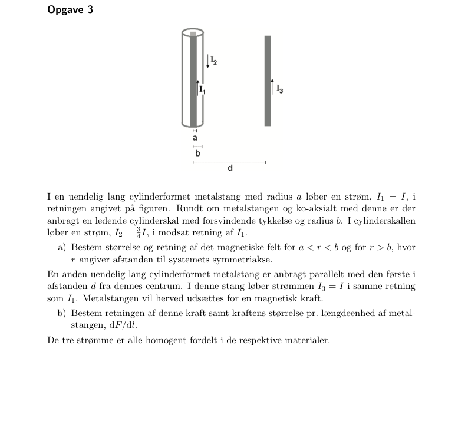{width=90%}

[Til indholdsfortegnelsen](#indhold) · [Til opgaveindeks](#opgaveindeks)

## Roterende massiv cylinder: solenoidesuperposition {#type-1-2}

### November 2021 – Opgave 5a · Magnetfelt fra roterende ladet cylinder {#op-2021-11-5}

★★ · **Kilde:** samlet opgave-PDF, side 7; del a.

#### Opgavebeskrivelse

En uendelig cylinder med radius $a$ og homogen volumenladning $\rho_0$ roterer med $\dot\phi=\omega$ omkring z-aksen. Vis, at yderfeltet er nul og $B_z=\mu_0\rho_0\omega(a^2-s^2)/2$ indenfor.

#### Genkendelse

**Denne type opgave genkendes ved:** Azimutal strøm skabt af roterende volumenladning.

**Metodevalg:** J=ρv; curl B; solenoidesum.

#### Idé

Hver tynd cylindrisk skal svarer til en ideel uendelig solenoide, hvis felt kun findes indeni.

#### Løsning

**a)** Ladninger ved radius $s$ har $\mathbf v=\omega s\hat\phi$, så $\mathbf J=\rho_0\omega s\hat\phi$. En skal med tykkelse $ds'$ svarer til overfladestrøm $dK=\rho_0\omega s'ds'$. Dens felt indenfor er $dB_z=\mu_0dK$ og udenfor nul.

For $s>a$ er man udenfor alle skaller, så deres samlede felt er nul. For $s<a$ bidrager kun skaller med $s'>s$:
$$B_z(s)=\mu_0\rho_0\omega\int_s^as'ds'=\frac{\mu_0\rho_0\omega}{2}(a^2-s^2).$$
Alternativt er $(\nabla\times B)_\phi=-dB_z/ds=\mu_0\rho_0\omega s$, der integreres med $B_z(a)=0$.

#### Slutresultat

$$
\boxed{\mathbf B(s)=\begin{cases}\frac{\mu_0\rho_0\omega}{2}(a^2-s^2)\hat z&s<a,\\0&s>a.\end{cases}}
$$

#### Kontrol

Feltet er kontinuert ved $a$, da der ikke er en særskilt overfladestrøm. Et eksternt påtrykt homogent aksialfelt er ikke medregnet; der vælges nul baggrundsfelt.

**Facitkontrol:** de efterspurgte slutresultater er sammenholdt med det leverede facit; ekstra retninger, mellemregninger og forudsætninger er forklaret ovenfor.

#### Metode at huske

**Roterende ladning → $J_\phi=\rho\omega s$ → sum af solenoideskaller.**

#### Originalfigur og ordlyd

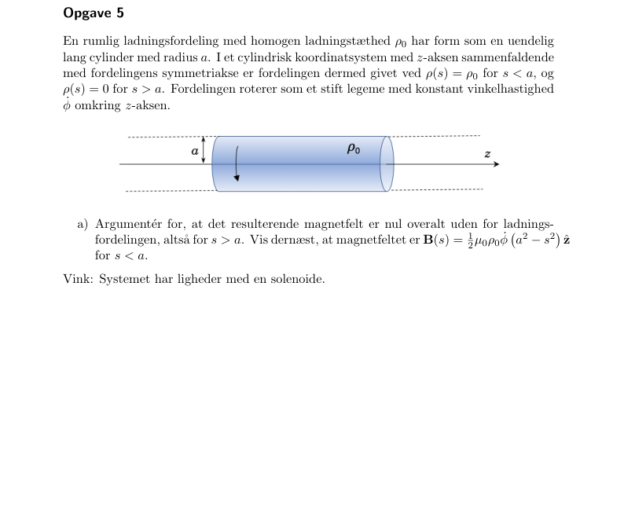{width=90%}

[Til indholdsfortegnelsen](#indhold) · [Til opgaveindeks](#opgaveindeks)

## Hul/boring i strømleder {#type-1-3}

### Februar 2022 – Opgave 4ab · Forskudt cylindrisk boring {#op-2022-02-4}

★★ · **Kilde:** samlet opgave-PDF, side 11; del a, b.

#### Opgavebeskrivelse

En cylinder med radius $R$ har et hul med radius $R/2$, hvis akse ligger $R/4$ mod højre. Materialet fører $\mathbf J=J\hat z$. Find totalstrøm og feltet i A ved boringens højre rand.

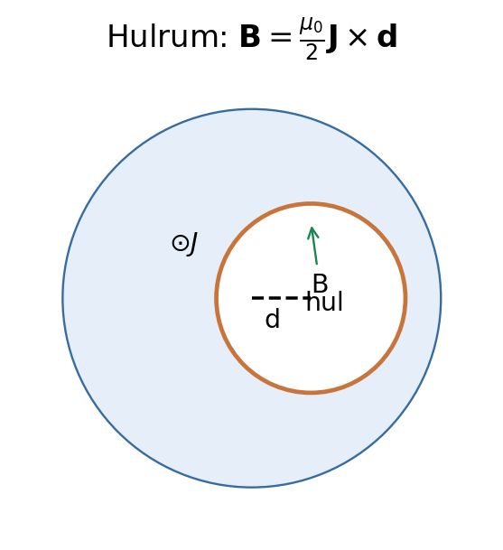{width=85%}

#### Genkendelse

**Denne type opgave genkendes ved:** En hul geometri kan skrives som fuld cylinder minus en forskudt cylinder.

**Metodevalg:** Ampère; superposition med negativ J.

#### Idé

Indenfor en uniform strøm-cylinders tværsnit er $B=(\mu_0/2)J\times s$. Subtraktion giver et konstant hulrumsfelt.

#### Løsning

**a)** Strømførende areal er $\pi R^2-\pi(R/2)^2=3\pi R^2/4$, så $I=3\pi R^2J/4$.

**b)** Lad $\mathbf d=(R/4)\hat x$ pege fra stor cylinders akse til hullet. For et punkt i hullet er $\mathbf s'=\mathbf s-\mathbf d$. Den fulde cylinder giver $(\mu_0/2)\mathbf J\times\mathbf s$, og den fiktive hulcylinder har $-\mathbf J$ og giver $-(\mu_0/2)\mathbf J\times\mathbf s'$. Summen er
$$\mathbf B=\frac{\mu_0}{2}\mathbf J\times(\mathbf s-\mathbf s')=\frac{\mu_0}{2}J\hat z\times\frac R4\hat x=\frac{\mu_0JR}{8}\hat y.$$
Dette gælder hele boringen, herunder grænseværdien i A.

#### Slutresultat

$$
\boxed{I=\frac34\pi R^2J,\qquad\mathbf B_A=\frac{\mu_0JR}{8}\hat y}
$$

#### Kontrol

Feltet er ens i hele hullet og forsvinder, hvis akseskiftet går mod nul. Retningen følger $\hat z\times\hat x=\hat y$.

**Facitkontrol:** de efterspurgte slutresultater er sammenholdt med det leverede facit; ekstra retninger, mellemregninger og forudsætninger er forklaret ovenfor.

#### Metode at huske

**Hul i cylinder → fuld $+J$ og hul $-J$ → subtrahér lokale radiusvektorer.**

#### Originalfigur og ordlyd

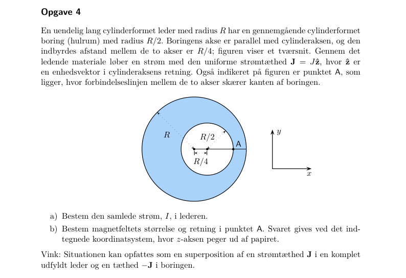{width=90%}

[Til indholdsfortegnelsen](#indhold) · [Til opgaveindeks](#opgaveindeks)

## Massiv cylinder: ikke-uniform J(s) {#type-1-4}

### Februar 2024 – Opgave 4ab · Strømtæthed som aftager lineært {#op-2024-02-4}

★★ · **Kilde:** samlet opgave-PDF, side 27; del a, b.

#### Opgavebeskrivelse

En lang leder med radius $S=3.1$ mm har $J(s)=J_0(1-s/S)$, $J_0=96.0$ A/mm², langs +z. Find indesluttet strøm, totalstrøm, felt og værdier ved 0, S og 2S.

{width=85%}

#### Genkendelse

**Denne type opgave genkendes ved:** Radialt varierende længdestrøm i cylindrisk geometri.

**Metodevalg:** Strømintegral; Ampère.

#### Idé

Integrér strømtæthed over tværsnit før Ampères lov; brug det fulde tværsnitsarealelement.

#### Løsning

**a)**
$$I(s)=2\pi J_0\int_0^s(1-s'/S)s'ds'=2\pi J_0\left(\frac{s^2}2-\frac{s^3}{3S}\right).$$
Ved $S$ fås $I_{\mathrm{tot}}=\pi J_0S^2/3$. Med $J_0=96.0\cdot10^6$ A/m² og $S=3.1\cdot10^{-3}$ m:
$$I_{\mathrm{tot}}=\frac\pi3(96.0\cdot10^6)(3.1\cdot10^{-3})^2=966\,\mathrm A.$$
**b)** $B_\phi2\pi s=\mu_0I(s)$ giver
$$B_\phi=\mu_0J_0(s/2-s^2/(3S))\quad(s<S),\qquad B_\phi=\frac{\mu_0J_0S^2}{6s}\quad(s>S).$$
Retningen er positiv $\hat\phi$ for strøm i +z. Ved aksen er B=0, ved S er $B=\mu_0J_0S/6=62.3$ mT og ved 2S det halve, 31.2 mT.

#### Slutresultat

$$
\boxed{I_{\mathrm{tot}}=966\,\mathrm A,\quad B(0)=0,\quad B(S)=62.3\,\mathrm{mT},\quad B(2S)=31.2\,\mathrm{mT}}
$$

#### Kontrol

Felterne matcher ved S. Totalstrømmen er en tredjedel af $J_0\pi S^2$, som forventet af den aftagende profil. Se facitbemærkningen i dækningskontrollen om den trykte strømværdi.

> **Facitafvigelse:** det trykte facit siger 70 kA. Det symbolske facit, opgavens J₀=96,0 A/mm² og S=3,1 mm giver 966 A. Facits 62 mT ved kanten svarer også til 966 A, ikke 70 kA.

#### Metode at huske

**Ikke-uniform $J(s)$ → $I(s)=\int J2\pi sds$ → Ampère → indsæt randradier.**

#### Originalfigur og ordlyd

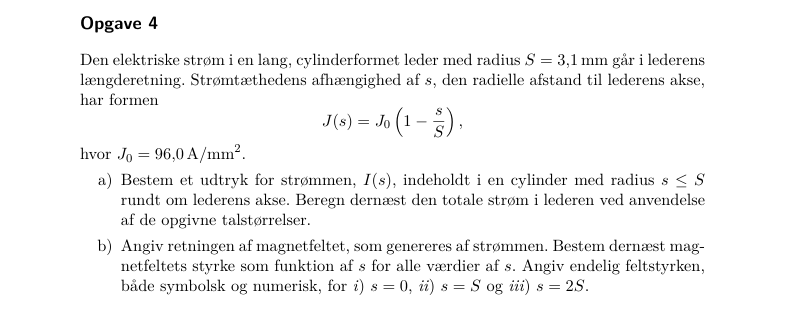{width=90%}

[Til indholdsfortegnelsen](#indhold) · [Til opgaveindeks](#opgaveindeks)

## Flere parallelle ledere og halvcylindrisk strømflade {#type-1-5}

### Januar 2025 – Opgave 5abc · Én tråd, fem tråde og halvcylinder {#op-2025-01-5}

★★ · **Kilde:** samlet opgave-PDF, side 35; del a, b, c.

#### Opgavebeskrivelse

Alle strømme går i +z og ligger i afstand a fra z-aksen: (a) én I på negativ x-akse; (b) fem I/5 ved vinkler $-90,-45,0,45,90$ grader relativt til negativ x; (c) I uniformt fordelt på en venstre halvcylinder. Find B på z-aksen.

#### Genkendelse

**Denne type opgave genkendes ved:** Feltbidrag fra lange tråde, som alle ligger lige langt fra observationsaksen.

**Metodevalg:** Ampère for enkelttråd; superposition.

#### Idé

Brug højrehåndsreglen for hver tråd og integrér projektionerne.

#### Løsning

**a)** En tråd på negativ x giver $\mathbf B_a=\mu_0I\hat y/(2\pi a)$.

**b)** Ved vinkel $\alpha$ relativt til negativ x giver en tråd y-komponenten $\mu_0(I/5)\cos\alpha/(2\pi a)$. x-komponenterne ophæves parvis. Derfor
$$\mathbf B_b=\frac{\mu_0I}{2\pi5a}(1+\sqrt2)\hat y.$$
**c)** Fordel $dI=(I/\pi)d\alpha$ på $-\pi/2<\alpha<\pi/2$. Dermed
$$B_y=\frac{\mu_0I}{2\pi^2a}\int_{-\pi/2}^{\pi/2}\cos\alpha\,d\alpha=\frac{\mu_0I}{\pi^2a},\quad B_x=0.$$
Resultaterne er uafhængige af z, fordi lederne er uendelige.

#### Slutresultat

$$
\boxed{\begin{gathered}\mathbf B_a=\frac{\mu_0I}{2\pi a}\hat y \\ \mathbf B_b=\frac{\mu_0I(1+\sqrt2)}{10\pi a}\hat y \\ \mathbf B_c=\frac{\mu_0I}{\pi^2a}\hat y\end{gathered}}
$$

#### Kontrol

Samme geometriske projektionsfaktorer optræder i E-opgaven februar 2024–1, men magnetfeltet er drejet 90 grader i tværsnittet.

**Facitkontrol:** de efterspurgte slutresultater er sammenholdt med det leverede facit; ekstra retninger, mellemregninger og forudsætninger er forklaret ovenfor.

#### Metode at huske

**Parallelle tråde → enkelttrådsfelt → højrehåndsprojektion → sum eller integral.**

#### Originalfigur og ordlyd

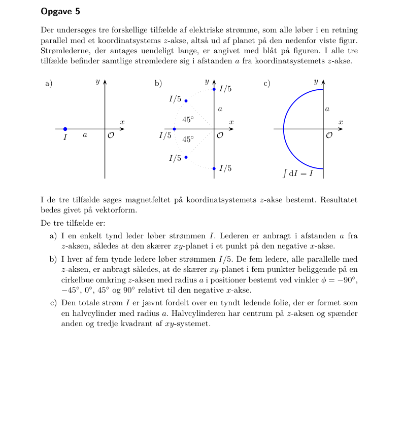{width=90%}

[Til indholdsfortegnelsen](#indhold) · [Til opgaveindeks](#opgaveindeks)

## Massiv cylinder og linseformet hulrum {#type-1-6}

### November 2025 – Opgave 4abc · Modsat strøm i to overlappende cylindre {#op-2025-11-4}

★★ · **Kilde:** samlet opgave-PDF, side 39; del a, b, c.

#### Opgavebeskrivelse

Først én massiv cylinder med radius R og uniform J i +z. Derefter to overlappende cylindre med akser $x=-d,+d$ og strømme +J og -J; overlapområdet er fjernet. Find B i enkeltcylinderen og i hulrummet ved $(0,0,z)$ og $(0,b,z)$.

#### Genkendelse

**Denne type opgave genkendes ved:** Et kompliceret tværsnit opstår ved to simple strømfordelinger med modsatte fortegn.

**Metodevalg:** Ampère; superposition.

#### Idé

De to fiktive strømme ophæves i overlapområdet, og deres felter summeres.

#### Løsning

**a)** $I_{\mathrm{enc}}=J\pi s^2$ indenfor. Ampère giver $B_\phi2\pi s=\mu_0J\pi s^2$, så $B_\phi=\mu_0Js/2$ og $k=\mu_0J/2$. Udenfor er $I=J\pi R^2$, så $B_\phi=\mu_0JR^2/(2s)$.

**b)** Ved midtlinjen har begge akser afstand d. Venstre +J giver $+\mu_0Jd\hat y/2$; højre -J giver det samme. Summen er $\mu_0Jd\hat y$.

**c)** I ethvert punkt i overlapområdet er lokale radiusvektorer $\mathbf s_L=(x+d)\hat x+y\hat y$ og $\mathbf s_R=(x-d)\hat x+y\hat y$. Derfor
$$\mathbf B=\frac{\mu_0J}{2}\hat z\times(\mathbf s_L-\mathbf s_R)=\frac{\mu_0J}{2}\hat z\times2d\hat x=\mu_0Jd\hat y.$$
Ved $(0,b,z)$ gælder det, når $d^2+b^2<R^2$.

#### Slutresultat

$$
\boxed{B_{\mathrm{enkelt}}=\begin{cases}\mu_0Js/2&s<R,\\\mu_0JR^2/(2s)&s>R,\end{cases}\qquad\mathbf B_{\mathrm{hulrum}}=\mu_0Jd\hat y}
$$

#### Kontrol

Hulrumsfeltet er uniformt og uafhængigt af b og z; x-komponenterne ophæves. Gyldighedsområdet er overlapområdet, ikke hele planet.

**Facitkontrol:** de efterspurgte slutresultater er sammenholdt med det leverede facit; ekstra retninger, mellemregninger og forudsætninger er forklaret ovenfor.

#### Metode at huske

**Sammensat strømgeometri → to hele cylindre ±J → lokale radiusvektorer → konstant differens.**

#### Originalfigur og ordlyd

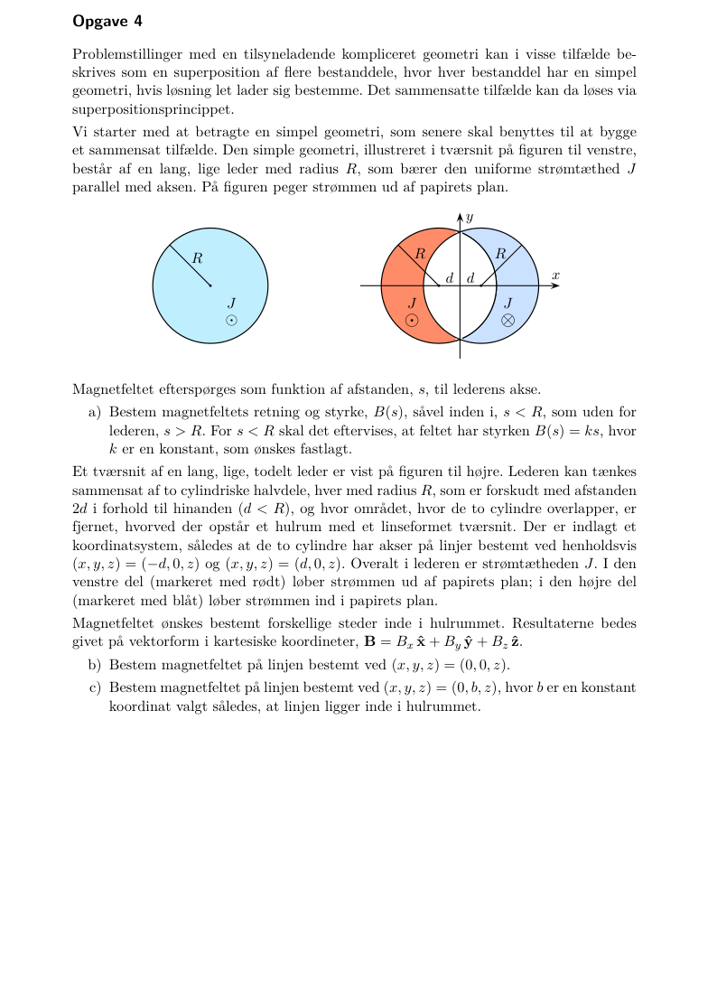{width=90%}

[Til indholdsfortegnelsen](#indhold) · [Til opgaveindeks](#opgaveindeks)

## Krydshenvisninger {#kryds-1}

- [November 2022 – 3](03-DYN.html#op-2022-11-3) — Lang solenoide: B og selvinduktans.
- [November 2023 – 2](03-DYN.html#op-2023-11-2) — To strømflader.
- [November 2024 – 6](02-B_A.html#op-2024-11-6) — Toroide med jernkerne og luftgab.

# Biot–Savart-geometrier {#emne-2}

## Langt strømførende bånd som sum af tråde {#type-2-1}

### November 2024 – Opgave 3ab · Magnetfelt uden for et tyndt bånd {#op-2024-11-3}

★★ · **Kilde:** samlet opgave-PDF, side 30; del a, b.

#### Opgavebeskrivelse

Et uendeligt langt bånd ligger ved $0<x<w$, $y=0$, med uniform strøm I i +z. Punkt A ligger ved $x=w+b$. Find B og grænsen $w\ll b$.

#### Genkendelse

**Denne type opgave genkendes ved:** En endelig bredde bryder cylindersymmetrien, men hvert smalt båndelement er en uendelig tråd.

**Metodevalg:** Trådintegration; logaritme; grænseudvikling.

#### Idé

Del strømmen op som $dI=(I/w)dx$ og summér trådfelterne.

#### Løsning

**a)** Alle tråde ligger til venstre for A, så højrehåndsreglen giver $+\hat y$. En tråd ved x har afstand $w+b-x$ og giver
$$dB_y=\frac{\mu_0}{2\pi}\frac{I\,dx/w}{w+b-x}.$$
Integrér:
$$B_y=\frac{\mu_0I}{2\pi w}\int_0^w\frac{dx}{w+b-x}
=\frac{\mu_0I}{2\pi w}[-\ln(w+b-x)]_0^w
=\frac{\mu_0I}{2\pi w}\ln\frac{b+w}{b}.$$
**b)** Et meget smalt bånd ligner én tråd i afstand b. Matematisk er $\ln(1+w/b)=w/b+O((w/b)^2)$, og dermed $B_y\simeq\mu_0I/(2\pi b)$.

#### Slutresultat

$$
\boxed{\mathbf B_A=\frac{\mu_0I}{2\pi w}\ln\left(1+\frac wb\right)\hat y\ \longrightarrow\ \frac{\mu_0I}{2\pi b}\hat y\quad(w/b\to0)}
$$

#### Kontrol

Logaritmens argument er dimensionsløst. B har enhed T og peger opad i tværsnittet.

**Facitkontrol:** de efterspurgte slutresultater er sammenholdt med det leverede facit; ekstra retninger, mellemregninger og forudsætninger er forklaret ovenfor.

#### Metode at huske

**Bånd → parallelle $dI$-tråde → integrér $1/$afstand → tjek tyndbåndsgrænse.**

#### Originalfigur og ordlyd

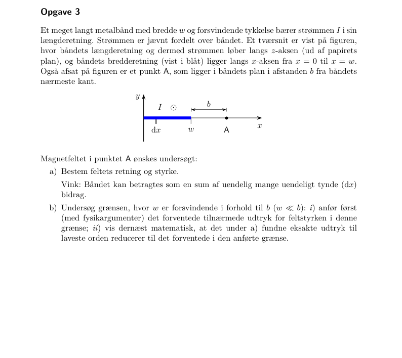{width=90%}

[Til indholdsfortegnelsen](#indhold) · [Til opgaveindeks](#opgaveindeks)

## Øvrige geometrier / dækning {#ovrige-2}

**Endelig leder, bue og cirkelløkke.** Ingen selvstændig eksakt Biot–Savart-opgave af disse typer. November 2024–5 bruger dipolapproksimationen for små cirkelløkker.

# Givet B → find strøm {#emne-3}

## Cylindrisk curl og lokal Lorentzkraft {#type-3-1}

### November 2021 – Opgave 4ab · Azimutalt felt proportionalt med s² {#op-2021-11-4}

★★ · **Kilde:** samlet opgave-PDF, side 7; del a, b.

#### Opgavebeskrivelse

$\mathbf B=\kappa s^2\hat\phi$. Ved $(x_0,0,0)$ bevæger $q>0$ sig med $\mathbf v=v(\cos\alpha\hat x+\sin\alpha\hat y)$. Find kraft og $\mathbf J=\beta s^n\hat z$.

#### Genkendelse

**Denne type opgave genkendes ved:** Givet B, og der søges både partikelkraft og kildestrøm.

**Metodevalg:** Lorentzkraft; Ampère differentialt.

#### Idé

Omsæt først basisvektoren i punktet; brug derefter cylindrisk curl.

#### Løsning

**a)** Ved $x_0>0$ er $s=x_0$ og $\hat\phi=\hat y$. Dermed
$$\mathbf F=q\mathbf v\times\mathbf B=q\kappa x_0^2v[\cos\alpha\hat x\times\hat y+\sin\alpha\hat y\times\hat y]
=q\kappa x_0^2v\cos\alpha\hat z.$$
Størrelsen er $q\kappa x_0^2v|\cos\alpha|$ og retningen følger fortegnet af $\cos\alpha$.

**b)** Magnetostatik giver $\mu_0\mathbf J=\nabla\times\mathbf B$. Den eneste komponent er
$$\mu_0J_z=\frac1s\frac d{ds}(sB_\phi)=\frac1s\frac d{ds}(\kappa s^3)=3\kappa s.$$
Så $\beta=3\kappa/\mu_0$ og $n=1$.

#### Slutresultat

$$
\boxed{\mathbf F=q\kappa x_0^2v\cos\alpha\hat z,\qquad\mathbf J=\frac{3\kappa}{\mu_0}s\hat z}
$$

#### Kontrol

Når $v$ er parallelt med $B$ ($\alpha=\pi/2$), er kraften nul. Udtrykket for kraften følger figurens $x_0>0$; en position på negativ x-akse kræver ændret basisretning.

**Facitkontrol:** de efterspurgte slutresultater er sammenholdt med det leverede facit; ekstra retninger, mellemregninger og forudsætninger er forklaret ovenfor.

#### Metode at huske

**Givet $B$ → lokal basis → $qv\times B$; kildestrøm → cylindrisk curl.**

#### Originalfigur og ordlyd

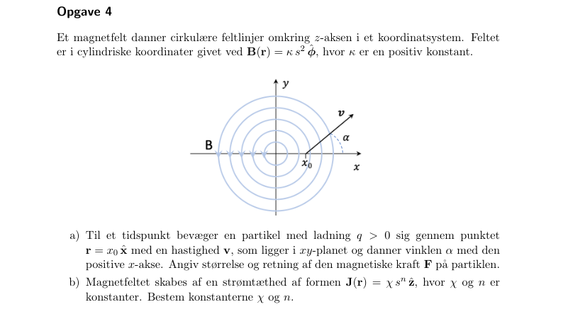{width=90%}

[Til indholdsfortegnelsen](#indhold) · [Til opgaveindeks](#opgaveindeks)

## Krydshenvisninger {#kryds-3}

- [Februar 2023 – 4](02-B_A.html#op-2023-02-4) — A → B → J.

# Lorentzkraft og partikelbevægelse {#emne-4}

## Spændingsacceleration og massespektrometer {#type-4-1}

### Juni 2021 – Opgave 4a · Kulstofion i halvcirkelbane {#op-2021-06-4}

★ · **Kilde:** samlet opgave-PDF, side 3; del a.

#### Opgavebeskrivelse

En C$^+$-ion med $M=12.0u$ accelereres fra hvile gennem $V=4.0\cdot10^4$ V og kommer vinkelret ind i $B=2.5$ T. Find indgang–udgangsafstanden $d$ efter en halvcirkel. $u=1.66054\cdot10^{-27}$ kg.

#### Genkendelse

**Denne type opgave genkendes ved:** Spændingsacceleration efterfulgt af afbøjning i homogent magnetfelt.

**Metodevalg:** Energi; Lorentzkraft; centripetalkraft.

#### Idé

Spændingen giver kinetisk energi; magnetfeltet ændrer kun retningen.

#### Løsning

**a)** Først $qV=\frac12Mv^2$, så $v=\sqrt{2qV/M}$. I magnetfeltet er kraften vinkelret på hastigheden:
$$qvB=\frac{Mv^2}{r}\quad\Rightarrow\quad r=\frac{Mv}{qB}=\frac1B\sqrt{\frac{2MV}{q}}.$$
Figuren viser et halvcirkelforløb, så det målte $d$ er diameteren:
$$d=2r=\frac2B\sqrt{\frac{2MV}{q}}.$$
Indsæt $M=1.992648\cdot10^{-26}$ kg og $q=e=1.602176634\cdot10^{-19}$ C:
$$r=0.0399\,\mathrm m,\qquad d=0.0798\,\mathrm m=7.98\,\mathrm{cm}.$$

#### Slutresultat

$$
\boxed{d=\frac2B\sqrt{\frac{2MV}{e}}=7.98\,\mathrm{cm}}
$$

#### Kontrol

$v\simeq8.02\cdot10^5$ m/s er langt under lyshastigheden, så klassisk energi er passende. Magnetkraften udfører intet arbejde.

**Facitkontrol:** de efterspurgte slutresultater er sammenholdt med det leverede facit; ekstra retninger, mellemregninger og forudsætninger er forklaret ovenfor.

#### Metode at huske

**Spænding → kinetisk energi → $qvB=Mv^2/r$ → figurens diameter.**

#### Originalfigur og ordlyd

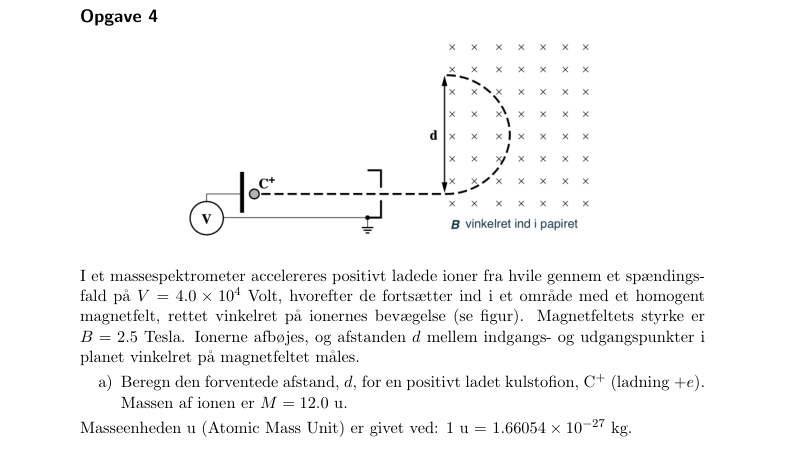{width=90%}

[Til indholdsfortegnelsen](#indhold) · [Til opgaveindeks](#opgaveindeks)

## Kartesisk krydsprodukt {#type-4-2}

### Januar 2025 – Opgave 4a · Kraft på ladning med tre hastighedskomponenter {#op-2025-01-4}

★ · **Kilde:** samlet opgave-PDF, side 35; del a.

#### Opgavebeskrivelse

$Q=6.00\,\mu$C, $\mathbf v=(3,4,-3)$ m/µs og $\mathbf B=(4,3,2)$ T. Find kraftvektor og størrelse.

#### Genkendelse

**Denne type opgave genkendes ved:** Generelle vektorer, hvor hastigheden ikke er vinkelret på feltet.

**Metodevalg:** F=q v cross B.

#### Idé

Brug krydsproduktet komponentvis og omregn m/µs til m/s.

#### Løsning

**a)** Symbolsk:
$$\mathbf F=Q[(v_yB_z-v_zB_y)\hat x+(v_zB_x-v_xB_z)\hat y+(v_xB_y-v_yB_x)\hat z].$$
Med $\mathbf v=10^6(3,4,-3)$ m/s og $Q=6\cdot10^{-6}$ C ophæves millionfaktorerne:
$$\mathbf F=6[(4\cdot2-(-3)3)\hat x+((-3)4-3\cdot2)\hat y+(3\cdot3-4\cdot4)\hat z]$$
$$=(102\hat x-108\hat y-42\hat z)\,\mathrm N.$$
Størrelsen er $F=\sqrt{102^2+108^2+42^2}=154$ N.

#### Slutresultat

$$
\boxed{\mathbf F=(102\hat x-108\hat y-42\hat z)\,\mathrm N,\qquad |F|=154\,\mathrm N}
$$

#### Kontrol

$\mathbf F\cdot\mathbf v\propto306-432+126=0$ og $\mathbf F\cdot\mathbf B=408-324-84=0$. Kraften er ortogonal til begge vektorer.

**Facitkontrol:** de efterspurgte slutresultater er sammenholdt med det leverede facit; ekstra retninger, mellemregninger og forudsætninger er forklaret ovenfor.

#### Metode at huske

**Vektorkraft → omregn enheder → krydsprodukt → norm og prikproduktkontrol.**

#### Originalfigur og ordlyd

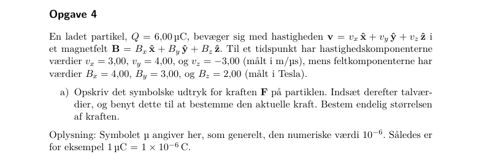{width=90%}

[Til indholdsfortegnelsen](#indhold) · [Til opgaveindeks](#opgaveindeks)

## Øvrige geometrier / dækning {#ovrige-4}

**Helix.** Ingen særskilt helixopgave i materialet.

# Kraft på strømførende leder {#emne-5}

## Lige og krum leder i homogent felt {#type-5-1}

### Februar 2022 – Opgave 3a · Kraft på ret stykke og halvcirkel {#op-2022-02-3}

★ · **Kilde:** samlet opgave-PDF, side 10; del a.

#### Opgavebeskrivelse

En leder består af et ret stykke med længde $L$ og en halvcirkel med diameter $L$, begge med strøm fra venstre mod højre i xy-planet. $\mathbf B=B\hat z$. Find begge kræfter og den samlede ved $B=0.45$ T, $L=0.23$ m og $I=7.6$ A.

#### Genkendelse

**Denne type opgave genkendes ved:** Feltet er homogent, selv om lederens form er krum.

**Metodevalg:** Integreret Lorentzkraft.

#### Idé

Træk B uden for integralet; den integrerede tangent er forskellen mellem endepunkterne.

#### Løsning

**a)** For et vilkårligt stykke i konstant felt:
$$\mathbf F=I\int d\mathbf l\times\mathbf B=I(\mathbf r_{\mathrm{slut}}-\mathbf r_{\mathrm{start}})\times\mathbf B.$$
Det rette stykke har endepunktsforskel $L\hat x$, så $\mathbf F_a=ILB\hat x\times\hat z=-ILB\hat y$.

Halvcirklens buelængde er $\pi L/2$, men endepunktsforskellen er også $L\hat x$. Derfor $\mathbf F_b=-ILB\hat y$, ikke $-I(\pi L/2)B\hat y$.

Summen bliver $\mathbf F=-2ILB\hat y$. Indsæt tallene: $2\cdot7.6\cdot0.23\cdot0.45=1.57$ N.

#### Slutresultat

$$
\boxed{\mathbf F_a=\mathbf F_b=-ILB\hat y,\qquad\mathbf F_{\mathrm{total}}=-1.57\hat y\,\mathrm N}
$$

#### Kontrol

En fuldstændigt lukket løkke i homogent felt har nul nettokraft; de udeladte til- og fraledninger ville levere den modsatte samlede kraft.

**Facitkontrol:** de efterspurgte slutresultater er sammenholdt med det leverede facit; ekstra retninger, mellemregninger og forudsætninger er forklaret ovenfor.

#### Metode at huske

**Konstant $B$ → $F=I\Delta r\times B$ → brug endepunkter, ikke buelængde.**

#### Originalfigur og ordlyd

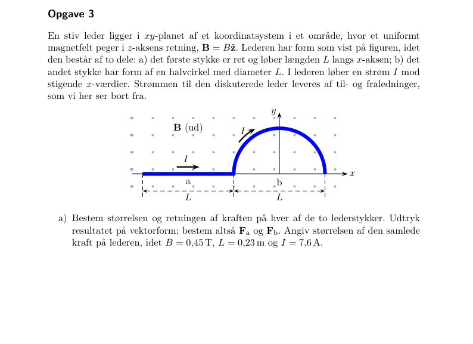{width=90%}

[Til indholdsfortegnelsen](#indhold) · [Til opgaveindeks](#opgaveindeks)

## Kraft mellem lang leder og rektangulær løkke {#type-5-2}

### Februar 2024 – Opgave 3ab · Nettokraft og mekanisk flyttearbejde {#op-2024-02-3}

★★★ · **Kilde:** samlet opgave-PDF, side 26; del a, b.

#### Opgavebeskrivelse

En rektangulær løkke med bredde $b=0.38$ m og højde $a=0.24$ m ligger over en lang leder, nærmeste afstand $d=0.14$ m. $I_1=15$ A mod højre i lederen; figurens løkkestrøm $I_2=1.8$ A løber mod venstre i nærmeste side. Find kraft og eksternt arbejde til afstanden $0.2d$.

#### Genkendelse

**Denne type opgave genkendes ved:** Feltet er stærkere på nærmeste løkkeside; dens strøm er modsat den lange leders.

**Metodevalg:** B fra lang leder; I dl cross B; arbejde.

#### Idé

De korte siders kræfter ophæves. De parallelle siders kræfter er modsatrettede og forskellige.

#### Løsning

**a)** Nærmeste side frastødes opad med $F_n=\mu_0I_1I_2b/(2\pi d)$; fjerneste tiltrækkes nedad med $F_f=\mu_0I_1I_2b/[2\pi(d+a)]$. Derfor er nettokraften væk fra lederen:
$$F=K\left(\frac1d-\frac1{d+a}\right)=\frac{\mu_0I_1I_2ab}{2\pi d(d+a)},\quad K=\frac{\mu_0I_1I_2b}{2\pi}.$$
Numerisk $F=9.26\,\mu$N.

**b)** Ved langsom flytning skal $F_{\mathrm{ekst}}=-F$ i afstandskoordinaten s. Derfor
$$W_{\mathrm{ekst}}=-K\int_d^{0.2d}\left(\frac1s-\frac1{s+a}\right)ds
=-K\left[\ln\frac{s}{s+a}\right]_d^{0.2d}$$
$$=K\ln\frac{0.2d+a}{0.2(d+a)}=2.58\,\mu\mathrm J.$$
Strømmene holdes konstante af eksterne forsyninger; dette arbejde er ikke generelt lig minus ændringen af magnetisk feltenergi alene.

#### Slutresultat

$$
\boxed{F=9.26\,\mu\mathrm N\ \text{væk fra lederen},\qquad W_{\mathrm{ekst}}=2.58\,\mu\mathrm J}
$$

#### Kontrol

Flytningen er mod den frastødende kraft, så arbejdet er positivt. Begge resultater går mod nul, hvis en af strømmene er nul.

**Facitkontrol:** de efterspurgte slutresultater er sammenholdt med det leverede facit; ekstra retninger, mellemregninger og forudsætninger er forklaret ovenfor.

#### Metode at huske

**Lang leder → felt på nær/fjern side → differens af kræfter → negativt kraftintegral.**

#### Originalfigur og ordlyd

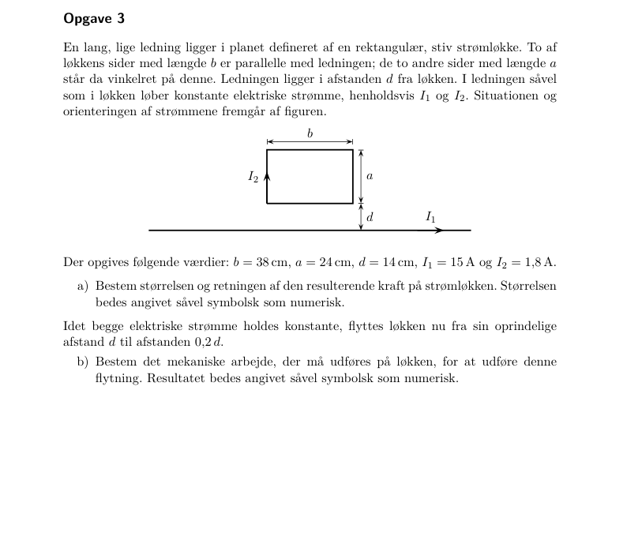{width=90%}

[Til indholdsfortegnelsen](#indhold) · [Til opgaveindeks](#opgaveindeks)

## Krydshenvisninger {#kryds-5}

- [Juni 2021 – 3](02-B_A.html#op-2021-06-3) — Tiltrækning mellem parallelstrømme.
- [Januar 2026 – 2](01-E_V.html#op-2026-01-2) — Frastødning mellem afladningsstrømme.

# Magnetisk dipol {#emne-6}

## Roterende ladet ring og skive {#type-6-1}

### November 2022 – Opgave 4ab · Magnetisk moment fra rotation {#op-2022-11-4}

★★ · **Kilde:** samlet opgave-PDF, side 15; del a, b.

#### Opgavebeskrivelse

En tynd ring med middelradius $R$, højde $h$, bredde $b\ll R$ og volumenladning $\rho$ roterer med $\omega$. Find strøm og moment; find derefter momentet af en massiv skive med radius R og tykkelse h.

#### Genkendelse

**Denne type opgave genkendes ved:** Mekanisk rotation af ladning skaber en strøm.

**Metodevalg:** I=Q/T; m=IA; ringintegration.

#### Idé

En omløbstid er $2\pi/\omega$. Skiven deles i koncentriske ringe.

#### Løsning

**a)** Ringens volumen er cirka $2\pi Rbh$, så $Q=2\pi Rbh\rho$. Omløbstiden er $T=2\pi/\omega$, og
$$I=Q/T=\rho\omega Rbh,\quad\mathbf m=I\pi R^2\hat z=\pi\rho\omega bhR^3\hat z.$$
Her vælges $+z$ langs rotationsaksens højrehåndsretning; for negativ ladning er momentet modsat.

**b)** Et ringelement i skiven har $dq=\rho h2\pi sds$ og $dI=dq/T=\rho h\omega sds$. Dets moment er $dm=\pi s^2dI=\pi\rho h\omega s^3ds$. Integrér:
$$\mathbf m=\pi\rho h\omega\int_0^Rs^3ds\hat z=\frac{\pi\rho h\omega R^4}{4}\hat z.$$

#### Slutresultat

$$
\boxed{\begin{gathered}I_{\mathrm{ring}}=\rho\omega Rbh \\ \mathbf m_{\mathrm{ring}}=\pi\rho\omega bhR^3\hat z \\ \mathbf m_{\mathrm{skive}}=\frac14\pi\rho h\omega R^4\hat z\end{gathered}}
$$

#### Kontrol

Momentets enhed er A·m². Ringresultatet bruger $b\ll R$, mens skiveintegralet ikke bruger en tynd-radialringsapproksimation for hele skiven.

**Facitkontrol:** de efterspurgte slutresultater er sammenholdt med det leverede facit; ekstra retninger, mellemregninger og forudsætninger er forklaret ovenfor.

#### Metode at huske

**Roterende ladning → $I=Q/T$ → $m=IA$ → integrér ringe ved massiv skive.**

#### Originalfigur og ordlyd

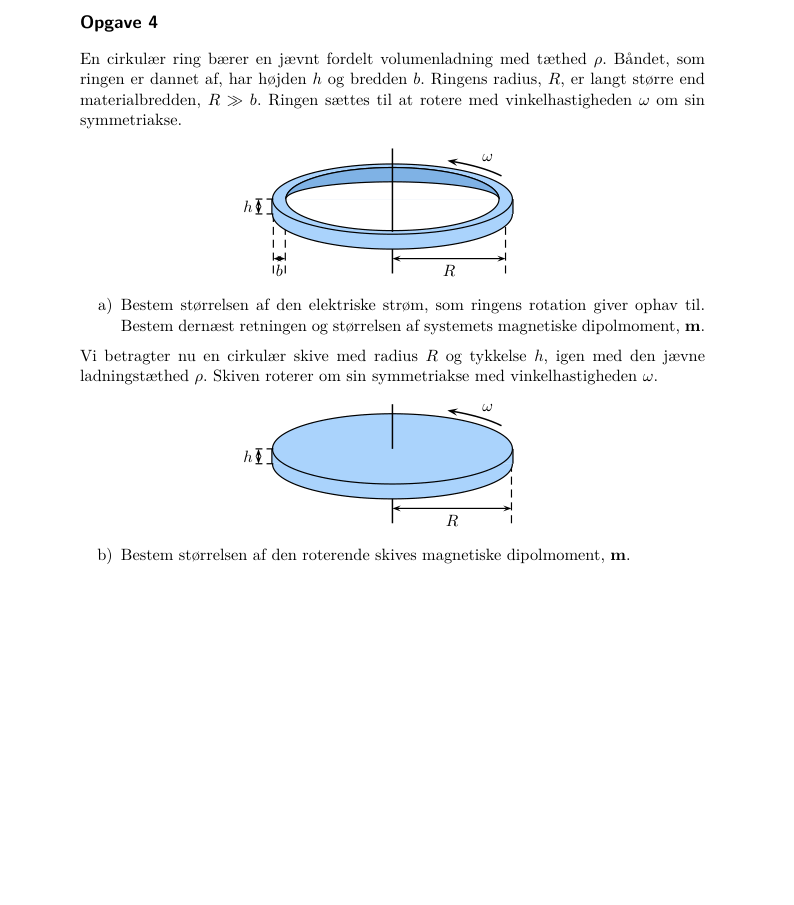{width=90%}

[Til indholdsfortegnelsen](#indhold) · [Til opgaveindeks](#opgaveindeks)

## Krydshenvisninger {#kryds-6}

- [November 2024 – 5](03-DYN.html#op-2024-11-5) — Magnetisk dipolfelt og gensidig induktion.

## Øvrige geometrier / dækning {#ovrige-6}

**Torque og potentiel energi.** Ingen særskilt torque-/dipolenergiopgave. Roterende ring/skive træner dipolmoment.

# Vektorpotentiale {#emne-7}

## A → B og Poissons ligning i cylinder {#type-7-1}

### Februar 2022 – Opgave 7ab · Stykvist aksialt vektorpotentiale {#op-2022-02-7}

★★★ · **Kilde:** samlet opgave-PDF, side 12; del a, b.

#### Opgavebeskrivelse

En cylinder med radius $R$ fører uniform $J\hat z$, $I=\pi R^2J$. Der er $A_z=-\mu_0Is^2/(4\pi R^2)$ indenfor og $A_z=C\ln(s/R)-\mu_0I/(4\pi)$ udenfor. Test Poisson og find B samt C.

#### Genkendelse

**Denne type opgave genkendes ved:** Kun aksial komponent af A, som kun afhænger af radius.

**Metodevalg:** Laplacian; curl; kontinuitet.

#### Idé

Coulomb-gauge er automatisk opfyldt. Laplacianen tester kilden, curl giver feltet.

#### Løsning

**a)** $\nabla\cdot\mathbf A=\partial_zA_z=0$. For en z-komponent er
$$\nabla^2A_z=\frac1s\frac d{ds}\left(s\frac{dA_z}{ds}\right).$$
Indenfor er $dA_z/ds=-\mu_0Is/(2\pi R^2)$ og derfor $\nabla^2A_z=-\mu_0I/(\pi R^2)=-\mu_0J$. Udenfor er $dA_z/ds=C/s$, så $s\,dA_z/ds=C$ og Laplacianen er nul. A er kontinuert ved $R$.

**b)** Curlen har kun azimutalkomponent $B_\phi=-dA_z/ds$:
$$B_\phi=\begin{cases}\mu_0Is/(2\pi R^2)&s<R,\\-C/s&s>R.\end{cases}$$
Der er ingen særskilt overfladestrøm ved $R$, så kontinuitet giver $-C/R=\mu_0I/(2\pi R)$, altså $C=-\mu_0I/(2\pi)=-\mu_0JR^2/2$.

#### Slutresultat

$$
\boxed{\begin{gathered}C=-\frac{\mu_0I}{2\pi} \\ \mathbf B=\begin{cases}\mu_0Is\hat\phi/(2\pi R^2)&s<R,\\\mu_0I\hat\phi/(2\pi s)&s>R.\end{cases}\end{gathered}}
$$

#### Kontrol

A og dets første radiale afledte matcher ved $R$. A vokser logaritmisk ved uendelig, hvilket er tilladt for en uendelig leder; B aftager.

**Facitkontrol:** de efterspurgte slutresultater er sammenholdt med det leverede facit; ekstra retninger, mellemregninger og forudsætninger er forklaret ovenfor.

#### Metode at huske

**Aksialt $A_z(s)$ → radial Laplacian → $B_\phi=-dA_z/ds$ → match ved grænsen.**

#### Originalfigur og ordlyd

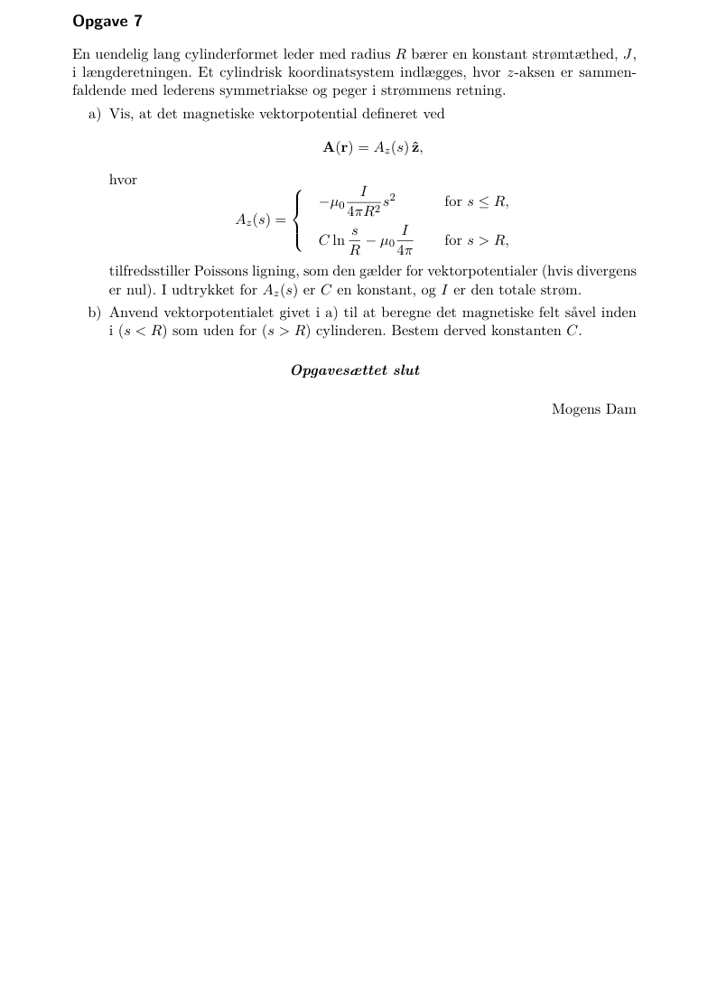{width=90%}

[Til indholdsfortegnelsen](#indhold) · [Til opgaveindeks](#opgaveindeks)

## Kartesisk A → B → J og orienteret strøm {#type-7-2}

### Februar 2023 – Opgave 4ab · Polynomielt vektorpotentiale {#op-2023-02-4}

★★ · **Kilde:** samlet opgave-PDF, side 18; del a, b.

#### Opgavebeskrivelse

$\mathbf A=\kappa(3zy\hat x-2zy\hat y+z^2\hat z)$. Find B, J og strøm gennem en cirkelflade med radius R og normal $(\hat x+\hat y-\hat z)/\sqrt3$.

#### Genkendelse

**Denne type opgave genkendes ved:** Et generelt vektorpotentiale og en skråtstillet flade.

**Metodevalg:** To curloperationer; fladeintegral.

#### Idé

B findes som curl A, J som curl B i magnetostatik. Strømmen er en orienteret flux af J.

#### Løsning

**a)** Udregn hver komponent:
$$B_x=\partial_yA_z-\partial_zA_y=2\kappa y,$$
$$B_y=\partial_zA_x-\partial_xA_z=3\kappa y,\quad B_z=\partial_xA_y-\partial_yA_x=-3\kappa z.$$
Derpå
$$\mu_0\mathbf J=\nabla\times\mathbf B=(0,0,\partial_x(3\kappa y)-\partial_y(2\kappa y))=-2\kappa\hat z.$$
**b)** J er konstant, så
$$I=\int\mathbf J\cdot\hat n\,da=\left(-\frac{2\kappa}{\mu_0}\hat z\right)\cdot\frac{\hat x+\hat y-\hat z}{\sqrt3}\,\pi R^2
=\frac{2\kappa\pi R^2}{\sqrt3\mu_0}.$$

#### Slutresultat

$$
\boxed{\begin{gathered}\mathbf B=\kappa(2y\hat x+3y\hat y-3z\hat z) \\ \mathbf J=-\frac{2\kappa}{\mu_0}\hat z \\ I=\frac{2\kappa\pi R^2}{\sqrt3\mu_0}\end{gathered}}
$$

#### Kontrol

$\nabla\cdot B=0+3\kappa-3\kappa=0$. Den valgte normal har negativ z-komponent, så strømmen bliver positiv ved $\kappa>0$.

**Facitkontrol:** de efterspurgte slutresultater er sammenholdt med det leverede facit; ekstra retninger, mellemregninger og forudsætninger er forklaret ovenfor.

#### Metode at huske

**Givet $A$ → curl → $B$ → curl → $J$ → $I=\int J\cdot n\,da$.**

#### Originalfigur og ordlyd

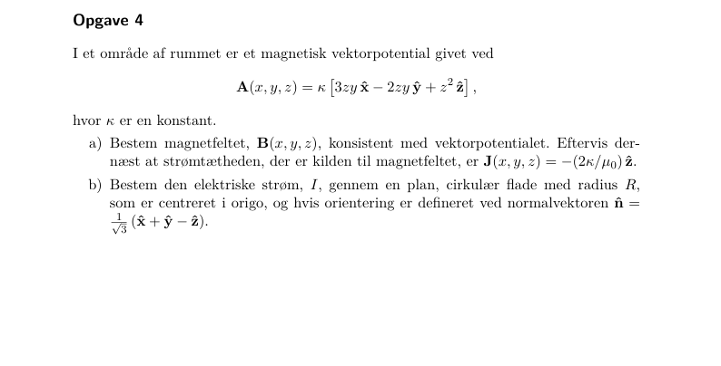{width=90%}

[Til indholdsfortegnelsen](#indhold) · [Til opgaveindeks](#opgaveindeks)

## Kartesiske og cylindriske udtryk for samme A {#type-7-3}

### Januar 2026 – Opgave 4a · Ensartet B fra azimutalt vektorpotentiale {#op-2026-01-4}

★ · **Kilde:** samlet opgave-PDF, side 43; del a.

#### Opgavebeskrivelse

(i) $\mathbf A=k(x\hat y-y\hat x)$. (ii) $\mathbf A=-k\mathbf s\times\hat z=-ks\hat s\times\hat z$. Find magnetfeltet i begge tilfælde.

#### Genkendelse

**Denne type opgave genkendes ved:** De to udtryk er samme felt skrevet i forskellige koordinater.

**Metodevalg:** Curl; basisskift.

#### Idé

Brug kartesisk curl i i) og omskriv krydsproduktet til azimutal basis i ii).

#### Løsning

**a)** **i)** $A_x=-ky$, $A_y=kx$ og $A_z=0$. Derfor $B_x=B_y=0$ og
$$B_z=\partial_xA_y-\partial_yA_x=k-(-k)=2k.$$
**ii)** Da $\hat s\times\hat z=-\hat\phi$, er $A_\phi=ks$. Cylindrisk curl giver
$$B_z=\frac1s\frac{\partial(sA_\phi)}{\partial s}=\frac1s\frac{d(ks^2)}{ds}=2k.$$
De øvrige komponenter er nul. Identiteten $s\hat\phi=-y\hat x+x\hat y$ viser også direkte, at vektorpotentialerne er identiske.

#### Slutresultat

$$
\boxed{\mathbf B=2k\hat z\quad\text{i begge tilfælde}}
$$

#### Kontrol

$\nabla\cdot B=0$. Udtrykket er regulært ved aksen, da $A=0$ der, selv om $\hat\phi$ alene ikke er defineret ved s=0. $[k]=$ T.

**Facitkontrol:** de efterspurgte slutresultater er sammenholdt med det leverede facit; ekstra retninger, mellemregninger og forudsætninger er forklaret ovenfor.

#### Metode at huske

**Givet $A$ → vælg koordinatsystem → curl → sammenlign via basisskift.**

#### Originalfigur og ordlyd

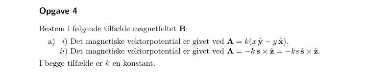{width=90%}

[Til indholdsfortegnelsen](#indhold) · [Til opgaveindeks](#opgaveindeks)

# Magnetiske materialer {#emne-8}

## Indfrosset magnetisering i cylinder {#type-8-1}

### November 2022 – Opgave 5ab · Bundne strømme og H-felt {#op-2022-11-5}

★★ · **Kilde:** samlet opgave-PDF, side 16; del a, b.

#### Opgavebeskrivelse

En uendelig cylinder med radius $R$ har magnetisering $\mathbf M=ks^2\hat z$. Find bundne strømme og felterne H og B indenfor/udenfor.

#### Genkendelse

**Denne type opgave genkendes ved:** Magnetiseringen er givet, og der er ingen fri strøm.

**Metodevalg:** curl M; M cross normal; Ampère med H.

#### Idé

Beregn de bundne strømme direkte. Bestem H med magnetisk symmetri og fravær af frie kilder.

#### Løsning

**a)**
$$\mathbf J_b=\nabla\times\mathbf M=-\frac{dM_z}{ds}\hat\phi=-2ks\hat\phi.$$
På cylinderfladen er normalen $\hat s$, og
$$\mathbf K_b=\mathbf M\times\hat n=kR^2\hat z\times\hat s=kR^2\hat\phi.$$
Der er ingen endeflader i den uendelige cylinder.

**b)** $\nabla\times H=J_f=0$. Desuden er der ingen magnetiske polkilder, da $\nabla\cdot M=0$ i volumen og $M\cdot\hat n=0$ på sidefladen. Med nul eksternt baggrundsfelt giver entydighed derfor $H=0$ overalt. Alternativt giver de azimutale bundne strømme $dB_z/ds=2\mu_0ks$ indenfor og overfladestrømmen det korrekte spring ved R.

Brug $\mathbf B=\mu_0(\mathbf H+\mathbf M)$: $B=\mu_0ks^2\hat z$ indenfor og nul udenfor.

#### Slutresultat

$$
\boxed{\begin{gathered}\mathbf J_b=-2ks\hat\phi \\ \mathbf K_b=kR^2\hat\phi \\ \mathbf H=0 \\ \mathbf B=\begin{cases}\mu_0ks^2\hat z&s<R,\\0&s>R.\end{cases}\end{gathered}}
$$

#### Kontrol

Det tangentiale B-felt må springe, fordi der er en overfladestrøm. H er kontinuert, da der ikke er fri overfladestrøm. Nul curl af H alene ville ikke være tilstrækkeligt til at sætte H=0.

**Facitkontrol:** de efterspurgte slutresultater er sammenholdt med det leverede facit; ekstra retninger, mellemregninger og forudsætninger er forklaret ovenfor.

#### Metode at huske

**Givet $M$ → $J_b,K_b$ → løs $H$ med kilder og randbetingelser → $B=\mu_0(H+M)$.**

#### Originalfigur og ordlyd

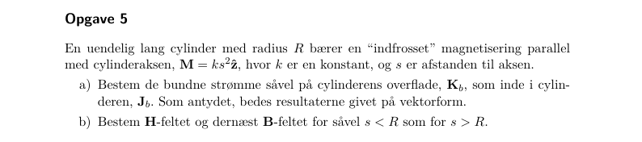{width=90%}

[Til indholdsfortegnelsen](#indhold) · [Til opgaveindeks](#opgaveindeks)

## Toroide med lineær kerne og luftgab {#type-8-2}

### November 2024 – Opgave 6abc · H, B og magnetisk reluktans {#op-2024-11-6}

★★★ · **Kilde:** samlet opgave-PDF, side 32; del a, b, c.

#### Opgavebeskrivelse

En toroide med N vindinger, strøm I og middelradius R har lineær permeabilitet $\mu$. Et gab med bredde $d=\eta2\pi R$ indføres. Brug $R=0.23$ m, N=620, I=8.5 A, $\mu=3000\mu_0$, d=6.0 mm.

#### Genkendelse

**Denne type opgave genkendes ved:** Sluttet magnetisk vej med to materialer i serie.

**Metodevalg:** Ampère med H; kontinuitet af B.

#### Idé

Ampères H-integral tæller fri strøm NI. Normal B er kontinuert gennem gabet, når lækage/randeffekter ignoreres.

#### Løsning

**a)** Uden gab giver $H2\pi R=NI$, så $H=NI/(2\pi R)$ og $B=\mu NI/(2\pi R)$. Feltet følger toroidens omløbsretning bestemt af vindingernes strøm og højrehåndsreglen.

**b)** Da $\nabla\cdot B=0$ og tværsnittet er det samme, er $B_g=B_j=B$. Materialelovene giver $H_g=B/\mu_0$, $H_j=B/\mu$, og derfor $H_g/H_j=\mu/\mu_0$. Integrér rundt:
$$NI=H_j(2\pi R-d)+H_gd=B\left(\frac{2\pi R-d}{\mu}+\frac d{\mu_0}\right).$$
Med $B_0=\mu_0NI/(2\pi R)$ fås
$$B_g=\frac{B_0}{(1-\eta)\mu_0/\mu+\eta}.$$
**c)** $B_0=4.58$ mT, $\eta=0.006/(2\pi\cdot0.23)=0.00415$. Forstærkningen er $f=1/[(1-\eta)/3000+\eta]=223$. Dermed $B_g\simeq1.02$ T.

#### Slutresultat

$$
\boxed{\begin{gathered}H=\frac{NI}{2\pi R}\ \text{uden gab} \\ B_g=\frac{B_0}{(1-\eta)\mu_0/\mu+\eta} \\ B_0=4.58\,\mathrm{mT} \\ f=223\end{gathered}}
$$

#### Kontrol

Når gabet forsvinder, bliver f=$\mu/\mu_0$; når $\mu=\mu_0$, bliver f=1. Jernets faktiske permeabilitet er ikke konstant ved alle felter; opgaven bruger udtrykkeligt en lineær approksimation.

**Facitkontrol:** de efterspurgte slutresultater er sammenholdt med det leverede facit; ekstra retninger, mellemregninger og forudsætninger er forklaret ovenfor.

#### Metode at huske

**Toroide → $\oint Hdl=NI$ → fælles B → sum af magnetiske vejbidrag.**

#### Originalfigur og ordlyd

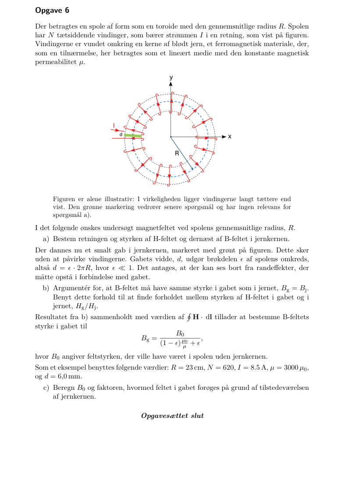{width=90%}

[Til indholdsfortegnelsen](#indhold) · [Til opgaveindeks](#opgaveindeks)
