Dette er en selvstændig opgavesamling, ikke en erstatning for formelsamlingen. Find først emne og geometri, slå en gammel opgave op, og følg udledningen.

**Kilder:** 11 eksamenssæt (juni 2021–januar 2026) og det vedhæftede facitark dateret 6. august 2026. [Originale opgaver](kilder/eksamen_alle.pdf) · [Originalt facit](kilder/eksamen_facits.pdf) · [Dækningskontrol og facitafvigelser](00-daekningskontrol.html).

**Notation:** $k_e=(4\pi\varepsilon_0)^{-1}$, $c^{-2}=\mu_0\varepsilon_0$. Cylindrisk radius er normalt $s$, sfærisk radius $r$. Plusomløb følger højrehåndsreglen omkring den valgte normal. Kildernes symboler bevares lokalt; $\rho_e$ bruges til resistivitet, når den ellers kunne forveksles med ladningstæthed. V/m = N/C; T = N/(A·m); Wb = V·s; H = Wb/A.

**Sværhedsgrad:** ★ grundlæggende · ★★ flere trin · ★★★ sammensat. Markeringen er en repetitionshjælp, ikke en officiel bedømmelse.

**Sammenhæng med formelsamlingen:** emnenavne og rækkefølge følger din specifikation. Formelsamlingen selv er ikke vedhæftet; dens præcise metodekoder og notation er derfor ikke verificeret. Der er ikke opfundet DYN-numre. Emner uden en opgave i de leverede sæt markeres eksplicit.

**Dokumenter:** [01-E_V](01-E_V.html) · [02-B_A](02-B_A.html) · [03-DYN](03-DYN.html)

# Indholdsfortegnelse {#indhold}

- [Strøm og modstand](#emne-1)
  - [Varierende ledningsevne σ(x)](#type-1-1)
    - [November 2024 – 4ab: Stationær strøm i inhomogent materiale](#op-2024-11-4)
  - [RC-afladning og magnetisk kraft](#type-1-2)
    - [Januar 2026 – 2cd: Afladningsstrøm og frastødning mellem parallelle stænger](#op-2026-01-2)
  - [Øvrige geometrier / dækning](#ovrige-1)
- [Simpel motional EMF](#emne-2)
  - [Bevægelig stang i homogent B](#type-2-1)
    - [Juni 2021 – 6abcd: Stang med konstant fart: strøm, kraft, effekt og arbejde](#op-2021-06-6)
- [Motional EMF + mekanisk feedback](#emne-3)
  - [Faldende ring i feltgradient](#type-3-1)
    - [November 2023 – 5abcd: Magnetisk bremsning og terminalfart](#op-2023-11-5)
  - [Batteridrevet stang med mod-EMF](#type-3-2)
    - [November 2025 – 5abcd: Acceleration, terminalfart og batteriets totalenergi](#op-2025-11-5)
- [Ændrende geometri / areal](#emne-4)
  - [Voksende ligesidet trekant](#type-4-1)
    - [Februar 2024 – 5abcd: Tidsvoksende EMF men konstant strøm](#op-2024-02-5)
- [Fast spole + B(t)](#emne-5)
  - [Sinusformet homogent felt](#type-5-1)
    - [Februar 2022 – 6a: Strøm i ring ved bestemt fase](#op-2022-02-6)
  - [Rumligt ikke-uniformt eksponentialfelt](#type-5-2)
    - [November 2022 – 6a: Flux gennem kvadratisk løkke](#op-2022-11-6)
  - [Eksponentielt felt med konstant offset](#type-5-3)
    - [Januar 2025 – 6abc: EMF, varmeenergi og ledningstværsnit](#op-2025-01-6)
  - [Cylinderkoordinater: vinkel- og radiusafhængigt felt](#type-5-4)
    - [Januar 2026 – 3abc: Flux og varme fra ikke-uniformt harmonisk B](#op-2026-01-3)
- [Induceret elektrisk felt](#emne-6)
  - [Kondensator: forskydningsstrøm og tilbagekobling](#type-6-1)
    - [November 2021 – 6abc: Harmonisk E giver B og induceret E-korrektion](#op-2021-11-6)
  - [Krydshenvisninger](#kryds-6)
  - [Øvrige geometrier / dækning](#ovrige-6)
- [Selvinduktion](#emne-7)
  - [Solenoide: selvinduktans, RL-opladning og energi](#type-7-1)
    - [November 2022 – 3abcd: CMS-solenoiden](#op-2022-11-3)
  - [Krydshenvisninger](#kryds-7)
- [Gensidig induktion](#emne-8)
  - [Lang leder og nærliggende rektangulær løkke](#type-8-1)
    - [Februar 2023 – 5abcd: Fluxkobling, induceret EMF og middelvarme](#op-2023-02-5)
  - [Små cirkelløkker på akse og i ækvatorialplan](#type-8-2)
    - [November 2024 – 5abc: Gensidig induktans fra magnetisk dipolfelt](#op-2024-11-5)
- [Magnetisk energi](#emne-9)
  - [Transmissionslinje af to parallelle strømflader](#type-9-1)
    - [November 2023 – 2ab: Feltenergi og selvinduktans mellem bånd](#op-2023-11-2)
  - [Krydshenvisninger](#kryds-9)
- [Forskydningsstrøm / Ampère-Maxwell](#emne-10)
  - [Cirkulære kondensatorplader](#type-10-1)
    - [Februar 2023 – 6a: B fra harmonisk elektrisk felt](#op-2023-02-6)
  - [Krydshenvisninger](#kryds-10)
- [Maxwell-opgaver](#emne-11)
  - [Givet elektrisk felt med ikke-nul curl](#type-11-1)
    - [November 2023 – 3ab: Rumlig ladning og nødvendig tidsvariation af B](#op-2023-11-3)
  - [Krydshenvisninger](#kryds-11)

# Opgaveindeks {#opgaveindeks}

| Opgave | Opgavetype | Metode | Nøgleord |
|---|---|---|---|
| [November 2024 – 4ab](#op-2024-11-4) | Varierende ledningsevne σ(x) | Kontinuitet; J=σE; potentialeintegral; Gauss | σ(x), J, E, R, rho, grænseladning |
| [Januar 2026 – 2cd](#op-2026-01-2) | RC-afladning og magnetisk kraft | Kirchhoff; separabel ODE; trådfelt | RC, eksponential, parallelle strømme |
| [Juni 2021 – 6abcd](#op-2021-06-6) | Bevægelig stang i homogent B | BLv; Ohm; Lenz; energibalance | stang, skinner, konstant v |
| [November 2023 – 5abcd](#op-2023-11-5) | Faldende ring i feltgradient | Faraday; Ohm; mekanisk effekt | ring, tyngdekraft, gradient, terminalhastighed |
| [November 2025 – 5abcd](#op-2025-11-5) | Batteridrevet stang med mod-EMF | Kredsligning; Newton; separabel ODE; energiintegral | batteri, mod-EMF, eksponential, feedback |
| [Februar 2024 – 5abcd](#op-2024-02-5) | Voksende ligesidet trekant | Geometri; Faraday; tidsafhængig modstand; kraft | trekant, voksende areal, modstand pr. længde |
| [Februar 2022 – 6a](#op-2022-02-6) | Sinusformet homogent felt | Flux; Faraday; Ohm | sinus, fase, strømretning |
| [November 2022 – 6a](#op-2022-11-6) | Rumligt ikke-uniformt eksponentialfelt | Arealintegral; Faraday | kvadrat, x²+y², eksponential |
| [Januar 2025 – 6abc](#op-2025-01-6) | Eksponentielt felt med konstant offset | Fluxkobling; Faraday; Jouleintegral; resistivitet | spole, N vindinger, offset, aluminium |
| [Januar 2026 – 3abc](#op-2026-01-3) | Cylinderkoordinater: vinkel- og radiusafhængigt felt | Polært arealintegral; Faraday; periodeintegral | sin²φ, s ds dφ, varme |
| [November 2021 – 6abc](#op-2021-11-6) | Kondensator: forskydningsstrøm og tilbagekobling | Ampère-Maxwell; Faraday; randbetingelse | kvasistatisk, cirkelplader, E1 |
| [November 2022 – 3abcd](#op-2022-11-3) | Solenoide: selvinduktans, RL-opladning og energi | Ampère; fluxkobling; RL-ligning; Joulevarme | solenoide, GJ, tidskonstant |
| [Februar 2023 – 5abcd](#op-2023-02-5) | Lang leder og nærliggende rektangulær løkke | Trådfelt; fluxintegral; Faraday; sinusmiddel | gensidig induktion, AC, middelværdi |
| [November 2024 – 5abc](#op-2024-11-5) | Små cirkelløkker på akse og i ækvatorialplan | Dipolmoment; dipolfelt; flux; Faraday | små løkker, fortegn, MAB, MAC |
| [November 2023 – 2ab](#op-2023-11-2) | Transmissionslinje af to parallelle strømflader | Strømflade; superposition; B²-energi | parallelle bånd, induktans, feltenergi |
| [Februar 2023 – 6a](#op-2023-02-6) | Cirkulære kondensatorplader | Forskydningsstrøm; Ampère-Maxwell | kondensator, s≤R, E(t) |
| [November 2023 – 3ab](#op-2023-11-3) | Givet elektrisk felt med ikke-nul curl | Divergens; Faraday | Maxwell, ladning, ikke-elektrostatisk |

# Strøm og modstand {#emne-1}

## Varierende ledningsevne σ(x) {#type-1-1}

### November 2024 – Opgave 4ab · Stationær strøm i inhomogent materiale {#op-2024-11-4}

★★★ · **Kilde:** samlet opgave-PDF, side 31; del a, b.

#### Opgavebeskrivelse

Et materiale med længde d og areal A ligger mellem perfekte ledere ved $V(0)=V_0,V(d)=0$. Konduktiviteten er $\sigma(x)=1/(bx)$, b>0, og permittiviteten er ε₀. Find J,R,E, grænseladninger og volumenladning.

#### Genkendelse

**Denne type opgave genkendes ved:** Konstant tværsnit og stationær strøm trods stedafhængig ledningsevne.

**Metodevalg:** Kontinuitet; J=σE; potentialeintegral; Gauss.

#### Idé

Stationær ladningsbevarelse kræver konstant J. E varierer, fordi σ varierer.

#### Løsning

**a)** $\nabla\cdot J=0$ giver $dJ_x/dx=0$. Lokal Ohms lov giver $E=J/\sigma=Jbx$. Spændingen er
$$V_0=V(0)-V(d)=\int_0^dE(x)dx=Jb\frac{d^2}{2}.$$
Altså $J=2V_0/(bd^2)$ og $I=JA$, så $R=V_0/I=bd^2/(2A)$.

**b)**
$$\mathbf E(x)=\frac{2V_0x}{d^2}\hat x.$$
Ved venstre metalflade er normalen ind i materialet $+\hat x$, men $E(0)=0$, så $\sigma_1=0$. Ved højre metalflade er normal fra metal til materiale $-\hat x$, så
$$\sigma_2=\varepsilon_0\mathbf E(d)\cdot(-\hat x)=-\frac{2\varepsilon_0V_0}{d}.$$
I volumen er
$$\rho=\varepsilon_0\nabla\cdot E=\frac{2\varepsilon_0V_0}{d^2}.$$
Potentialeprofilen er $V(x)=V_0[1-(x/d)^2]$.

#### Slutresultat

$$
\boxed{\begin{gathered}J=\frac{2V_0}{bd^2} \\ R=\frac{bd^2}{2A} \\ E=\frac{2V_0x}{d^2} \\ \sigma_1=0 \\ \sigma_2=-\frac{2\varepsilon_0V_0}d \\ \rho=\frac{2\varepsilon_0V_0}{d^2}\end{gathered}}
$$

#### Kontrol

Volumenladningen $\rho Ad$ ophæves af den højre grænseladning $\sigma_2A$ i denne endeflademodel. σ divergerer ved x=0, men E→0, og J har en endelig grænse. Dette er en stationær ledningsmodel, ikke en elektrostatisk leder med E=0 overalt.

**Facitkontrol:** de efterspurgte slutresultater er sammenholdt med det leverede facit; ekstra retninger, mellemregninger og forudsætninger er forklaret ovenfor.

#### Metode at huske

**Variabel $\sigma$ → konstant $J$ → $E=J/\sigma$ → spændingsintegral → $R$ og ladning.**

#### Originalfigur og ordlyd

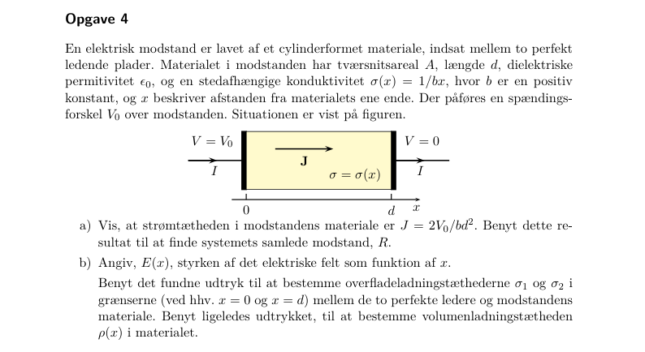{width=90%}

[Til indholdsfortegnelsen](#indhold) · [Til opgaveindeks](#opgaveindeks)

## RC-afladning og magnetisk kraft {#type-1-2}

### Januar 2026 – Opgave 2cd · Afladningsstrøm og frastødning mellem parallelle stænger {#op-2026-01-2}

★★ · **Kilde:** samlet opgave-PDF, side 42; del c, d.

#### Opgavebeskrivelse

Kun del c–d: C=0.091 F oplades til Q₀=5.7 C og aflades gennem R=0.25 Ω. To parallelle stænger med længde l=0.83 m og afstand d=0.052 m indgår i samme seriekrans. Find I(t), I₀, 1%-tid og stangkraft. Se E/V for a–b.

#### Genkendelse

**Denne type opgave genkendes ved:** Afladende kondensator uden selvinduktans; strømmen går ud og hjem ad parallelle stænger.

**Metodevalg:** Kirchhoff; separabel ODE; trådfelt.

#### Idé

Kirchhoffs spændingslov giver en førsteordens ODE. Kraften er proportional med strømmen i anden potens.

#### Løsning

**c)** Vælg I positiv som afladningsstrøm, så $I=-\dot Q$. Kirchhoff giver $Q/C-RI=0$, dvs.
$$\dot Q=-Q/(RC).$$
Integrér $dQ/Q=-dt/(RC)$ med Q(0)=Q₀: $Q=Q_0e^{-t/(RC)}$. Derfor
$$I(t)=\frac{Q_0}{RC}e^{-t/(RC)},\quad \tau=RC=0.02275\,\mathrm s,\quad I_0=250\,\mathrm A.$$
Sæt $I(T)/I_0=0.01$, så $T=RC\ln100=0.1048$ s=105 ms.

**d)** Strømmen løber i modsatte retninger gennem stængerne, som derfor frastøder hinanden. Feltet fra den ene ved den anden er $B=\mu_0I/(2\pi d)$, så
$$F(t)=IlB=\frac{\mu_0l}{2\pi d}\left(\frac{Q_0}{RC}\right)^2e^{-2t/(RC)}.$$
Ved start er kraftstørrelsen cirka 0.200 N. Stængernes position fastholdes, og endefelter ignoreres som i opgaven.

#### Slutresultat

$$
\boxed{\begin{gathered}I(t)=\frac{Q_0}{RC}e^{-t/(RC)} \\ I_0=250\,\mathrm A \\ T_{1\%}=105\,\mathrm{ms} \\ F(t)=\frac{\mu_0l}{2\pi d}\left(\frac{Q_0}{RC}\right)^2e^{-2t/(RC)}\end{gathered}}
$$

#### Kontrol

Kraften falder med dobbelt eksponent i forhold til strømmen. Hele den oprindelige kondensatorenergi bliver varme i modellen uden mekanisk arbejde og uden induktans.

**Facitkontrol:** de efterspurgte slutresultater er sammenholdt med det leverede facit; ekstra retninger, mellemregninger og forudsætninger er forklaret ovenfor.

#### Metode at huske

**RC-afladning → Q(t) → I(t) → modsat strøm i parallelstænger → F∝I².**

**Samme opgave, øvrige dele:** [åbn 01-E_V](01-E_V.html#op-2026-01-2).

#### Originalfigur og ordlyd

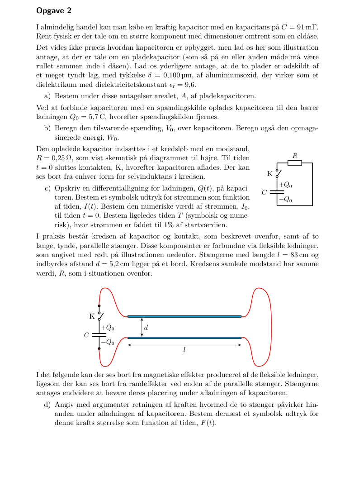{width=90%}

[Til indholdsfortegnelsen](#indhold) · [Til opgaveindeks](#opgaveindeks)

## Øvrige geometrier / dækning {#ovrige-1}

**Uniform ledningsevne.** Januar 2025–6c bruger uniform resistivitet; de selvstændige ledningsopgaver handler om varierende ledningsevne eller RC.

# Simpel motional EMF {#emne-2}

## Bevægelig stang i homogent B {#type-2-1}

### Juni 2021 – Opgave 6abcd · Stang med konstant fart: strøm, kraft, effekt og arbejde {#op-2021-06-6}

★★ · **Kilde:** samlet opgave-PDF, side 4; del a, b, c, d.

#### Opgavebeskrivelse

Skinneafstand $L=0.20$ m, $R=0.30\,\Omega$, $B=1.2$ T ud af papiret. Stangen trækkes mod højre, væk fra modstanden, med $v=3.4$ m/s over $d=1.2$ m. Find I, ekstern F, P og varmeenergi.

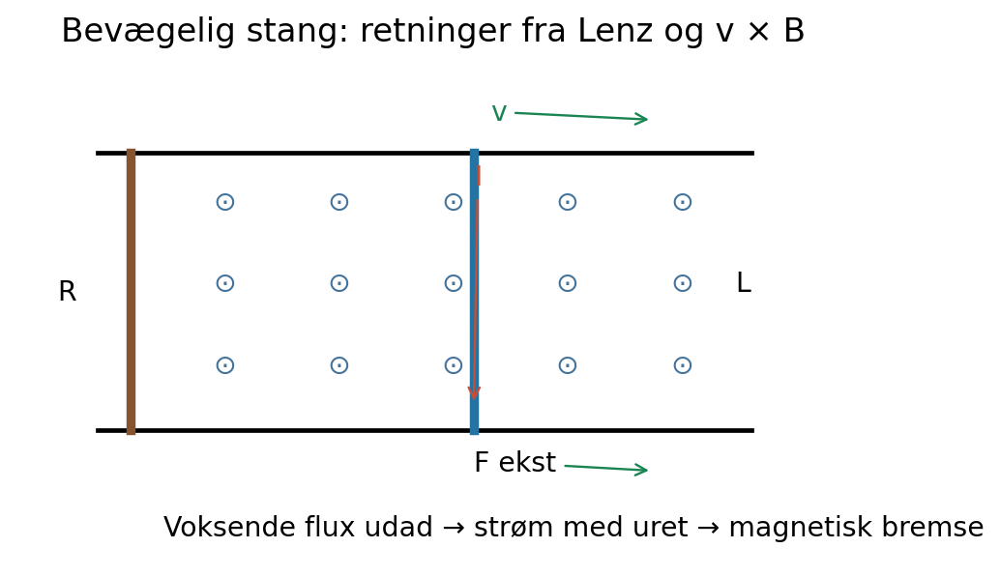{width=85%}

#### Genkendelse

**Denne type opgave genkendes ved:** Bevægelig stang, konstant fart og homogent magnetfelt.

**Metodevalg:** BLv; Ohm; Lenz; energibalance.

#### Idé

Vælg +z ud af papiret og positiv omløbsretning mod uret. Det voksende areal giver voksende positiv flux, så strømmen skal være negativ i denne konvention.

#### Løsning

**a)** $A=Lx$, $\Phi=BLx$, så
$$\mathcal E=-\frac{d\Phi}{dt}=-BLv,\quad I_{\mathrm{fortegnet}}=-\frac{BLv}{R}.$$
Strømmen går **med uret**, ned gennem stangen og op gennem modstanden. Det stemmer også med $\mathbf v\times\mathbf B=\hat x\times\hat z=-\hat y$. Størrelsen er $I=1.2\cdot0.20\cdot3.4/0.30=2.72$ A.

**b)** Magnetkraften bremser stangen mod venstre: $F_{\mathrm{mag}}=ILB$. Den nødvendige eksterne kraft er mod højre med
$$F_{\mathrm{ekst}}=\frac{B^2L^2v}{R}=0.653\,\mathrm N.$$
**c)** $P=Fv=B^2L^2v^2/R=2.22$ W, identisk med $I^2R$.

**d)** Rejsetiden er $t=d/v$, og derfor
$$W=P\frac dv=\frac{B^2L^2vd}{R}=0.783\,\mathrm J.$$

#### Slutresultat

$$
\boxed{\begin{gathered}|I|=2.72\,\mathrm A\ \text{med uret} \\ F_{\mathrm{ekst}}=0.653\,\mathrm N \\ P=2.22\,\mathrm W \\ W=0.783\,\mathrm J\end{gathered}}
$$

#### Kontrol

Lenz kræver modstand mod voksende udadrettet flux. Facitarkets »mod uret« er modsat originalfigurens og tekstens feltretning; størrelserne i facit stemmer. $P_{\mathrm{mekanisk}}=P_{\mathrm{varme}}$.

> **Facitafvigelse:** facit skriver »mod uret«. Originalens felt er ud af papiret og arealet vokser. Faraday og v × B giver med uret; de numeriske størrelser stemmer.

#### Metode at huske

**Bevægelig stang → $\mathcal E=BLv$ → $I$ → $F$ → $P$ → $W$.**

#### Originalfigur og ordlyd

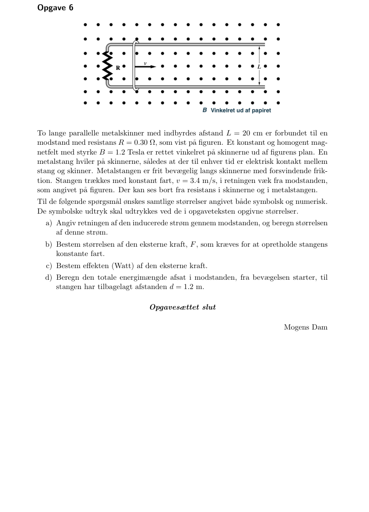{width=90%}

[Til indholdsfortegnelsen](#indhold) · [Til opgaveindeks](#opgaveindeks)

# Motional EMF + mekanisk feedback {#emne-3}

## Faldende ring i feltgradient {#type-3-1}

### November 2023 – Opgave 5abcd · Magnetisk bremsning og terminalfart {#op-2023-11-5}

★★ · **Kilde:** samlet opgave-PDF, side 24; del a, b, c, d.

#### Opgavebeskrivelse

En vandret ring med masse m, areal A og modstand R falder med fart v. $B_z=B_0(1-\kappa z)$, +z opad, $B_0,\kappa>0$. Find EMF, varmeeffekt, terminalfart og virkningen af κ<0.

#### Genkendelse

**Denne type opgave genkendes ved:** Bevægelse gennem et rumligt varierende felt ændrer fluxen.

**Metodevalg:** Faraday; Ohm; mekanisk effekt.

#### Idé

Brug dz/dt=-v. Ved terminalfart omsættes hele tyngdekraftens effekt mgv til varme.

#### Løsning

**a)** $\Phi=AB_0(1-\kappa z)$, så $\dot\Phi=-AB_0\kappa\dot z=AB_0\kappa v$ og $\mathcal E=-AB_0\kappa v$ for +z-normal. Størrelsen er $AB_0\kappa v$; strømmen går med uret set ovenfra.

**b)** $|I|=AB_0\kappa v/R$, og
$$P=I^2R=\frac{(AB_0\kappa)^2v^2}{R}.$$
**c)** Ved terminalfart gælder $mgv_\infty=P(v_\infty)$. For den positive, ikke-trivielle fart:
$$v_\infty=\frac{mgR}{(AB_0\kappa)^2}.$$
Det svarer til en bremsekraft $F_b=(AB_0\kappa)^2v/R$ opad og bevægelsesligning $m\dot v=mg-F_b$.

**d)** Ved $\kappa<0$ skifter EMF og strøm fortegn. P og bremsekraften afhænger af κ² og ændres ikke ved samme |κ|. Terminalfarten er derfor den samme; ved κ=0 er der ingen induktiv bremsevirkning i denne model.

#### Slutresultat

$$
\boxed{|\mathcal E|=A B_0|\kappa|v,\quad P=\frac{(AB_0\kappa v)^2}{R},\quad v_\infty=\frac{mgR}{(AB_0\kappa)^2}}
$$

#### Kontrol

Bremsning kræver en fysisk divergensfri fuld B-geometri; det angivne Bz er fluxkomponenten, ikke nødvendigvis hele feltet. Kraftresultatet udledes robust via energi og gælder uden selvinduktans/randeffektkorrektioner.

**Facitkontrol:** de efterspurgte slutresultater er sammenholdt med det leverede facit; ekstra retninger, mellemregninger og forudsætninger er forklaret ovenfor.

#### Metode at huske

**Bevægelse i gradient → fluxændring → strøm → varme → $mgv=P$.**

#### Originalfigur og ordlyd

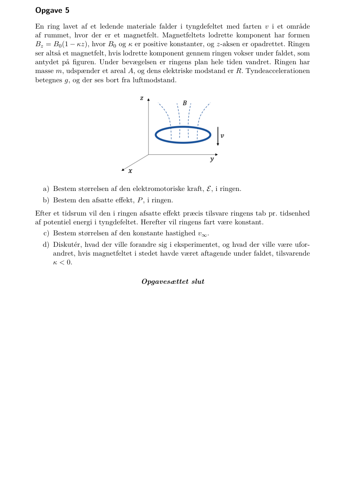{width=90%}

[Til indholdsfortegnelsen](#indhold) · [Til opgaveindeks](#opgaveindeks)

## Batteridrevet stang med mod-EMF {#type-3-2}

### November 2025 – Opgave 5abcd · Acceleration, terminalfart og batteriets totalenergi {#op-2025-11-5}

★★★ · **Kilde:** samlet opgave-PDF, side 40; del a, b, c, d.

#### Opgavebeskrivelse

Skinner med afstand d, batterispænding V og modstand R; en stang med masse m er først i hvile. B peger ud af papiret. Batteriets +pol forbindes via øverste skinne; stangen accelererer mod venstre. Find a₀,v∞,v(t) og batteriets samlede afgivne energi.

#### Genkendelse

**Denne type opgave genkendes ved:** En elektrisk kraft sætter stangen i bevægelse; bevægelsen skaber en mod-EMF.

**Metodevalg:** Kredsligning; Newton; separabel ODE; energiintegral.

#### Idé

Vælg positiv fart mod venstre. Batteriets EMF er V, mens den bevægelsesinducerede EMF Bdv modvirker strømmen.

#### Løsning

**a)** Strømmen løber fra batteriets +pol gennem øverste skinne og ned gennem stangen. Dermed er $\mathbf F=I(-d\hat y)\times B\hat z=-IBd\hat x$, mod venstre. Ved start er $v=0$, $I_0=V/R$, så $a_0=BVd/(mR)$.

**b)** Når v vokser, er $I=(V-Bdv)/R$. Kraften aftager og går mod nul ved $v_\infty=V/(Bd)$. Konstant acceleration kan derfor ikke fortsætte.

**c)** Newton giver
$$m\dot v=\frac{Bd}{R}(V-Bdv)=\frac{B^2d^2}{R}(v_\infty-v).$$
Sæt $\tau=mR/(B^2d^2)$. Så $dv/(v_\infty-v)=dt/\tau$; integration med v(0)=0 giver
$$-\ln\frac{v_\infty-v}{v_\infty}=t/\tau,\qquad v=v_\infty(1-e^{-t/\tau}).$$
**d)** Strømmen er $I(t)=(V/R)e^{-t/\tau}$. Batteriets effekt er VI, og den asymptotiske fart nås kun som t→∞:
$$U_{\mathrm{bat}}=\int_0^\infty VI\,dt=\frac{V^2}{R}\int_0^\infty e^{-t/\tau}dt
=\frac{V^2\tau}{R}=\frac{mV^2}{B^2d^2}.$$

#### Slutresultat

$$
\boxed{\begin{gathered}a_0=\frac{BVd}{mR} \\ v_\infty=\frac V{Bd} \\ \tau=\frac{mR}{B^2d^2} \\ v(t)=\frac V{Bd}(1-e^{-t/\tau}) \\ U_{\mathrm{bat}}=\frac{mV^2}{B^2d^2}\end{gathered}}
$$

#### Kontrol

Slutkinetikken er $mv_\infty^2/2$. Joulevarmen er $\int I^2Rdt=V^2\tau/(2R)$, samme beløb; deres sum er batteriets energi. Positiv v betyder venstre, så $\mathbf v=-v\hat x$.

**Facitkontrol:** de efterspurgte slutresultater er sammenholdt med det leverede facit; ekstra retninger, mellemregninger og forudsætninger er forklaret ovenfor.

#### Metode at huske

**Batteri minus mod-EMF → I(v) → Newton → v(t) → integrér VI.**

#### Originalfigur og ordlyd

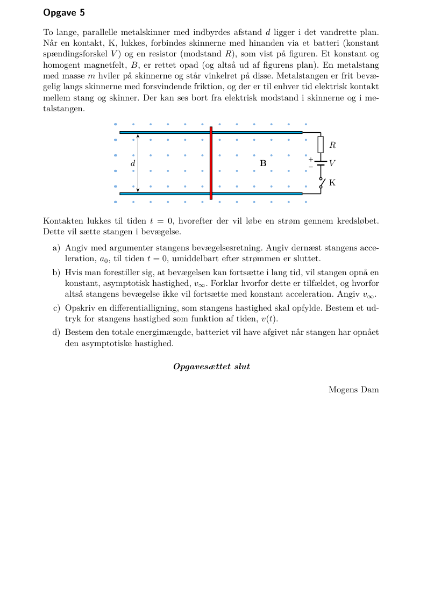{width=90%}

[Til indholdsfortegnelsen](#indhold) · [Til opgaveindeks](#opgaveindeks)

# Ændrende geometri / areal {#emne-4}

## Voksende ligesidet trekant {#type-4-1}

### Februar 2024 – Opgave 5abcd · Tidsvoksende EMF men konstant strøm {#op-2024-02-5}

★★★ · **Kilde:** samlet opgave-PDF, side 27; del a, b, c, d.

#### Opgavebeskrivelse

To ledningsgrene danner 60°. En tværstang flyttes med konstant v vinkelret på sig selv, så kredsen er en ligesidet trekant. Felt B peger ind i papiret. Modstand pr. længde er r. Ved t=0 er stangen i hjørnet. Find l, EMF, R,I,F og varme fra 0 til T.

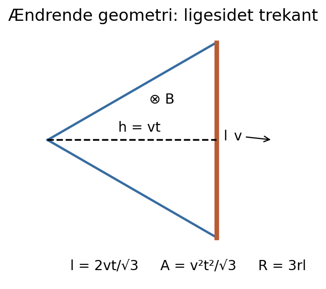{width=85%}

#### Genkendelse

**Denne type opgave genkendes ved:** B er konstant, men både areal og ledningslængde ændres.

**Metodevalg:** Geometri; Faraday; tidsafhængig modstand; kraft.

#### Idé

Find højden vt og derfra sidelængde og areal. Modstanden følger hele trekantens omkreds.

#### Løsning

**a)** Højden i en ligesidet trekant er $\sqrt3l/2$, så $l=2vt/\sqrt3$. Arealet er
$$A=\frac{\sqrt3}{4}l^2=\frac{v^2t^2}{\sqrt3}.$$
Vælg normal ud af papiret, så $\Phi=-BA$. Derfor $\mathcal E=-\dot\Phi=2Bv^2t/\sqrt3$.

**b)** $R(t)=3rl=2\sqrt3rvt$. Dermed
$$I(t)=\mathcal E/R=\frac{2Bv^2t/\sqrt3}{2\sqrt3rvt}=\frac{Bv}{3r},\quad t>0.$$
Strømmen går mod uret, som er figurens positive omløbsretning: den modvirker voksende indadrettet flux.

**c)** Stangens længde er l og dens magnetkraft er $F=IBl$, modsat v. Den eksterne kraft har størrelse
$$F_{\mathrm{ekst}}=\frac{Bv}{3r}B\frac{2vt}{\sqrt3}=\frac{2B^2v^2}{3\sqrt3r}t.$$
**d)**
$$W=\int_0^TI^2R(t)dt=\int_0^T\frac{B^2v^2}{9r^2}2\sqrt3rvt\,dt
=\frac{B^2v^3T^2}{3\sqrt3r}.$$

#### Slutresultat

$$
\boxed{l=\frac{2vt}{\sqrt3},\quad I=\frac{Bv}{3r},\quad F=\frac{2B^2v^2t}{3\sqrt3r},\quad W=\frac{B^2v^3T^2}{3\sqrt3r}}
$$

#### Kontrol

$Fv=I^2R$. Ved t=0 er både R og EMF nul; den konstante strøm er t→0⁺-grænsen i en idealiseret model uden selvinduktans, ikke en veldefineret strøm i et kredsløb af nul størrelse.

**Facitkontrol:** de efterspurgte slutresultater er sammenholdt med det leverede facit; ekstra retninger, mellemregninger og forudsætninger er forklaret ovenfor.

#### Metode at huske

**Geometri → $A(t)$ → flux → EMF → $R(t)$ → $I$ → $F,P,W$.**

#### Originalfigur og ordlyd

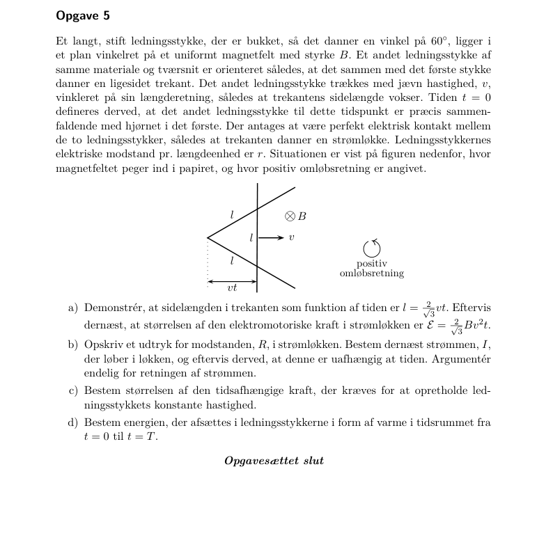{width=90%}

[Til indholdsfortegnelsen](#indhold) · [Til opgaveindeks](#opgaveindeks)

# Fast spole + B(t) {#emne-5}

## Sinusformet homogent felt {#type-5-1}

### Februar 2022 – Opgave 6a · Strøm i ring ved bestemt fase {#op-2022-02-6}

★ · **Kilde:** samlet opgave-PDF, side 11; del a.

#### Opgavebeskrivelse

En cirkulær ring med radius a og modstand R ligger vinkelret på $\mathbf B=B_0\sin\omega t\hat z$. Find strømmen ved $T=\pi/(3\omega)$.

#### Genkendelse

**Denne type opgave genkendes ved:** Fast areal og et tidsvarierende homogent B-felt.

**Metodevalg:** Flux; Faraday; Ohm.

#### Idé

Vælg normal +z og positiv strøm mod uret. Differentiér fluxen før tidspunktet indsættes.

#### Løsning

**a)** Fluxen er $\Phi(t)=\pi a^2B_0\sin\omega t$. Faraday giver
$$\mathcal E=-\frac{d\Phi}{dt}=-\pi a^2B_0\omega\cos\omega t,$$
og uden mærkbar selvinduktans er $I(t)=\mathcal E/R$. Ved $T=\pi/(3\omega)$ er $\omega T=\pi/3$ og $\cos(\pi/3)=1/2$, derfor
$$I(T)=-\frac{\pi a^2B_0\omega}{2R}.$$
Minusfortegnet betyder negativ omløbsretning set fra +z, altså med uret. Feltet i +z vokser i dette øjeblik, og strømmen frembringer et modfelt i -z.

#### Slutresultat

$$
\boxed{I(T)=-\frac{\pi a^2B_0\omega}{2R}\quad\text{med uret set fra }+z}
$$

#### Kontrol

Strømmen afhænger af $dB/dt$, ikke af værdien af B alene. $B_0\omega a^2/R$ har enhed A.

**Facitkontrol:** de efterspurgte slutresultater er sammenholdt med det leverede facit; ekstra retninger, mellemregninger og forudsætninger er forklaret ovenfor.

#### Metode at huske

**Fast ring → flux → differentiér → indsæt fase → Ohm og Lenz.**

#### Originalfigur og ordlyd

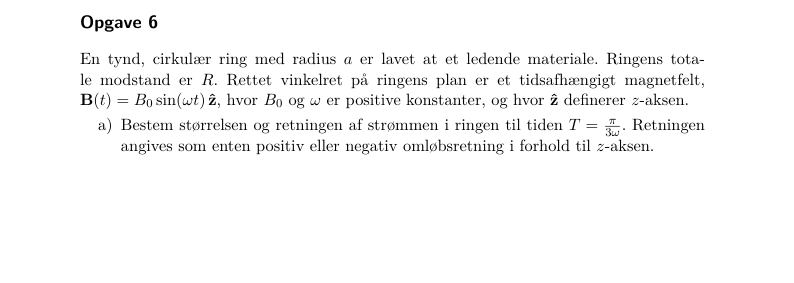{width=90%}

[Til indholdsfortegnelsen](#indhold) · [Til opgaveindeks](#opgaveindeks)

## Rumligt ikke-uniformt eksponentialfelt {#type-5-2}

### November 2022 – Opgave 6a · Flux gennem kvadratisk løkke {#op-2022-11-6}

★★ · **Kilde:** samlet opgave-PDF, side 16; del a.

#### Opgavebeskrivelse

En kvadratisk løkke fylder $0<x,y<L$ og har modstand R. Feltet er $\mathbf B=B_0(x^2+y^2)e^{-t/\tau}\hat z/L^2$. Find den inducerede strøm.

#### Genkendelse

**Denne type opgave genkendes ved:** Fast flade med både rumlig og tidslig feltvariation.

**Metodevalg:** Arealintegral; Faraday.

#### Idé

Integrér B over hele fladen; feltet kan ikke erstattes af værdien i ét tilfældigt punkt.

#### Løsning

**a)** Vælg +z-normal. Fluxen bliver
$$\Phi=\frac{B_0e^{-t/\tau}}{L^2}\int_0^L\int_0^L(x^2+y^2)dxdy.$$
Første led integrerer til $(L^3/3)L=L^4/3$; det andet giver det samme. Altså
$$\Phi=\frac23B_0L^2e^{-t/\tau}.$$
Faraday og Ohm giver
$$\mathcal E=-\dot\Phi=\frac{2B_0L^2}{3\tau}e^{-t/\tau},\qquad I=\frac{2B_0L^2}{3\tau R}e^{-t/\tau}.$$
Strømmen er positiv, mod uret set fra +z. Den faldende positive flux erstattes delvist af løkkens eget positive felt.

#### Slutresultat

$$
\boxed{I(t)=\frac{2B_0L^2}{3\tau R}e^{-t/\tau}\quad\text{mod uret set fra }+z}
$$

#### Kontrol

$I\to0$ for $t\to\infty$ og for meget langsom feltændring $\tau\to\infty$. Selvinduktans er udeladt som i opgaven.

**Facitkontrol:** de efterspurgte slutresultater er sammenholdt med det leverede facit; ekstra retninger, mellemregninger og forudsætninger er forklaret ovenfor.

#### Metode at huske

**Rumligt felt → arealintegral først → tidsafledt → Ohm → Lenz.**

#### Originalfigur og ordlyd

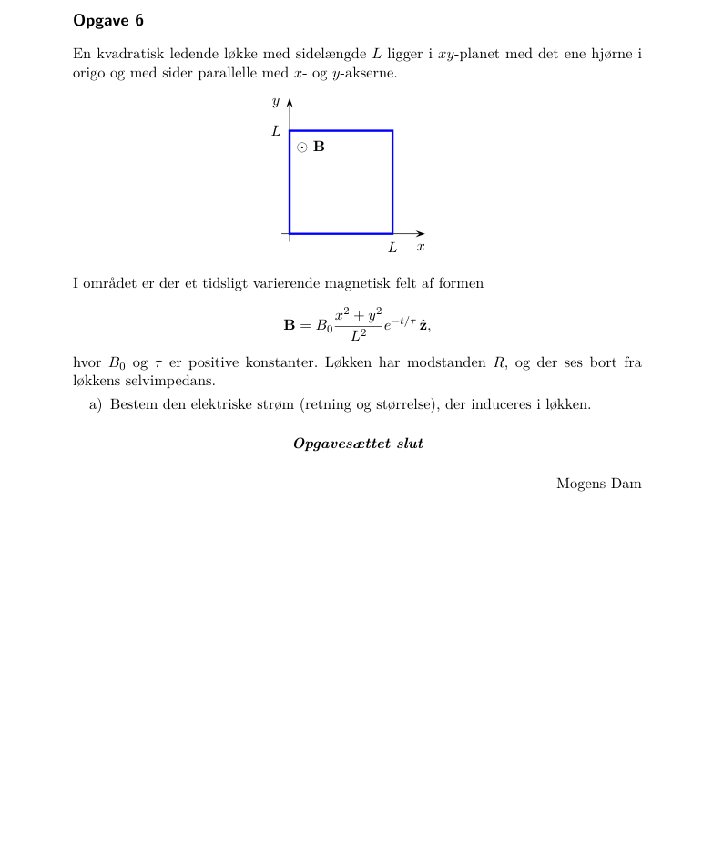{width=90%}

[Til indholdsfortegnelsen](#indhold) · [Til opgaveindeks](#opgaveindeks)

## Eksponentielt felt med konstant offset {#type-5-3}

### Januar 2025 – Opgave 6abc · EMF, varmeenergi og ledningstværsnit {#op-2025-01-6}

★★ · **Kilde:** samlet opgave-PDF, side 36; del a, b, c.

#### Opgavebeskrivelse

Spole med N=12, radius r=0.20 m, R=1.2 Ω og $B_z(t)=a(1-e^{-t/\tau})+b$, a=5.0 T, b=-2.0 T, τ=60 s. Find EMF, varme til T=55 s og lederareal med $\rho_e=2.8\cdot10^{-8}\,\Omega$m.

#### Genkendelse

**Denne type opgave genkendes ved:** Fast spole med N vindinger; feltet har et konstant offset og en tidsvarierende del.

**Metodevalg:** Fluxkobling; Faraday; Jouleintegral; resistivitet.

#### Idé

Fluxkoblingen er N gange enkeltvindingens flux. Offsettet forsvinder ved differentiation.

#### Løsning

**a)** $\Lambda=N\pi r^2B_z(t)$, derfor
$$\mathcal E=-\dot\Lambda=-\frac{N\pi r^2a}{\tau}e^{-t/\tau}=-\mathcal E_*e^{-t/\tau}.$$
Den er negativ, med uret set fra +z, fordi Bz vokser for alle t≥0, også mens det stadig er negativt. $\mathcal E_*=0.1257$ V.

**b)**
$$W=\int_0^T\frac{\mathcal E^2}{R}dt=\frac{\mathcal E_*^2}{R}\int_0^Te^{-2t/\tau}dt
=\frac{\mathcal E_*^2\tau}{2R}(1-e^{-2T/\tau})$$
$$=\frac{(N\pi r^2a)^2}{2\tau R}(1-e^{-2T/\tau})=0.332\,\mathrm J.$$
**c)** Ledningslængden er $l_w\simeq2\pi rN$. Fra $R=\rho_el_w/A_w$ fås
$$A_w=\frac{\rho_e2\pi rN}{R}=3.52\cdot10^{-7}\,\mathrm{m^2}=0.352\,\mathrm{mm^2}.$$

#### Slutresultat

$$
\boxed{\begin{gathered}\mathcal E=-0.1257e^{-t/(60\,\mathrm s)}\,\mathrm V \\ W(55\,\mathrm s)=0.332\,\mathrm J \\ A_w=0.352\,\mathrm{mm^2}\end{gathered}}
$$

#### Kontrol

Offsettet b påvirker hverken EMF eller varmen. Ved T=0 er W=0; ved T→∞ bliver varmen endelig. Ekstra tilslutningsledning og selvinduktans negligeres i facitmodellen.

**Facitkontrol:** de efterspurgte slutresultater er sammenholdt med det leverede facit; ekstra retninger, mellemregninger og forudsætninger er forklaret ovenfor.

#### Metode at huske

**Fast spole → $N\Phi$ → differentiér → integrér $\mathcal E^2/R$ → brug $R=\rho l/A$.**

#### Originalfigur og ordlyd

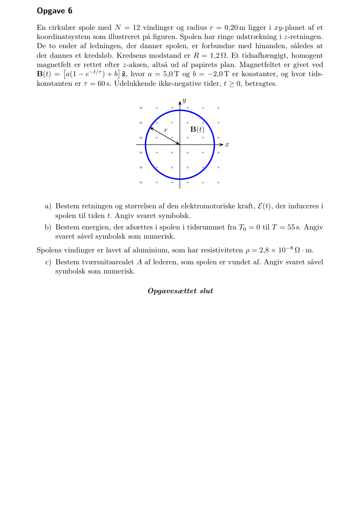{width=90%}

[Til indholdsfortegnelsen](#indhold) · [Til opgaveindeks](#opgaveindeks)

## Cylinderkoordinater: vinkel- og radiusafhængigt felt {#type-5-4}

### Januar 2026 – Opgave 3abc · Flux og varme fra ikke-uniformt harmonisk B {#op-2026-01-3}

★★ · **Kilde:** samlet opgave-PDF, side 43; del a, b, c.

#### Opgavebeskrivelse

En cirkulær løkke med radius S og modstand R har $\mathbf B=ks\sin^2\phi\cos(t/T)\hat z$. k,T>0; selvinduktans negligeres. Find initial flux, I(t), retning ved 5T og varme over 0≤t≤2πT.

#### Genkendelse

**Denne type opgave genkendes ved:** Et ikke-uniformt felt gennem en cirkelflade; både s og φ skal integreres.

**Metodevalg:** Polært arealintegral; Faraday; periodeintegral.

#### Idé

Brug arealelementet s ds dφ og adskil rumlig og tidslig afhængighed.

#### Løsning

**a)**
$$\Phi(t)=k\cos(t/T)\int_0^Ss^2ds\int_0^{2\pi}\sin^2\phi\,d\phi
=\frac{k\pi S^3}{3}\cos(t/T).$$
Så $\Phi_0=k\pi S^3/3$.

**b)** Med +z-normal og positiv strøm mod uret er
$$\mathcal E=\frac{k\pi S^3}{3T}\sin(t/T),\qquad I(t)=\frac{k\pi S^3}{3RT}\sin(t/T).$$
Ved t=5T er $\sin5<0$, så strømmen er negativ: **med uret** set fra +z. Det er den lokale ændring af fluxen, ikke alene fortegnet af cos 5, der afgør retningen.

**c)**
$$W=\int_0^{2\pi T}I^2Rdt=\frac{k^2\pi^2S^6}{9RT^2}\int_0^{2\pi T}\sin^2(t/T)dt.$$
Sæt u=t/T, dt=Tdu, og brug $\int_0^{2\pi}\sin^2u\,du=\pi$. Dermed $W=\pi^3k^2S^6/(9RT)$.

#### Slutresultat

$$
\boxed{\Phi_0=\frac{k\pi S^3}3,\quad I(t)=\frac{k\pi S^3}{3RT}\sin(t/T),\quad W=\frac{\pi^3k^2S^6}{9RT}}
$$

#### Kontrol

Rumdifferentialet s ds dφ giver S³, ikke S². T er en tidsskala; perioden er 2πT. Varmeenergien er positiv uanset fortegnet af strømmen.

**Facitkontrol:** de efterspurgte slutresultater er sammenholdt med det leverede facit; ekstra retninger, mellemregninger og forudsætninger er forklaret ovenfor.

#### Metode at huske

**Ikke-uniformt B → polært fluxintegral → Faraday → Ohm → integrér I²R.**

#### Originalfigur og ordlyd

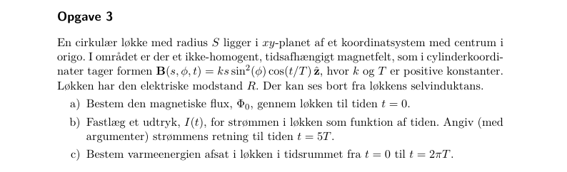{width=90%}

[Til indholdsfortegnelsen](#indhold) · [Til opgaveindeks](#opgaveindeks)

# Induceret elektrisk felt {#emne-6}

## Kondensator: forskydningsstrøm og tilbagekobling {#type-6-1}

### November 2021 – Opgave 6abc · Harmonisk E giver B og induceret E-korrektion {#op-2021-11-6}

★★★ · **Kilde:** samlet opgave-PDF, side 8; del a, b, c.

#### Opgavebeskrivelse

Cirkulære kondensatorplader med radius a og afstand d har $V_A-V_B=V_0\cos\omega t$. Nederste plade er A, +z opad. Find E₀, Jd, B₁ og $E_1=\chi(s)E_0$, samt frekvens for 1% korrektion ved a=1 cm.

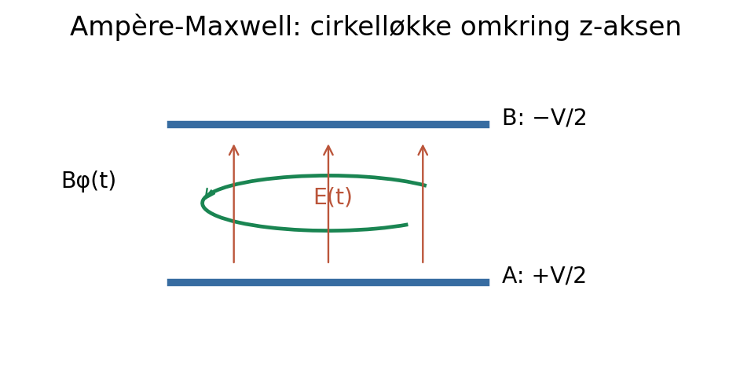{width=85%}

#### Genkendelse

**Denne type opgave genkendes ved:** Tidsvarierende kondensatorfelt og en efterfølgende Faraday-korrektion.

**Metodevalg:** Ampère-Maxwell; Faraday; randbetingelse.

#### Idé

Brug først Ampère-Maxwell på en cirkel. Brug så Faraday i et radialt-aksialt rektangel; korrektionen vælges nul ved pladernes rand s=a som i facitmodellens kvasistatiske matching.

#### Løsning

**a)** $\mathbf E_0=(V_0/d)\cos\omega t\hat z$. Skriv amplituden $E_* = V_0/d$ og $c^{-2}=\mu_0\varepsilon_0$.

**b)** $\mathbf J_d=\varepsilon_0\partial_t\mathbf E_0=-\varepsilon_0E_*\omega\sin\omega t\hat z$. På radius s<a giver
$$B_{1,\phi}2\pi s=\mu_0\varepsilon_0\pi s^2\partial_tE_{0,z},\qquad B_{1,\phi}=-\frac{E_*\omega s}{2c^2}\sin\omega t.$$
**c)** Antag $\mathbf E_1=E_{1,z}(s,t)\hat z$. Da $(\nabla\times E_1)_\phi=-\partial_sE_{1,z}$, giver Faraday
$$\partial_sE_{1,z}=\partial_tB_{1,\phi}=-\frac{\omega^2s}{2c^2}E_*\cos\omega t.$$
Integrér i s:
$$E_{1,z}=-\frac{\omega^2s^2}{4c^2}E_{0,z}+C(t).$$
Med $E_{1,z}(a)=0$ fås $C(t)=\omega^2a^2E_{0,z}/(4c^2)$ og
$$\chi(s)=\frac{\omega^2}{4c^2}(a^2-s^2).$$
Maksimum er på aksen. Sæt $\omega^2a^2/(4c^2)=0.01$, så $\omega=0.2c/a$ og $\nu=\omega/(2\pi)=0.954$ GHz for a=0.010 m.

#### Slutresultat

$$
\boxed{\begin{gathered}\mathbf B_1=-\frac{E_*\omega s}{2c^2}\sin\omega t\hat\phi \\ \chi(s)=\frac{\omega^2(a^2-s^2)}{4c^2} \\ \nu_{1\%}=0.954\,\mathrm{GHz}\end{gathered}}
$$

#### Kontrol

$\chi$ er dimensionsløs. Faraday bestemmer kun den s-afhængige del; en homogen tidsfunktion kræver en rand-/matchingbetingelse. Resultatet følger facitmodellens valg $E_1(a)=0$, ikke en generel eksakt løsning for endelige plader.

> **Modelbetingelse:** facits E₁ kræver valget E₁(a)=0. Faraday alene efterlader en rumligt homogen tidsfunktion. Denne forudsætning er vist eksplicit.

#### Metode at huske

**$E(t)$ → forskydningsstrøm → $B_\phi$ → Faraday → integrér og fastlæg randkonstant.**

#### Originalfigur og ordlyd

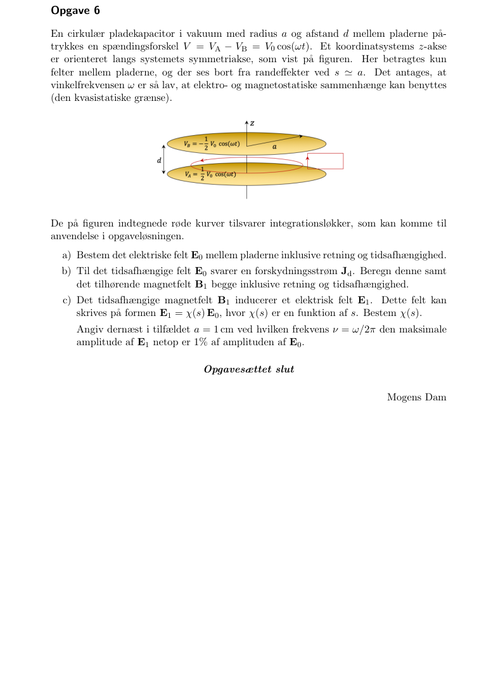{width=90%}

[Til indholdsfortegnelsen](#indhold) · [Til opgaveindeks](#opgaveindeks)

## Krydshenvisninger {#kryds-6}

- [Februar 2023 – 6](03-DYN.html#op-2023-02-6) — Forskydningsstrøm og B mellem plader.

## Øvrige geometrier / dækning {#ovrige-6}

**Solenoide: inside/outside.** Ingen selvstændig induceret-E-opgave med både indre og ydre solenoideregion. Kondensatorens E₁-korrektion er behandlet; der er ikke opfundet en gammel opgave til den manglende type.

# Selvinduktion {#emne-7}

## Solenoide: selvinduktans, RL-opladning og energi {#type-7-1}

### November 2022 – Opgave 3abcd · CMS-solenoiden {#op-2022-11-3}

★★★ · **Kilde:** samlet opgave-PDF, side 14; del a, b, c, d.

#### Opgavebeskrivelse

Solenoide: N=2180, længde l=12.5 m, radius r=3.00 m, nominel I=18.2 kA. Forsyning $\mathcal E_R=26$ V og kredsmodstand $R_c=75\,\mu\Omega$. Ledertværsnit $30.0\times26.6$ mm²; aluminiumresistivitet $\rho_e=2.65\cdot10^{-8}\,\Omega$m. Find B,L,U, opladningstid, holdespænding og hypotetisk varmeeffekt.

#### Genkendelse

**Denne type opgave genkendes ved:** Lang solenoide og strømopbygning gennem en induktans.

**Metodevalg:** Ampère; fluxkobling; RL-ligning; Joulevarme.

#### Idé

Bestem B og fluxkobling først. Brug derefter kredsligningen med konstant forsyning.

#### Løsning

**a)** $B=\mu_0(N/l)I=3.99$ T i langsolenoideapproksimationen.

**b)** Flux pr. vinding er $\Phi=B\pi r^2$. Da $N\Phi=LI$:
$$L=\frac{N\mu_0(N/l)I\pi r^2}{I}=\frac{\mu_0N^2\pi r^2}{l}=13.5\,\mathrm H.$$
$$U=\int_0^ILI'\,dI'=\frac12LI^2=2.24\,\mathrm{GJ}.$$
**c)** $L\dot I+R_cI=\mathcal E_R$, $I(0)=0$. Separation eller integrerende faktor giver
$$I(t)=\frac{\mathcal E_R}{R_c}(1-e^{-R_ct/L}).$$
Sæt I til den nominelle værdi og isolér tiden:
$$T=-\frac L{R_c}\ln\left(1-\frac{R_cI}{\mathcal E_R}\right)=2.70\,\mathrm h.$$
Derefter kræves kun $\mathcal E_S=R_cI=1.37$ V.

**d)** Den oprullede leders længde er cirka $l_w=N2\pi r=4.11\cdot10^4$ m. Arealet er $A_w=30.0\cdot26.6\cdot10^{-6}=7.98\cdot10^{-4}$ m². Hypotetisk normalledermodstand er $R_{\mathrm{Al}}=\rho_el_w/A_w=1.36\,\Omega$. Derfor $P=I^2R_{\mathrm{Al}}=452$ MW.

#### Slutresultat

$$
\boxed{\begin{gathered}B=3.99\,\mathrm T \\ L=13.5\,\mathrm H \\ U=2.24\,\mathrm{GJ} \\ T=2.70\,\mathrm h \\ \mathcal E_S=1.37\,\mathrm V \\ P_{\mathrm{Al}}=452\,\mathrm{MW}\end{gathered}}
$$

#### Kontrol

Opladningen kan nå I, da $\mathcal E_R/R_c>I$. R_c og den hypotetiske R_Al beskriver forskellige situationer og må ikke forveksles. Endefelter ignoreres som opgaven kræver.

**Facitkontrol:** de efterspurgte slutresultater er sammenholdt med det leverede facit; ekstra retninger, mellemregninger og forudsætninger er forklaret ovenfor.

#### Metode at huske

**Solenoide → $B$ → fluxkobling → $L$ → RL-opladning → energi og varme.**

#### Originalfigur og ordlyd

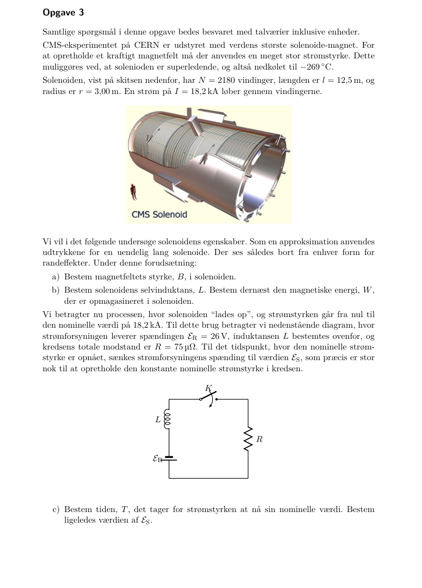{width=90%}

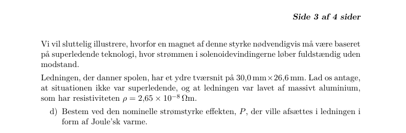{width=90%}

[Til indholdsfortegnelsen](#indhold) · [Til opgaveindeks](#opgaveindeks)

## Krydshenvisninger {#kryds-7}

- [November 2023 – 2](03-DYN.html#op-2023-11-2) — Transmissionslinjens L fra feltenergi.

# Gensidig induktion {#emne-8}

## Lang leder og nærliggende rektangulær løkke {#type-8-1}

### Februar 2023 – Opgave 5abcd · Fluxkobling, induceret EMF og middelvarme {#op-2023-02-5}

★★★ · **Kilde:** samlet opgave-PDF, side 19; del a, b, c, d.

#### Opgavebeskrivelse

Løkke med sider b parallelle med en lang leder, højde h og nærmeste afstand a. Strømmen i lederen er $I_1=I_0\cos\omega t$. Løkkens modstand er R, selvinduktans negligeres. Brug b=0.140 m, h=0.100 m, a=0.050 m, R=0.0100 Ω, f=50 Hz og $P_{\mathrm{avg}}=1.90\cdot10^{-5}$ W.

#### Genkendelse

**Denne type opgave genkendes ved:** En strøm i kreds 1 skaber tidsvarierende flux i kreds 2.

**Metodevalg:** Trådfelt; fluxintegral; Faraday; sinusmiddel.

#### Idé

Integrér trådens 1/s-felt over løkken og anvend Faraday på den samlede flux.

#### Løsning

**a)** Vælg normal ud af papiret som figurens positive flux. Med lederens viste strøm er feltet udad gennem løkken. Et strimmelareal er $bds$, og
$$\Phi=\int_a^{a+h}\frac{\mu_0I_1}{2\pi s}bds=\frac{\mu_0b}{2\pi}\ln\frac{a+h}a\,I_1=CI_1.$$
**b)** $\mathcal E=-C\dot I_1=CI_0\omega\sin\omega t$. For $0<t<\pi/\omega$ er dette positivt: mod uret set ud fra papiret. Den udadrettede flux falder, og strømmen understøtter den.

**c)** $I_2=\mathcal E/R$, så $P=I_2^2R=C^2I_0^2\omega^2\sin^2\omega t/R$.

**d)** Da middelværdien af $\sin^2$ er 1/2:
$$P_{\mathrm{avg}}=\frac{C^2I_0^2\omega^2}{2R}\quad\Rightarrow\quad I_0=\frac{\sqrt{2RP_{\mathrm{avg}}}}{C\omega}.$$
Her er $C=3.08\cdot10^{-8}$ H og $\omega=2\pi f=314$ s⁻¹, så $I_0=63.8$ A.

#### Slutresultat

$$
\boxed{C=\frac{\mu_0b}{2\pi}\ln\frac{a+h}a,\quad\mathcal E=CI_0\omega\sin\omega t,\quad I_0=63.8\,\mathrm A}
$$

#### Kontrol

C har enhed H, og samme geometri giver gensidig induktans i en passende lukket kredsmodel. Brug amplituden I₀, ikke RMS-strømmen, i de viste sinusudtryk.

**Facitkontrol:** de efterspurgte slutresultater er sammenholdt med det leverede facit; ekstra retninger, mellemregninger og forudsætninger er forklaret ovenfor.

#### Metode at huske

**$I_1$ → $B_1(s)$ → flux → $M$ → Faraday → middelværdi af $\sin^2$.**

#### Originalfigur og ordlyd

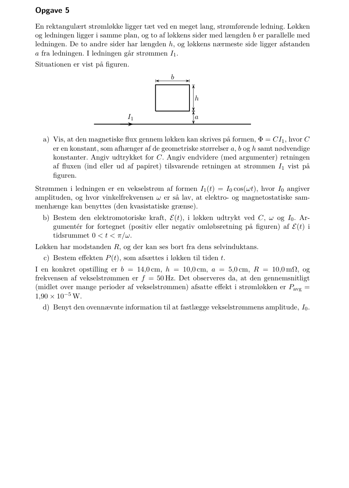{width=90%}

[Til indholdsfortegnelsen](#indhold) · [Til opgaveindeks](#opgaveindeks)

## Små cirkelløkker på akse og i ækvatorialplan {#type-8-2}

### November 2024 – Opgave 5abc · Gensidig induktans fra magnetisk dipolfelt {#op-2024-11-5}

★★★ · **Kilde:** samlet opgave-PDF, side 31; del a, b, c.

#### Opgavebeskrivelse

Tre løkker med radius a≪b har centre A=(0,0,0), B=(0,0,b), C=(0,b,0), alle i planer parallelle med xy. R er hver modstand. Positive strømme giver +z-normal som i figuren. Find MAB, MAC og inducerede strømme, når IA vokser.

#### Genkendelse

**Denne type opgave genkendes ved:** Løkkerne er små i forhold til deres afstand og kan erstattes af magnetiske dipoler.

**Metodevalg:** Dipolmoment; dipolfelt; flux; Faraday.

#### Idé

Brug dipolfeltet fra A på henholdsvis aksen og ækvator; feltet regnes uniformt over modtagerløkken.

#### Løsning

**a)** $\mathbf m_A=I_A\pi a^2\hat z$. På aksen i afstand b:
$$B_{A,z}(B)=\frac{\mu_0}{4\pi}\frac{2m_A}{b^3}=\frac{\mu_0I_Aa^2}{2b^3}.$$
Fluxen er $\Phi_B\simeq B_z\pi a^2$, så
$$M_{AB}=\Phi_B/I_A=\frac{\mu_0\pi a^4}{2b^3}.$$
**b)** I ækvatorialplanet er $\mathbf B_A(C)=-\mu_0\mathbf m_A/(4\pi b^3)$, så $M_{AC}=-\mu_0\pi a^4/(4b^3)$.

**c)** Uden selvinduktiv og sekundær gensidig tilbagekobling er
$$I_B=-\frac{M_{AB}}R\frac{dI_A}{dt}=-\frac{\mu_0\pi a^4}{2b^3R}\dot I_A,$$
$$I_C=-\frac{M_{AC}}R\frac{dI_A}{dt}=+\frac{\mu_0\pi a^4}{4b^3R}\dot I_A.$$
For $\dot I_A>0$ går B i negativ omløbsretning og C i positiv. Set fra +z er det henholdsvis med og mod uret.

#### Slutresultat

$$
\boxed{\begin{gathered}M_{AB}=\frac{\mu_0\pi a^4}{2b^3} \\ M_{AC}=-\frac{\mu_0\pi a^4}{4b^3} \\ I_B=-M_{AB}\dot I_A/R \\ I_C=-M_{AC}\dot I_A/R\end{gathered}}
$$

#### Kontrol

M kan være negativ på grund af orienteringen. Facit anvender den samme ledende approksimation; uden forsømmelse af modtagerløkkernes induktive spændinger kræves koblede kredsligninger.

**Facitkontrol:** de efterspurgte slutresultater er sammenholdt med det leverede facit; ekstra retninger, mellemregninger og forudsætninger er forklaret ovenfor.

#### Metode at huske

**Lille kildeløkke → dipolfelt → modtagerflux → fortegnet $M$ → $-M\dot I/R$.**

#### Originalfigur og ordlyd

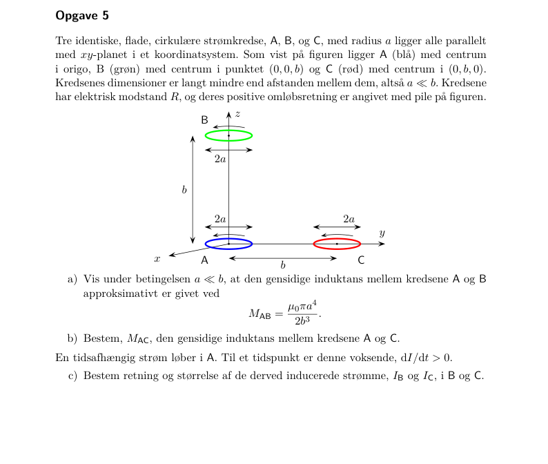{width=90%}

[Til indholdsfortegnelsen](#indhold) · [Til opgaveindeks](#opgaveindeks)

# Magnetisk energi {#emne-9}

## Transmissionslinje af to parallelle strømflader {#type-9-1}

### November 2023 – Opgave 2ab · Feltenergi og selvinduktans mellem bånd {#op-2023-11-2}

★★ · **Kilde:** samlet opgave-PDF, side 22; del a, b.

#### Opgavebeskrivelse

To brede parallelle bånd med længde l=4.00 m, bredde b=0.300 m og afstand h=0.0120 m fører modsatrettede strømme I=9.5 kA. Antag b≫h og se bort fra randeffekter. Find B, U og L.

#### Genkendelse

**Denne type opgave genkendes ved:** To modsatrettede uniforme strømflader.

**Metodevalg:** Strømflade; superposition; B²-energi.

#### Idé

En flade giver μ₀K/2 på hver side. Mellem modstrømmende flader lægges bidragene sammen; udenfor ophæves de.

#### Løsning

**a)** Overfladestrømmen er $K=I/b$. Derfor er feltets størrelse mellem båndene $B=\mu_0K=\mu_0I/b=39.8$ mT. Med originalfigurens strømretninger er $\mathbf B=-(\mu_0I/b)\hat z$. Over og under båndparret er B=0 i denne approksimation.

**b)** Det feltfyldte volumen er $lbh$. Energitætheden er $u_B=B^2/(2\mu_0)$, så
$$U=\frac1{2\mu_0}\left(\frac{\mu_0I}{b}\right)^2lbh=\frac{\mu_0I^2lh}{2b}=9.07\,\mathrm J.$$
Sammenlign med $U=LI^2/2$:
$$L=\frac{2U}{I^2}=\frac{\mu_0lh}{b}=2.01\cdot10^{-7}\,\mathrm H=201\,\mathrm{nH}.$$
Dette er den eksterne induktans i den ideelle tyndbåndsmodel.

#### Slutresultat

$$
\boxed{\begin{gathered}\mathbf B_{\mathrm{mellem}}=-\frac{\mu_0I}{b}\hat z \\ U=9.07\,\mathrm J \\ L=201\,\mathrm{nH} \\ B_{\mathrm{udenfor}}=0\end{gathered}}
$$

#### Kontrol

L vokser med længde og afstand, men falder med bredde. Nul felt udenfor kræver idealiseret brede bånd og præcis modsatrettede strømme.

**Facitkontrol:** de efterspurgte slutresultater er sammenholdt med det leverede facit; ekstra retninger, mellemregninger og forudsætninger er forklaret ovenfor.

#### Metode at huske

**To strømflader → superponér B → $u_B$ gange volumen → $L=2U/I^2$.**

#### Originalfigur og ordlyd

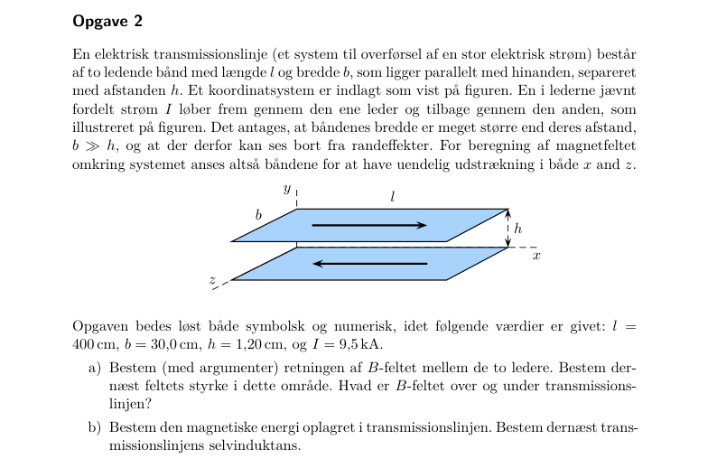{width=90%}

[Til indholdsfortegnelsen](#indhold) · [Til opgaveindeks](#opgaveindeks)

## Krydshenvisninger {#kryds-9}

- [November 2022 – 3](03-DYN.html#op-2022-11-3) — CMS: energi fra L og I.

# Forskydningsstrøm / Ampère-Maxwell {#emne-10}

## Cirkulære kondensatorplader {#type-10-1}

### Februar 2023 – Opgave 6a · B fra harmonisk elektrisk felt {#op-2023-02-6}

★★ · **Kilde:** samlet opgave-PDF, side 20; del a.

#### Opgavebeskrivelse

Mellem cirkulære plader med radius R og lille afstand er $\mathbf E=E_0\sin\omega t\hat z$. Find forskydningsstrøm gennem en koncentrisk cirkelflade med radius $s\le R$ og tilhørende B.

{width=85%}

#### Genkendelse

**Denne type opgave genkendes ved:** Tidsvarierende elektrisk felt i et område uden ledningsstrøm.

**Metodevalg:** Forskydningsstrøm; Ampère-Maxwell.

#### Idé

Forskydningsstrømmen erstatter ledningsstrømmen i Ampères lov.

#### Løsning

**a)** Det elektriske fluxintegral gennem fladen er $\Phi_E=E(t)\pi s^2$. Derfor er den fortegnede forskydningsstrøm i +z-retning
$$I_d=\varepsilon_0\frac{d\Phi_E}{dt}=\varepsilon_0\pi s^2E_0\omega\cos\omega t.$$
Symmetrien kræver et azimutalt magnetfelt. Ampère-Maxwell giver
$$B_\phi2\pi s=\mu_0I_d\quad\Rightarrow\quad B_\phi=\frac{\mu_0\varepsilon_0E_0\omega s}{2}\cos\omega t.$$
Positiv cosinus giver positiv $\hat\phi$, dvs. mod uret set fra +z; negativ cosinus vender retningen. Ved aksen er B=0.

#### Slutresultat

$$
\boxed{\begin{gathered}I_d=\varepsilon_0\pi s^2E_0\omega\cos\omega t \\ \mathbf B=\frac{E_0\omega s}{2c^2}\cos\omega t\hat\phi\quad(s\le R)\end{gathered}}
$$

#### Kontrol

$I_d$ er en skalar gennem en orienteret flade; Jd er vektoren $\varepsilon_0\partial_tE$. For s>R kan samme ensartede felt ikke indsættes over hele fladen; den opgivne opgave gælder s≤R.

**Facitkontrol:** de efterspurgte slutresultater er sammenholdt med det leverede facit; ekstra retninger, mellemregninger og forudsætninger er forklaret ovenfor.

#### Metode at huske

**$E(t)$ → $\varepsilon_0d\Phi_E/dt$ → Ampère-Maxwell → $B_\phi$.**

#### Originalfigur og ordlyd

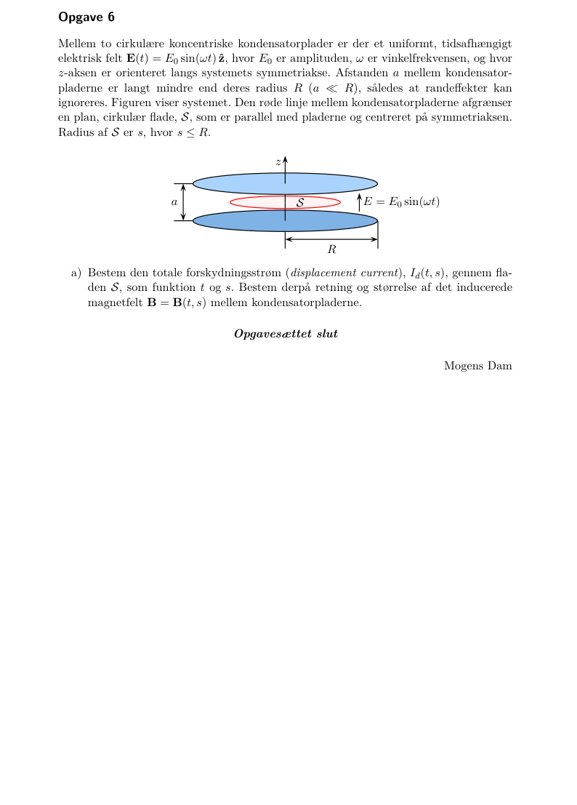{width=90%}

[Til indholdsfortegnelsen](#indhold) · [Til opgaveindeks](#opgaveindeks)

## Krydshenvisninger {#kryds-10}

- [November 2021 – 6](03-DYN.html#op-2021-11-6) — Kondensator med efterfølgende induceret E.

# Maxwell-opgaver {#emne-11}

## Givet elektrisk felt med ikke-nul curl {#type-11-1}

### November 2023 – Opgave 3ab · Rumlig ladning og nødvendig tidsvariation af B {#op-2023-11-3}

★★ · **Kilde:** samlet opgave-PDF, side 22; del a, b.

#### Opgavebeskrivelse

I kuben $0<x,y,z<a$ er $\mathbf E=(E_0/a^2)[(x^2+z^2)\hat x+(y^2+x^2)\hat y+(z^2+y^2)\hat z]$. Find ρ,Q og hvad der kan sluttes om B.

#### Genkendelse

**Denne type opgave genkendes ved:** Feltet er ikke automatisk elektrostatisk, blot fordi udtrykket ikke viser t.

**Metodevalg:** Divergens; Faraday.

#### Idé

Divergens bestemmer ρ; curl bestemmer kun tidsafledningen af B, ikke hele B.

#### Løsning

**a)**
$$\rho=\varepsilon_0\nabla\cdot E=\frac{2\varepsilon_0E_0}{a^2}(x+y+z).$$
Hvert af integralerne $\int x\,d\tau,\int y\,d\tau,\int z\,d\tau$ over kuben er $a^4/2$. Derfor
$$Q=\frac{2\varepsilon_0E_0}{a^2}\cdot\frac{3a^4}{2}=3\varepsilon_0E_0a^2.$$
**b)** Komponentvis curl:
$$\nabla\times E=\frac{2E_0}{a^2}(y\hat x+z\hat y+x\hat z).$$
Faraday kræver altså
$$\partial_t\mathbf B=-\frac{2E_0}{a^2}(y\hat x+z\hat y+x\hat z).$$
Hvis E-udtrykket gælder uændret over et tidsinterval, er
$$\mathbf B(\mathbf r,t)=\mathbf B(\mathbf r,t_0)-\frac{2E_0(t-t_0)}{a^2}(y\hat x+z\hat y+x\hat z).$$
Startfeltet kan ikke bestemmes af de givne data alene, men skal bl.a. opfylde $\nabla\cdot B=0$.

#### Slutresultat

$$
\boxed{\begin{gathered}\rho=\frac{2\varepsilon_0E_0}{a^2}(x+y+z) \\ Q=3\varepsilon_0E_0a^2 \\ \partial_t\mathbf B=-\frac{2E_0}{a^2}(y\hat x+z\hat y+x\hat z)\end{gathered}}
$$

#### Kontrol

Curlfeltets divergens er nul, som nødvendigt for at bevare $\nabla\cdot B=0$. Givet E fastlægger ikke en unik absolut B-værdi.

**Facitkontrol:** de efterspurgte slutresultater er sammenholdt med det leverede facit; ekstra retninger, mellemregninger og forudsætninger er forklaret ovenfor.

#### Metode at huske

**Givet $E$ → divergens for ladning → curl for $\partial_tB$ → nævn ubestemt startfelt.**

#### Originalfigur og ordlyd

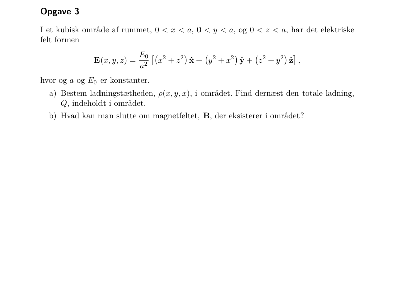{width=90%}

[Til indholdsfortegnelsen](#indhold) · [Til opgaveindeks](#opgaveindeks)

## Krydshenvisninger {#kryds-11}

- [Juni 2021 – 5](01-E_V.html#op-2021-06-5) — Curl/divergens-test for E og B.
- [November 2021 – 3](01-E_V.html#op-2021-11-3) — Elektrostatisk muligt/umuligt felt.
- [Februar 2023 – 4](02-B_A.html#op-2023-02-4) — A → B → J.
